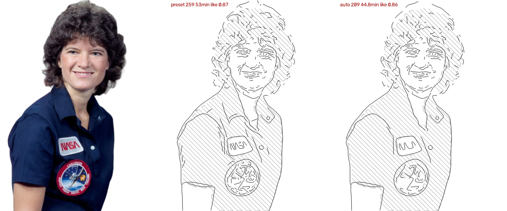

# 2026-11-13 — 실사 인물: 선화가 그린 선을 살리고 얼굴·명암을 다시 그림

## 문제

실사 사진에서 최종 획이 사진의 인상(눈·입·머리 모양, 어두운 면)을 잘 담지 못했다. 사진 4장(마이크·무대·의자, NASA 우주인 초상)을 앱과 같은 세션(실사 사진 프리셋)으로 단계마다 돌려서 원인을 찾았다.

## 진단

- **선화 모델 출력은 괜찮았다.** 선화 마스크를 뼈대로 만든 직후(획 따라가기 단계)에는 선화 선의 0.95 ~ 0.97이 획에 있었다. 이 비율("선화 재현율")은 선화 마스크 뼈대 중 획에서 2 px 안에 있는 비율로 쟀다.
- **정리 단계에서 대부분 사라졌다.** 최종 획의 선화 재현율은 0.28 ~ 0.34였다.
  - **원인 1(가장 큼):** `drop_ink_twins`는 Canny가 굵은 선의 양쪽 경계를 두 줄로 잡는 것을 지우려고, "사이가 어두운 나란한 두 선"을 하나로 합친다. 선화 경로에서는 "사이가 어두운지"를 선화 이미지로 보고, 간격은 종이 2 mm(16 px)였다. 선화에서는 가까운 두 선 사이에 다른 선이 끼어 있는 경우가 많아, 머리카락·눈꺼풀·입술이 쌍으로 지워졌다. 두꺼운 먹을 테두리 두 줄로 만드는 `hollow`와도 부딪혔다. 이 단계만 적용하면 0.95 → 0.41이었다.
  - **원인 2:** 짧은 토막 버리기 기준이 14 px(약 1.75 mm)였다. 따라간 획의 85%가 이보다 짧았다(길이 중간값 5.4 px).
  - **원인 3:** 선화 경로에서는 "선화가 눈·입까지 그린다"는 이유로 얼굴 세밀 처리를 건너뛰었다. 그런데 그 선이 원인 1에서 지워졌다.
  - **원인 4(버그):** 선화를 쓰면 `prep_gray`를 선화 이미지로 바꿨다. 그래서 명암 빗금이 흰 바탕의 선화에서 어두운 면을 찾아, 명암 단계를 1~3으로 올려도 빗금이 0개였다(초상: 선화 기준 0개, 사진 기준 33개).

## 수정

- `stages._run_edges`: 선화 경로에서 `prep_gray`·`prep_color`(사진)를 그대로 두고, 선화는 `lineart_art`로 따로 넘긴다.
- `stages._run_dedupe`: 선화 경로(`lineart_used`)에서는 `drop_ink_twins`를 건너뛴다. 펜 굵기(4 px) 안에서 겹친 선만 지운다.
- `stages.LINEART_MIN_PX`: 14 → 6 px(펜 굵기의 1.5배).
- `stages._run_face`: 선화 경로도 얼굴 세밀 처리를 한다. 얼굴 조각(원본 해상도, 긴 변 500 px)에 선화 모델을 한 번 더 돌려, 얼굴 타원 안의 선을 바꾼다.
- `presets.IMAGE_TYPES["photo"]`: `tone_levels` 1(명암 빗금 1단계)을 기본으로 한다. `session.apply_preset`이 이미지 종류마다 이 값을 적용하고, 다른 종류는 0이다.
- 테스트(`tests/test_lineart.py`):
  - 선화 경로는 사진 밝기를 그대로 넘긴다.
  - 가까운 두 선화 선은 둘 다 남는다(Canny 경로는 하나로 합침).
  - 선화 경로에서도 얼굴을 조각에서 다시 그린다.
  - 짧은 토막 기준 변경에 맞춰 기존 테스트의 토막 길이를 고쳤다.

## 시험해 보고 채택하지 않은 것

- **얼굴 조각 768 px:** 눈 주변 선이 조금 늘었지만, 머리카락·모자 결 잔선이 더 늘었다(획 401 → 425). 500 px를 유지한다.
- **얼굴 짧은 선 기준 펜 1.5배(지금 3배):** 잔선이 많아졌다(401 → 513획).
- **사진별 밝기 맞춤(선화 넣기 전 감마):**
  - 대비만 줄인 사진은 선화가 똑같이 나왔다(모델이 대비에는 영향을 받지 않는 것으로 보임).
  - 감마로 어둡게 한 사진은 선이 37% 줄었고, 자동 감마로 되살아났다.
  - 그러나 원래 사진에 쓰면 니트 모자·머리카락 결 잔선과 옷 주름이 같이 늘었다.
  - 어두운 사진과 어두운 옷을 구분할 수 없어 기본으로 넣지 않았다.
- **사진별 선화 문턱:** 네 장의 선화 밝기 분포가 비슷했다(잉크 25번째 백분위 152 ~ 171). 고정 문턱(165/225)을 유지한다.

## 결과 (사진 4장, 같은 선화에서 예전 정리 순서를 재현해 비교)

| 사진 | 전: 획 / 선화 재현율 | 후: 윤곽 + 빗금 / 선화 재현율 | 명암 닮음 전 → 후 |
|---|---|---|---|
| NASA 초상 | 129 / 0.34 | 401 + 29 / **0.71** | 0.816 → **0.915** |
| 마이크 | 131 / 0.28 | 384 + 25 / **0.71** | 0.754 → **0.891** |
| 무대 | 188 / 0.28 | 548 + 41 / **0.76** | 0.842 → **0.905** |
| 의자 | 165 / 0.32 | 336 + 36 / **0.77** | 0.877 → **0.918** |

- 그림: `assets/2026-11-13-photo-detail/`
  - `sample-portrait_final_compare.jpg`: 원본 / 전 / 후
  - `photo1_mic_final_compare.jpg`
  - `sample-portrait_exp.jpg`: 정리 단계별 효과 분리

## 정정: 예상 시간

처음 이 기록에는 "24분 → 76분, 펜 10mm 기준"이라고 적었는데, 이 수치는 틀렸다.

- **첫 번째로 틀린 이유:** "전" 24분은 10mm 기준이었다. "후" 76분은 진단 스크립트가 작업 px를 종이 mm로 바꿀 때 앱과 다른 배율을 쓴 값이었다.
- **중간 정정도 틀림:** 중간에 "전 28.4분 → 후 54.6분(20mm)"으로 고쳤는데, 이것도 틀렸다. 정정 스크립트가 "전" 획을 그리는 순서로 정렬하지 않아, 이동 거리가 부풀었다.
- **최종 기준:** 앱 시간 카드와 같은 설정(`session._timing_cfg`)으로 다시 쟀다.
  - 저장된 자세로 그릴 때와 같게 펜을 20mm 올리고, 누름은 −0.4mm로 둔다.
  - 로봇에 보낼 좌표(종이 맞춤·`drawing_warp` 적용)로 잰다.
  - "전" 획은 같은 선화에서 예전 정리를 재현하고, 지금 세션의 px→mm 변환과 `order_strokes`를 썼다.
  - 스크립트: `%TEMP%/track/time_reconcile.py`

| 사진 | 전(예전 정리, 빗금 없음) | 후(잔선 정리 없음) | 후(잔선 정리) |
|---|---|---|---|
| NASA 초상 | 128획 **21.3분** | 430획 73.5분 | 288획 **52.8분** |
| 마이크 | 129획 **21.2분** | 409획 70.2분 | 296획 **53.7분** |
| 무대 | 192획 **32.1분** | 588획 100.2분 | 473획 **83.2분** |
| 의자 | 168획 **27.5분** | 372획 64.3분 | 268획 **48.9분** |

획 수에는 빗금이 들어 있다. 잔선 정리를 켜면 예전보다 약 2.5배 걸린다.

## 사용자 피드백 반영: 잔선 정리 (주름·자글자글한 선 제거)

**사용자 요청:**

> 너무 자글자글한 거는 없애고, 눈 코 입 얼굴 윤곽 머리카락처럼 사람이 그림을 봤을 때 비슷하다 싶은 부분들을 살리고, 주름이나 얼굴에 있는 자글자글한 선들은 제거해야 체감이 좋을 듯. 글자나 문양 같은 것도 살려.

**구현:** `mirobot_sketch/declutter.py`를 추가했다. 얼굴 단계(이름: "얼굴 세밀·잔선 정리")에서 실사 선화 경로일 때만 실행하고, 조절 칸 "잔선 정리"(기본 켬)로 끌 수 있다. 판단 순서는 다음과 같다.

1. **얼굴 안쪽 타원(얼굴 상자의 0.45배 반축)에 있는 선:**
   - 눈(눈썹 포함)·코·입 영역에 절반 이상 들어가면 남긴다.
   - 얼굴 폭의 45%보다 길면 남긴다.
   - 그 밖의 선은 양옆 3px 띠의 80% 이상이 그 사진의 피부색이면 **피부 위 잔주름**으로 지운다.
   - 피부색은 양 볼과 코 옆에서 잰 Lab 값이다. 거리 16 안이면 피부로 보고, 밝기 차이는 반만 센다.
   - 머리카락이 이마를 덮은 선이나 얼굴 윤곽은 한쪽이 피부가 아니라서 남는다.
2. **그 밖의 선:**
   - 종이 3mm 이상이면 남긴다.
   - 짧아도 사진 대비가 크면 글자·문양으로 보고 남긴다. 대비는 Lab 세 채널 Sobel 크기의 중간값이고, 그 사진 선들의 60번째 백분위(하한 60) 이상이면 크다고 본다.
   - 나머지는 **짧고 흐린 잔선**으로 지운다.
   - 지운 선은 "버린 선"에 이유와 함께 보인다.

**시행착오:**

- **얼굴 타원 전체(0.65×0.7)에 주름 규칙을 적용:**
  - 옆얼굴 사진에서 이마를 덮은 앞머리 가닥이 주름으로 지워졌다. 그래서 주름 판단에 "양옆이 피부색" 조건을 넣었다.
  - 무대 사진에서는 입 앞에 댄 손가락 사이 선이 지워졌다(손도 피부색이다). 그래서 타원을 안쪽 0.45로 줄였다(주름 8 → 2개).
- **주름 판단에 대비 조건 추가:** 결과가 바뀌지 않았다. 주름과 손가락 선이 모두 대비 60번째 백분위 아래라서 넣지 않았다.

**결과:**

| 사진 | 윤곽 획 (정리 없음 → 정리) | 예상 시간 (앱 카드 기준) |
|---|---|---|
| 초상 | 401 → 259 | 73.5 → 52.8분 |
| 마이크 | 384 → 271 | 70.2 → 53.7분 |
| 무대 | 547 → 432 | 100.2 → 83.2분 |
| 의자 | 336 → 232 | 64.3 → 48.9분 |

- 초상: 볼·눈 밑 주름이 사라지고, 눈·입·윤곽·곱슬머리 모양·NASA 패치 글자와 문양은 남았다.
- 무대: 의상 장식(문양)은 남아 아직 선이 많다.
- 그림: `assets/2026-11-13-photo-detail/`
  - `sample-portrait_declutter.jpg`: 원본 / 정리 없음 / 정리
  - `photo2_stage_declutter.jpg`
  - `sample-portrait_s4.jpg`: 빨강 = 주름으로 지움, 회색 = 잔선으로 지움
- 테스트: `tests/test_declutter.py`
  - 주름·잔선은 지우고, 눈·글자·긴 선은 남긴다.
  - 피부가 아닌 곳의 선은 남긴다.
  - 얼굴이 없으면 잔선 규칙만 쓴다.
  - 선화 경로에서만 지우고, 지운 선은 "버린 선"에 남는다.

## 전체 점검: 코드·로직·CV 레이어 (사용자 요청 "전체적으로 확인하고 고도화")

네 영역을 나눠 읽기 전용으로 검토했다. 검토자는 영역마다 따로 두었고, 발견마다 파일:줄과 재현 실행을 붙이게 했다.

| 영역 | 대상 |
|---|---|
| 영상 파이프라인 | `sketch_pipeline`, `stages`, `lineart`, `faces`, `tone`, `edits`, `make_strokes`, `declutter` |
| 세션·시간·범위 | `session`, `paper_mapping`, `limits`, `draw_executor` |
| 카메라 CV | `camera`, `camera_marks`, `vision`, `camera_share`, `pen_correction`, `pen_pose`, `calibration` |
| 로봇 실행 | `draw_job`, `start_pose`, `mirobot_sim`, `virtual_robot`, `robot_status`, `draw_window` |

확인된 발견은 작업자가 고치고, 발견마다 회귀 테스트를 붙였다. 아래는 직접 고친 것이다.

- **앱 시간 카드가 실제와 달랐다:**
  - 원인: 카드는 설정의 10mm 펜 올림과 종이 맞춤 전 좌표로 계산했다. 저장된 자세로 그리면 20mm를 올린다.
  - 수정: `session._update_paper_fit`에서 로봇이 실제로 그릴 좌표(`robot_strokes_mm`)로 계산한다. 펜 올림 높이(`start_pose.REQUESTED_UP_CLEARANCE_MM`)와 누르는 깊이(`requested_pen_down_extra_mm`)는 실제 실행과 같은 값을 쓴다.
  - `estimate_time`은 이제 `drawing_warp`로 비튼 길이로 계산하고, 결과에 `up_clearance_mm`를 넣는다. 카드에는 "(20mm)"가 함께 보인다.
  - 초상 기준: 44.1분(이전 카드) → 52.8분. 검토자가 G-code 3D 길이로 잰 값은 52.4분이다(카드에 누름 깊이와 비틀기 길이를 넣기 전에 잰 값).
- **큰 그림이 비틀기 뒤 범위를 넘었다:**
  - 원인: 배치(`pixels_to_paper`)는 비틀기 전 좌표로 영역에 맞췄지만, 실행기는 비튼 좌표로 검사한다. box 250mm, 2:1 그림에서 2점이 거절됐고, 그중 하나는 x가 29mm 넘었다.
  - 수정: `pixels_to_paper(warp=...)`가 비튼 볼록 껍질이 영역 안에 들어갈 때까지 배율을 이분 탐색으로 줄인다. 세션이 실행기와 같은 비틀기를 넘긴다.
- **`join_gaps` 속도:**
  - 원인: 이을 때마다 KD-트리를 다시 만들었다.
  - 수정: 후보 쌍을 한 번만 찾고 거리 순 힙으로 처리한다. 1.5~6.5초가 0.05~0.08초로 줄었다. 사진 3장은 결과가 똑같았고, 1장은 2획이 달랐다.
  - 함께 고친 것: 점선 고리의 마지막 틈은 닫지 않았다(같은 획의 양 끝). 이제 길이가 틈의 4배 이상인 고리는 닫는다.
- **비교 지표가 순환이었다:**
  - 원인: 선화 경로에서 `compare`가 획을 만든 선화 지도와 다시 비교해, 선 정확도가 늘 0.95 안팎이었다.
  - 수정: 사진 자체의 윤곽(`tone.photo_edges`: 살짝 흐린 뒤 밝기 중앙값에 맞춘 Canny, 흰 배경 제외)과 비교한다. 초상 정확도는 0.952에서 0.874가 됐고, 잔선 정리를 켜면 오른다(0.866 → 0.874).
- **잔선 정리 보완(검토 발견):**
  - 눈 바로 아래 눈꺼풀과 아랫입술이 주름으로 지워졌다. 랜드마크에서 얼굴 폭의 10% 안에 닿는 선은 남기고, 입 영역을 아래로 넓혔다.
  - 겹친 얼굴은 하나라도 눈코입이면 남긴다.
  - 얼굴 밖 작은 닫힌 고리는 대비가 없어도 남던 것을 다른 짧은 선과 같은 기준으로 판단한다.

로봇 실행 영역에서 고친 것(작업자 수정, 테스트 `tests/test_robot_exec_fixes.py` 등). 실물 이동은 하지 않았다.

- **`$3`/`$23` 확인:** 지금까지는 실험 스크립트만 확인했다. 이제 앱의 실물 경로도 호밍 Idle 뒤, 첫 관절·접촉 이동 전에 `$$`를 읽는다(`require_controller_settings`).
  - 기대값은 설정 `controller_settings_expected`이고, 다르거나 없으면 움직이지 않고 값을 알려 준다.
  - `send_and_ack`로 읽으면 `$20` 설명의 "limit"가 오류로 잡히므로 따로 읽는다.
  - 다시 보정할 때 캘리브레이션 안에서 하는 첫 이동 앞에는 아직 넣지 않았다.
- **일시정지 중 선택 유실:** 펜을 떼는 동안 누른 [끝내기]·[이어서]를 큐 비우기에서 버려, 그 뒤 계속 기다렸다. 이제 끝내기가 이기고, 그 밖에는 마지막 선택을 남긴다.
- **요청 자세 복귀 중 USB 끊김:** `OSError`가 새어 나가, 다 그린 그림이 "오류"로 바뀌고 실행 기록도 없었다. 이제 "돌아오지 못함"으로 남는다.
- **누름 깊이 상한:** `requested_pen_down_extra_mm`에 범위가 없었다. 40을 넣으면 벽으로 40mm 밀었다. 이제 [-10, 8]mm 밖이면 이동 전에 거부한다. 예전에 일부러 쓴 7~8mm는 통과한다.
- **Idle 대기 취소:** 시작 자세 관절 이동의 Idle 대기(최대 180초)가 [멈춤]을 보지 않았다. 창은 20초 뒤 포트를 잡은 스레드를 남겼다. 이제 대기 중에도 멈춤을 본다.
- **복귀 실패 뒤 상태 표시:** 완료되면 무조건 Idle로 표시했다. 이제 복귀 실패나 마지막 상태가 Idle이 아니면 그 상태를 그대로 보인다.
- **확인 화면 예상 시간:** 늘 공중 모드 시간을 보였다. 초상 기준 펜으로 그리면 약 53분인데 15.6분으로 보였다. 이제 공중 체크 상태에 맞춰 다시 계산한다.
- **고치지 않은 것:**
  - "Idle이 오면 도착 확인 없이 다음 명령을 보냄": 컨트롤러가 명령을 받은 순서대로 실행하므로 결함이 아니다.
  - "창을 닫으면 펜을 떼지 않음": README에 적힌 의도된 동작이라 설명만 맞췄다.

카메라 CV 영역에서 고친 것(작업자 수정). 합성 영상으로만 확인했고, 카메라와 로봇은 쓰지 않았다.

- **선 확인이 진한 펜을 "가려짐"으로 봄:**
  - 원인: 종이와 22단계 넘게 다르거나 채도가 45를 넘으면 팔 가림으로 봤다. 진한 선(30단계 이상)이나 따뜻한 색 종이(채도 55)는 획 전체가 가려짐이 되어 확인이 끝나지 않았다.
  - 수정: 펜 선보다 큰 열림(9px)으로 가는 선을 지운 뒤 가림을 본다. 채도는 종이 중앙값보다 40 높을 때만 가림으로 본다.
- **종이 모서리 자동 찾기가 바깥 표시를 집음:** 면적이 가장 큰 사각형을 골랐다. 귀퉁이 4개와 바깥 X 하나가 있으면 X를 넣은 사각형이 골라졌고, 그러면 종이 자리·회전이 틀어졌다(중심 23px, 회전 −5.2°). 이제 각이 90°에 가깝고 변 비율이 종이에 가까운 조합을 고른다. 호모그래피의 조건수가 크면 버린다.
- **모서리 순서가 45° 근처에서 한 칸 돎:** 이제 위쪽 긴 변의 왼쪽 끝에서 시작한다.
- **수동 모서리 찍기 검사가 약함:**
  - 찌그러진 사각형, 프레임 밖 점, 시작점이 왼쪽 위가 아닌 순서도 통과했다. 이제 짧은 변, 종이 대비 종횡비, 50° 미만 각, 프레임 밖, 시작점을 거절한다.
  - 새로 찍는 점도 프레임 안으로 자른다.
- **끝점 세로 줄 오판:** 획 방향으로 더 그어진 선도 세로 줄로 셌다. 그러면 펜 물림 보정이 접촉 위치를 바꿀 수 있었다. 이제 끝 접선에 수직인 성분만 센다.
- **물림 되돌림 기준:** 늘리기는 끝점 8개 이상에서만 하는데, 되돌리기는 4개만 모여도 했다. 되돌리기도 8개로 맞췄다.
- **표시 찾기의 절대 밝기 문턱:** 종이 밝기 130 이하나 연필 회색 100에서 표시를 못 찾았다. 이제 표시와 고리의 상대 대비로 본다.
- **카메라 바꿀 때 겹쳐 열기:** 이전 캡처를 놓기 전에 다음 장치를 열었다. 이제 놓을 때까지 기다리고, 세대 번호로 옛 스레드가 화면을 덮지 못하게 했다.
- **카메라 공유 오류 숨김:** 오류를 기록만 하고 보여 주지 않았다. 이제 카메라 상태 줄에 보인다.
- **캘리브레이션 모서리 건너뜀:** 확인한 작은 크기가 없을 때 `c`를 누르면 그 모서리를 건너뛰고 다음으로 갔다. 그러고도 확인된 것으로 기록되어 접촉 단계로 넘어갔다. 이제 같은 모서리를 다시 묻는다.

영상 파이프라인 영역에서 고친 것(작업자 수정, 테스트 `tests/test_edits.py`·`test_pipeline.py`·`test_tone.py`·`test_make_strokes.py`).

- **어두운 선 모드가 1px 선을 지움(고쳤다가 되돌림):**
  - 작업자가 3×3 열기를 "넓이 8px 미만 점만 지우기"로 바꿨다.
  - 그러자 실제 일러스트(illust1, 상세도 보통)에서 명암 결 조각이 남아 88 → 129획으로 늘었다. 기준값 테스트(`test_golden`)도 이 차이로 실패했다.
  - 넓이 문턱을 40, 80px로 올려도 125, 117획이었다. 결 조각도 가늘고 길어서 넓이로는 진짜 가는 선과 구별되지 않았다.
  - 잔선을 줄이자는 이번 요청과 반대라 열기로 되돌리고, 이유를 주석에 적었다.
- **고르게 어두운 면에 빗금이 0개:** 대비가 20 미만이고 가장 밝은 값도 80 이하인 면은 어두움 1로 본다.
- **먹 쌍 지우기(Canny 경로):**
  - 이미 버린 구간의 점이 다음 선의 짝으로 쓰였다. 이제 남긴 점만 짝이 된다.
  - 조회를 획마다 한 번에 해서 빨라졌다.
  - 거리는 사진 속 선 굵기라 종이 크기와 상관없게, 작업 이미지 긴 변의 2%로 둔다.
  - 작업자는 처음에 종이 크기에 묶었다. 그러면 종이 크기만 바꿔도 이 단계부터 다시 계산되어, 편집 번호와 대기 중인 제안이 사라졌다(`test_agent`의 크기 변경 테스트 실패). 그래서 이미지 기준으로 바꿨다.
- **편집:**
  - 닫힌 획을 매끄럽게 할 때 이음목이 긴 현으로 잘렸다. 이제 닫힌 곡선으로 단순화한다.
  - 확대 화면에서 꼭짓점이 모두 창 밖인 선이 사라졌다. 이제 선분을 창에 잘라 그린다.
  - 화면 밖 점이 테두리의 지운 선과 같다고 판정됐다. 이제 화면 밖 점은 판정에서 뺀다.
- **명령줄 `--type photo`:** 선화·빗금을 적용하지 않아 앱과 결과가 달랐다. 이제 프리셋 값을 따른다.
- **고치지 않은 것:** 폭 3px U자의 돌아오는 다리가 자기 선과 겹쳐 지워지는 것. 펜 굵기(4px)보다 좁아 종이에서 구별되지 않는다.

나머지 영역(GUI·에이전트·경로·범위·WSL)에서 고친 것(작업자 수정, 테스트 `tests/test_agent.py`·`test_gui_smoke.py`·`test_paths.py`·`test_limits.py`·`test_rviz_setup.py`·`test_stage_params.py`).

- **그리기 잠금이 진행 중인 계산을 못 막음:** 잠금을 켜도 이미 돌던 재계산이나 검사를 통과한 에이전트 변경이 결과를 바꿨다. 그러면 로봇이 확인하지 않은 획을 그리거나, 화면만 바뀔 수 있었다.
  - 이제 잠글 때 세대 번호를 올려 진행 중인 계산을 버린다.
  - `update_params`·계산 커밋·편집 제안·적용은 잠금 중에 거부한다.
- **0.05 단위 값이 반올림되어 저장됨:** 칸에서 포커스가 빠지면 표시값(소수 한 자리)을 다시 읽어, 0.65가 0.7로 바뀌었다(`pen_mm`·`face_sensitivity`·`tone_bias`). 이제 스텝 자릿수로 표시한다.
- **에이전트의 `"false"`가 켜짐으로 처리됨:** 이제 참·거짓 문자열만 받고, NaN은 거부한다. 다시 계산하다 실패하면 이전 설정으로 되돌린다.
- **UI 콜백 하나가 실패하면 화면 갱신이 멈춤:** 콜백마다 잡고, 다음 갱신을 항상 예약한다.
- **기록에 개인 경로가 남음:**
  - UNC, `\\?\`, `file://`, 문장 안 절대 경로, 홈 폴더 자체(사용자 이름이 남음)를 정리한다.
  - 에이전트 상태의 이미지 경로도 파일 이름만 보낸다.
- **Codex MCP 설정이 아포스트로피 경로를 자름:** TOML 기본 문자열로 이스케이프한다.
- **에이전트 도구 스키마:** `box_mm` 상한이 세션과 달랐다. 이제 OpenRouter, 브리지 `/tools`, MCP 서버가 모두 세션의 실제 범위로 만든 목록을 쓴다. 편집 제안 항목에 `ids`·`region_mm`·`points_mm` 필드를 넣었다.
- **범위(Region) 퇴화 입력:** NaN·음수 크기를 "가운데에 들어감"으로 봤고, 크기 0에서 0으로 나눴고, 지붕이 비면 죽었다. 이제 이런 입력을 거부한다. 같은 x가 둘이면 낮은 쪽만 남긴다.
- **WSL 가져오기 실패 문구가 깨짐:** UTF-16 출력을 UTF-16으로 읽는다.

마지막 점검에서 더 고친 것(교차 검토 의견을 확인한 뒤 반영).

- **방향 설정 확인의 탈출구:** `$$` 읽기는 실험 스크립트와 같은 방식이지만, 앱 링크로 실물에서 돌려 본 적은 없다. 실물에서 읽기만 실패해도 그리기가 모두 막히지 않게 했다.
  - 설정 `controller_settings_expected`를 `null`(또는 `{}`)로 두면 확인을 건너뛴다. 실행 기록의 `controller_settings`에 "확인 꺼짐"이 남는다.
  - 키가 아예 없으면 기본값 123/60으로 확인한다. 확인하면 읽은 값을 실행 기록에 남긴다.
- **비틀기 배치 검사 보강:** 볼록 껍질 꼭짓점만 보던 것을 껍질 변을 1mm 간격으로 채운 점까지 보게 했다. 2차 비틀기는 꼭짓점 사이의 변을 휘게 만들기 때문이다.
- **시간 카드 설정:** 펜 올림·누름 값을 하나씩 베끼지 않고, 그리기 작업과 같은 `start_pose.drawing_config_from_recorded_contact`로 만든다. 접촉 샘플이 없으면 두 값만 맞춘다.
- **비교 안내를 경로별로:** 선화 경로에서 "canny_low를 낮추라"는 안내는 의미가 없다. 그 안내를 따르던 에이전트가 잔선을 되살릴 수 있었다. 이제 선화 경로는 얼굴 세밀·잔선 정리 쪽을 안내한다.
- **잔선 정리 대비 문턱 상한:** 대비 문턱이 그 사진 획들의 백분위라, 글자가 많은 사진에서는 뚜렷한 글자 획도 일부 지워질 수 있었다. 대비 150 이상인 짧은 획은 항상 남긴다.
  - 무대 사진(의상 장식)은 389 → 432획, 76.8 → 83.2분이 됐다.
  - 초상과 마이크 사진은 그대로다.
- **선 확인 가림 판정을 실물 사진으로 다시 검증:** 카메라 작업자의 수정은 합성 영상으로만 확인한 것이었다. 그래서 실제 BRIO 사진 3장(`out/vision_*.png` 왼쪽, 실행한 획, 그때의 등록)으로 예전 판정과 지금 판정을 다시 쟀다.

  | 사진 | 획 | 예전 (보임/안 보임/가려짐) | 지금 |
  |---|---|---|---|
  | 11-10 17:15 | 195 | 139 / 56 / 0 | 139 / 56 / 0 |
  | 11-11 15:45 | 160 | 65 / 93 / 2 | 68 / 92 / 0 |
  | 11-11 17:50 | 15 | 5 / 10 / 0 | 5 / 10 / 0 |

  실물에서는 같거나, 가려짐으로 잘못 보던 2획이 풀렸다. 스크립트는 `%TEMP%/track/linecheck_replay.py`이다.

## 자동 세팅: 사진마다 45분 안에서 가장 닮은 설정 찾기 (사용자 요청)

사용자 요청은 "사진마다 가장 알맞은 선 추출 세팅을 자동으로 찾되, 목표 시간은 45분이고 품질이 최우선이며 인물 특징이 잘 드러나야 한다"였다.

- **잔선 정리를 독립 단계로 나눔:** 예전에는 얼굴 세밀 단계 안에 있어, 강도만 바꿔도 얼굴 조각의 선화(ONNX)를 다시 돌렸다. "잔선 정리"(⑧) 단계로 떼어 내니 강도만 바꿀 때 그 단계만 0.2~0.9초에 다시 돈다. 조절값은 `declutter`, `clutter_mm`(3mm), `clutter_pct`(60), `clutter_max`(0 = 상한 없음)이다.
- **선 개수 상한(`clutter_max`):** 강도만으로 시간을 못 맞추면, 얼굴 밖에서 길이×대비 가중이 낮은 선부터 "시간 예산으로 덜 중요한 선 생략"으로 뺀다.
- **인물 특징 보호:** 첫 시도에서 초상의 얼굴 점수가 0.855 → 0.81로 떨어졌다. 턱선·머리선처럼 얼굴 상자 밖 둘레의 선이 강도를 올릴 때 함께 지워졌기 때문이다. 그래서 두 곳은 강도를 올려도 기본 기준(3mm/60)으로 보고, 상한에서도 지킨다.
  - 얼굴 둘레: 얼굴 상자의 0.85배 타원 안의 선이다.
  - 인물 외곽선: 배경을 지운 사진에서 인물 외곽 띠(±4px)에 60% 이상 놓인 선이다.
  - 결과: 4장 모두 얼굴 점수가 프리셋과 같아졌다(0.855/0.913/0.97/0.97). 무대 사진의 외곽선 점수는 0.633 → 0.663으로 올랐다.
- **닮음 점수(`autotune.likeness`):** 다섯 항목을 가중합한다. 얼굴이 없으면 0.30/0.25/0.20/0.25로 나눈다.
  - 눈(눈썹)·코·입 영역과 얼굴 윤곽 띠에서 사진 윤곽을 그린 비율: 0.40
  - 인물 외곽선: 0.15
  - 사진 전체 윤곽 재현: 0.15. 처음에는 이 항목이 없어 초상의 곱슬머리 결이 빠져도 점수가 거의 그대로였다.
  - 명암 닮음: 0.15
  - 윤곽 정확도: 0.15
- **탐색(`autotune.tune`):** 빗금 5가지(2단계 2mm, 1단계 1.5/2.0/2.6mm, 없음)마다 강도 사다리 7단계를 느슨한 쪽부터 돌린다. 처음 45분 안에 드는 후보를 채점하고, 안 들면(빗금 1단계 이하일 때) 선 개수 상한을 이분 탐색한다. 시간 안의 후보 중 점수가 가장 높은 것을 적용한다.
  - 강도 사다리의 흐린 선 백분위는 75까지만 올린다. 95까지 올리면 초상의 NASA 글자 획(대비 104~129)이 흐린 선으로 지워졌다.
  - 대비 상한을 110으로 낮추는 안도 시험했다. 글자는 남았지만 머리카락 결도 함께 남아 빗금을 넣을 수 없었고, 초상 점수가 0.82로 떨어졌다. 채택하지 않았다.
- **결과(스크립트 기준, 펜 20mm 올림):**

  | 사진 | 프리셋 | 자동 세팅 | 고른 설정 | 닮음 (프리셋 → 자동) | 후보 / 시간 |
  |---|---|---|---|---|---|
  | 초상 | 52.8분 | 44.8분 | 12mm/75, 빗금 1단계 1.5mm, 상한 209 | 0.867 → 0.862 | 48개 / 33초 |
  | 마이크 | 53.7분 | 45.0분 | 12mm/75, 빗금 1단계 1.5mm, 상한 215 | 0.905 → 0.898 | 35개 / 24초 |
  | 무대 | 83.2분 | 44.9분 | 12mm/75, 빗금 없음, 상한 256 | 0.896 → 0.835 | 75개 / 58초 |
  | 의자 | 48.9분 | 44.7분 | 8mm/75, 빗금 2단계 2.0mm | 0.882 → 0.882 | 15개 / 9초 |

  

  - 무대 사진은 프리셋이 83분이라 절반 가까이 줄여야 했다. 빗금 1단계 2.6mm 안(0.828)과 빗금 없음 안(0.835)이 비슷했고, 점수가 높은 빗금 없음을 골랐다. 그래서 어두운 머리 면이 비어 보인다.
  - 초상의 NASA 글자는 상한에서 일부 빠진다. 글자 획이 짧아 중요도(길이×대비)가 낮기 때문이다.
- **앱 연결:** "01 사진과 추천 설정"에 [자동 세팅 (목표 45분)] 버튼을 넣었다. 작업 스레드에서 돌고, 끝나면 조절 칸과 상태 줄에 결과를 보인다. 얼굴을 찾았는데 이미지 종류가 실사 사진이 아니면 실사 사진 프리셋으로 바꾼 뒤 찾는다(앱은 사진을 열 때 종류를 자동으로 고르지 않는다). 앱에서 마이크 사진으로 확인했다: 36.5분(일러스트 프리셋) → 44.9분(실사 사진, 5mm/65, 빗금 2단계 2.0mm, 닮음 0.91, 12초).
- **잠금과 되돌리기:** 탐색이 50번 가까이 설정을 바꾸므로, 도는 동안 조절 칸·종류/상세도·사진 열기·로봇으로 그리기·시뮬레이션을 잠근다(중간 후보로 재계산이나 그리기가 섞이지 않게). 계산이 돌고 있으면 시작하지 않는다. 도중에 예외가 나면 원래 이미지 종류와 설정으로 되돌린다.
- **명령줄:** `python -m mirobot_sketch.autotune 사진들 --target 45 --out out/auto`. 원본|획 나란히 보기, 종이 미리보기, 보고 JSON, 획 파일(`<이름>_strokes.json`, 앱의 획 저장과 같은 형식)을 저장한다. 이미지는 `imencode`로 써서 한글 경로에서도 저장된다(`cv2.imwrite`는 조용히 실패함). 한글 이름 사진으로 확인했고, 획 파일은 `draw_executor`의 계획만 보기(로봇 안 움직임)로 읽혔다(235획, G-code 2130줄). 그 계산은 37.0분으로 앱 카드(44.7분)보다 짧은데, 명령줄은 저장된 접촉 자세의 펜 20mm 올림이 아닌 설정 기본값으로 계산하기 때문으로 보인다(추정).
- **테스트:** `tests/test_autotune.py`(가짜 세션으로 탐색 논리 검사: 시간 안 최고 점수, 상한이 목표 안 최대값, 아무것도 안 맞으면 가장 빠른 후보), `tests/test_declutter.py`(잔선 정리 단계, 강도, 상한이 얼굴 안을 지키고 짧은 선부터 뺌), `tests/test_gui_smoke.py`(자동 세팅 중 잠금과 끝난 뒤 풀림). 단계 번호 테스트는 순서·종이가 ⑫가 된 것에 맞췄다.

## 사용자 사진 2장으로 자동 세팅 확인 (사용자 사진 1·2, 600×400)

사용자는 배경 제거가 제대로 되는지, 배경을 살린다면 중요한 요소가 표현되는지, 표정과 얼굴이 살아 있는지를 함께 보라고 했다. 두 사진 모두 "인물만(배경 제거)"과 "배경 유지(전체 구도, rembg 끔)"로 돌려 비교했다.

- **빗금이 얼굴을 덮던 문제:** 첫 결과에서는 명암 2단계 빗금이 볼·턱·목의 피부 그림자 위에 그어져, 흉터나 수염처럼 보였다. 빗금 단계에 "얼굴 피부에는 빗금 안 함"(`tone_skip_face`, 기본 켬)을 넣었다. 눈썹 아래 얼굴 타원과, 얼굴 둘레의 그 사진 피부색인 곳(목·귀)에 빗금을 긋지 않는다.
  - 처음에는 얼굴 타원 전체를 뺐다. 그러자 앞머리의 빗금까지 사라져 머리 모양이 비었다. 눈썹 위는 피부색인 곳만 빼도록 고쳤다.
- **결과:**

  | 사진 | 구도 | 예상 시간 | 닮음 | 얼굴 | 판단 |
  |---|---|---|---|---|---|
  | 1 (전망대) | 인물만 | 23.4분 | 0.89 | 0.95 | 채택. 배경 제거가 깨끗하고, 안경·웃는 입·머리 모양이 산다 |
  | 1 | 배경 유지 | 43.5분 | 0.80 | 0.98 | 도시 풍경이 가로 잔선과 빗금 덩어리로 바뀌어 알아볼 수 없다 |
  | 2 (포스터 앞) | 인물만(상반신) | 40.6분 | 0.84 | 0.94 | 채택. 다만 웃는 입이 일자에 가깝게 나온다 |
  | 2 | 배경 유지 | 43.2분 | 0.75 | 0.82 | 포스터는 상자 윤곽만 남고 글자(ETRI, 제목)는 사라진다. 얼굴이 작아져 표정이 더 흐려진다 |

- **남는 시간 쓰기:** 사진 1은 가장 느슨한 후보도 23.4분이라 21분이 남았다. 강도 사다리 앞에 기본보다 느슨한 2mm/50을, 빗금 후보에 2단계 1.5mm와 3단계 2.0mm를 넣어 다시 돌렸다.
  - 3단계: 사진 1은 닮음 0.890 → 0.892, 27.5분, 사진 2는 0.838 → 0.846이었다. 그러나 사진 2는 첫 기준(0.38)이 흰 줄무늬의 그림자까지 빗금으로 덮어 줄무늬가 흐려졌다. 흐린 명암 비교(tone_match)는 이 손해를 잡지 못한다. 그래서 후보에서 뺐다.
  - 최종(2단계 1.5mm 포함): 사진 1은 26.9분, 2mm/50, 빗금 2단계 1.5mm, 닮음 0.890. 머리카락 교차 빗금이 촘촘해졌다. 사진 2는 42.8분, 4mm/60, 2단계 1.5mm, 닮음 0.846.
  - 사진 1은 여전히 18분이 남는다. 후보를 더 촘촘하게 해도 점수가 0.002 안쪽으로만 오르고, 그림은 오히려 지저분해졌다. 이 사진에서는 선을 더 넣는 것이 품질을 올리지 않는다고 판단했다.

- **사진 2의 표정:** 원본이 600×400이라 얼굴 폭이 원본에서 약 57px이다. 얼굴 세밀 처리는 이 조각을 키워 선화를 돌리지만 정보가 적어, 이가 보이는 웃음이 윗입술 선과 끊긴 아랫입술로만 나온다. 같은 장면의 고해상도 원본이 있으면 나아질 것으로 본다(추정).
- **배경 판단은 아직 자동이 아니다:** 사진 2의 포스터처럼 글자가 있는 배경을 찾으려고 MSER 글자 후보를 줄로 묶어 보았다. 제목 글자 일부만 잡혀 신뢰할 수 없었고, 한 장에 맞춰 문턱을 조정하는 것이 되어 접었다. 지금 자동 세팅은 실사 사진 프리셋(배경 제거)을 쓴다.
- **테스트:** `tests/test_tone.py`에 두 가지를 넣었다. 빗금 금지 마스크 안에는 빗금이 없는지, 얼굴 마스크가 볼·입 주변은 막고 앞머리는 남기는지 검사한다.

## 사용자 피드백: "너무 이상하고 이빨이 기괴하다"

- **원인 1, 미리보기가 실제보다 옅었다:** 자동 세팅의 나란히 보기(`side_by_side`)가 획을 1px 선으로 그렸다. 실제 펜 굵기(0.5mm, 작업 이미지 4px)로 보니 이 사이 경계·속눈썹·안경 반사광이 덩어리와 얼룩이 되고, 1.5mm 교차 빗금은 머리·옷을 검게 메웠다. 나란히 보기를 실제 펜 굵기로 바꿨다(`tone.ink_image`). 앞서 2단계 1.5mm를 남긴 판단은 1px 미리보기로 내린 것이어서 되돌렸다.
- **원인 2, 작은 얼굴에 선화 조각이 너무 많다:** 종이 위 얼굴 폭은 사진 1이 35mm, 사진 2(상반신)가 24mm다. 선화는 이 하나하나와 반사광까지 따는데, 펜으로 그리면 읽히지 않는다.
- **고친 것:**
  - 입(`declutter.tidy_mouth`, 잔선 정리 단계): 입 영역의 선을 입꼬리 축을 따라 칸마다 위·아래 끝으로 모은다. 그 점들에 입꼬리를 지나는 곡선 v = t(1−t)(a+bt)를 맞춰 윤곽 하나로 다시 그린다. 위아래 간격이 펜 1.5배보다 좁으면 한 줄로 그린다. 위 곡선은 입꼬리 선보다 입 폭의 8%까지만 솟게 했다(인중의 선이 섞여 찡그린 입처럼 되던 것). 칸의 60% 이상이 비면 그대로 둔다.
  - 눈 속 짧은 선을 줄이는 규칙(`EYE_NOISE`)도 넣었다가 뺐다. 원래 사진 4장으로 확인하니 초상의 눈 선 22개가 사라져 눈이 비었다. 안경 반사광만 골라낼 방법이 없어 눈은 그대로 둔다.
  - 입 정리는 정면 얼굴에만 쓴다(`FRONTAL_MAX` 0.15: 코·입 중심이 두 눈 가운데에서 눈 사이 거리의 0.15배 안). 원래 사진 4장에서 마이크(옆얼굴, 0.61)·의자(기운 얼굴, 0.26)·무대(손이 입을 가림, 0.32)는 맞춘 곡선이 입술과 엇갈렸다. 정면인 사용자 사진 두 장과 초상은 0.03~0.07이다.
  - 빗금 후보에서 2단계 1.5mm를 뺐다(3단계는 이미 뺐음).
  - 닮음 점수: 입은 안쪽 55%(이 사이)의 사진 윤곽을 세지 않고 입술 윤곽 띠만 재현을 본다. 그대로 두면 일부러 줄인 이 때문에 얼굴 점수가 떨어져 탐색이 다시 지저분한 쪽을 고르게 된다. 처음에는 허용 거리를 얼굴 폭의 6%로 넓혔는데, 영역이 작아 아무 선 하나로도 거의 다 맞은 것으로 나와 되돌렸다.
- **결과:**
  - 사진 1: 23.0분, 2mm/50, 빗금 2단계 2.0mm, 닮음 0.86. 이가 덩어리로 나오던 입이 D자 모양으로 벌린 웃는 입이 됐다.
  - 사진 2: 43.1분, 2mm/50, 빗금 2단계 2.0mm, 닮음 0.81. 입은 얇고 한쪽으로 치우친 선이다. 원본 얼굴이 약 57px이라 선화가 이를 거의 잡지 못하고, 입꼬리 랜드마크도 부정확한 것으로 본다.
- **테스트:** `tests/test_declutter.py`에 세 가지를 넣었다. 웃는 입의 위·아래 경계와 이 사이 선이 윤곽 하나가 되고 턱선은 그대로인지, 다문 입은 한 줄이고 조각이 부족하면 그대로인지, 돌린 얼굴의 입은 그대로인지 검사한다.
- **사용자 피드백 2 ("눈·코는 너무 정밀한데 이빨은 하나도 없어 어색하다"):**
  - 이 줄(`_teeth_line`): 벌린 입 윤곽 안에 있는 선화 점을 칸마다 가운데값으로 모아 2차 곡선을 맞춘다. 이것을 이의 아래 끝 한 줄로 넣고, 입꼬리 쪽 18%는 비운다. 가운데 칸의 40% 이상에 점이 있을 때만 넣는다. 사진 1과 초상은 이가 보이는 웃음으로 읽힌다. 사진 2는 입이 좁아 넣지 않는다.
  - 얼굴 속 점(`SPECK`): 얼굴 안에서 종이 1.25mm(펜 굵기의 2.5배)보다 짧은 토막은 눈코입 근처라도 뺀다. 눈 영역 선 수는 사진 1이 12·12개 → 9·10개, 초상이 18·21개 → 9·11개가 된다(바꾸기 전 길이 목록으로 계산).
  - 눈 영역 아래쪽을 좁혀 눈 밑 주름을 피부 주름 판정으로 넘기는 것도 시험했다. 그림 변화가 거의 없었고, 아래 눈꺼풀을 지키던 기존 테스트(눈 중심 아래 얼굴 폭 9%)와 충돌해 되돌렸다.
  - 원래 사진 4장(초상·마이크·무대·의자)도 실제 펜 굵기로 확인했다. 마이크·무대·의자는 입이 그대로이고 얼굴 점수도 0.87·0.96·0.95다.
- **사용자 피드백 3 ("머리카락이 격자인 게 너무 이상하다"):** 2단계 빗금이 첫 방향과 90° 엇갈려, 0.5mm 펜으로는 머리카락이 바구니 같은 격자로 보였다. 단계가 올라가면 같은 방향의 줄 사이에 줄을 더 넣게 바꿨다(`tone.LEVEL_PHASES`: 2단계는 가운데, 3단계는 1/4·3/4 자리). 이제 머리는 한 방향 평행 빗금으로 어둡게 보인다. 사진 1은 21.8분, 사진 2는 40.6분이다. 테스트는 2단계 빗금 몸통이 모두 첫 방향인지와 1단계보다 진한지 검사한다. 예전 README의 명암 닮음·시간 수치(0.88/0.93, 25.1/31.2분)는 교차 빗금 시절 측정이라고 표시했다.
- **사용자 피드백 4 ("스케치는 볼펜으로 선을 딴 뒤 채색하는 첫 단계니 격자로 채우지 말고, 머리카락 결을 묘사하자"):**
  - 실사 프리셋의 빗금을 껐고(`tone_levels` 0), 자동 세팅도 빗금을 후보에서 뺐다(`TONES = ((0, 2.0),)`). 남는 시간은 잔선을 덜 지우는 데 쓴다.
  - 머리카락 결(`hair_flow`, 실사 프리셋 켬, 간격 `hair_spacing_mm` 2mm): 결 방향은 구조 텐서(밝기 기울기 외적을 간격만큼 흐린 것)의 주된 방향에 수직으로 잡는다. 간격마다 씨앗을 놓고 1px씩 양쪽으로 따라가며, 마스크를 벗어나거나 이미 그은 선에 간격의 절반보다 가까워지면 멈춘다(Jobard–Lefer). 3mm보다 짧은 선은 버리고, 25mm에서 끊는다.
  - 머리 영역(`stages._hair_mask`): 어두운 덩어리(어두움 0.45 초과) 중 얼굴 위·옆 띠에 걸친 것을 머리 둘레(얼굴 상자 위로 1배·양옆 0.8배, 턱 바로 밑까지)로 자르고 얼굴 피부를 뺀다. 처음에는 자르지 않았는데, 초상에서는 머리와 이어진 남색 셔츠 전체에 등고선 같은 선이 그어졌다.
  - 결과(실제 펜 굵기): 사진 1은 19.3분(머리 결 11획), 사진 2는 33.1분(19획)이다. 머리가 결 방향의 흐름선으로 그려진다. 초상(42.8분, 29획)은 곱슬머리가 흐름선으로 나오고 셔츠는 윤곽만 남는다. 무대(44.9분)는 긴 머리가 아래로 흐르는 선이 된다. 마이크는 비니의 짜임이, 의자는 머리 옆으로 든 팔의 소매가 결 선으로 함께 그려진다.
  - 테스트: 30° 줄무늬 결에서 흐름선이 그 방향을 따르고 서로 간격의 절반 넘게 떨어지는지, 머리와 이어진 어두운 옷은 머리 영역에서 잘리는지 검사한다.

## 머리 결: 선화의 실제 머리선 지키기와 ETF 결 방향 (선행 연구 조사의 1순위 1·2번)

- **진단:** 머리 영역(`_hair_mask`) 안의 선화 획 중 잔선 정리가 지운 것을 실사 프리셋 기본값으로 셌다. 사진 1이 13개, 사진 2가 8개, 초상이 116개, 마이크가 63개, 무대가 25개, 의자가 25개였고 모두 "짧고 흐린 잔선"이었다. 머리 결은 사진 대비가 약해 얼굴 밖 기준에 걸렸고, 그 자리를 합성 결 선이 채웠다. 사진 1은 선화에 머리 결이 거의 없어, 구조 텐서 결 선이 머리 윤곽을 따라 동심원으로 돌았다. 실제 사진은 정수리에서 앞머리가 흘러내린다.
- **고친 것:**
  - 잔선 정리(`declutter.classify(..., hair=)`, 단계 ⑧): 머리 결을 켜면 머리 영역에 60% 넘게 든 획은 대비와 상관없이 max(2mm, 짧은 선 기준/3) 이상이면 남기고, 선 개수 상한에서도 지킨다. 원래 규칙으로 남는 획은 그대로 남는다. 머리 마스크는 이 단계에서 만들어 ⑩이 다시 쓴다(`hair_mask`). 이 단계의 의존 설정에 `hair_flow`·`tone_skip_face`를 넣었다.
  - 결 선(`tone.hair_flow_strokes(..., obstacles=)`): 윤곽 획을 이미 그은 선으로 쳐서, 결 선은 그 사이 빈 곳만 채운다.
  - 결 방향(`tone.edge_tangent_flow`): Kang·Lee·Chui(2007)의 ETF다. 밝기 기울기에 수직인 접선을 반경(= 결 간격) 안의 이웃으로 4번 다듬는다. 이웃 가중은 (1+tanh(ĝ(y)−ĝ(x)))/2 × (t(x)·t(y))다. 계산은 머리 마스크 둘레 상자만 한다. 접선이 없는 곳은 구조 텐서 방향을 쓴다.
- **시험해 본 것:**
  - ETF 반경 = 간격/2, 3회: 사진 1의 결이 V자로 꺾이고 마이크 결이 흔들렸다. 반경 = 간격, 4회로 바꾸니 사진 1은 정수리에서 양옆으로 흘러내리는 결이 됐다.
  - 머리 결 최소 길이 1.25 / 2 / 3mm(초상 5mm/65, 마이크 8mm/75, 사진 2 2mm/50으로 고정): 초상은 246 / 227 / 200획, 41.4 / 39.4 / 36.7분이었다. 1.25mm는 점 같은 토막이 많아 2mm(펜 굵기 4배)로 정했다. 마이크와 사진 2는 거의 같았다.
- **결과(자동 세팅, 실제 펜 굵기, 이전 → 이후):**
  - 사진 1: 19.3 → 18.8분, 결 선 11 → 10획. 동심원 결이 정수리에서 흘러내리는 결로 바뀌었다.
  - 사진 2: 33.1 → 33.0분, 19 → 15획. 머리 모양은 비슷하다.
  - 초상: 42.8 → 42.4분, 29 → 8획(잔선 기준 2mm/50). 매끈한 흐름선 대신 선화의 곱슬 조각이 남는다. 곱슬머리 느낌은 살지만 짧은 조각이 많아 지저분해 보일 수 있다(판단 필요).
  - 마이크: 45.0 → 44.0분. 비니 위를 돌던 큰 곡선이 사라지고 앞머리 결이 선화대로 남는다.
  - 무대: 44.9 → 44.9분(선 상한 247). 의자: 43.0 → 44.2분. 두 장 모두 큰 차이가 없다.
  - 닮음 점수는 사진 1 0.85, 사진 2 0.77, 초상 0.75, 마이크 0.85, 무대 0.83, 의자 0.86이다. 점수는 판단 근거로 쓰지 않는다.
- **테스트:** 대비 없는 머리 결 2.5mm 획은 머리 마스크가 있으면 남고 1.5mm 토막은 빠지는지, 상한에서는 보통 획이 먼저 빠지고 머리 결끼리는 짧은 것부터 빠지는지 검사한다. 이미 그은 결 획에서 결 선이 간격의 절반 넘게 떨어지는지도 검사한다.

## 새 사진 5장으로 자동 세팅 (11월 14일, 사용자가 준 인물 사진, 결과는 `out/auto/`에만)

- **결과:** 4장은 처음부터 목표 안이었다. 화보 정면 얼굴(뾰족 머리) 35.1분, 옆얼굴 44.0분, 긴 머리 정면 44.7분, 단발 정면 23.8분.
- **긴 생머리 사진이 목표를 넘음:** 머리 결 획을 상한에서 끝까지 지키자, 가장 강한 정리(12mm/75)와 상한 156으로도 48.7분이었다. 세 가지를 고쳤다.
  - 선 개수 상한: 머리 결 획은 보통 획을 다 뺀 뒤에도 넘을 때만 짧은 것부터 뺀다(이전에는 끝까지 지킴). 48.7 → 47.4분으로 1.3분만 줄었다. 상한 20개에서 남은 윤곽 228획 중 상한으로 뺄 수 없는 획(얼굴·얼굴 둘레·인물 외곽선)이 208획이었고, 결 선 39획이 7.7분을 더했다(결 선을 끄면 39.7분, 펜 올림이 2,078초로 시간의 73%). 결 선은 상한 대상이 아니고, 상한으로 뺀 머리 획 자리를 결 선이 다시 채우는 것으로 본다(추정).
  - 자동 세팅: 상한으로도 못 맞추면 결 간격을 3mm, 4mm로 넓혀 상한을 다시 찾고, 그래도 안 되면 결 선을 끈다. 스케치는 머리를 결 선으로 묘사하기로 했으므로(사용자 피드백 4) 끄기보다 성기게 하는 쪽을 먼저 쓴다. 결과 줄에 "결 간격 Nmm(시간)"이나 "머리 결 선 끔(시간)"을 붙인다.
  - 결과: 결 간격 3mm에서 44.9분, 상한 246으로 맞았다. 결 선을 바로 끄는 순서로 먼저 돌렸을 때도 44.9분(상한 268)이었는데, 그때는 결 선 없이 선화 머리 획만 남았다. 대신 후보가 27개로 늘어 자동 세팅 자체가 1,311초 걸렸다(메모리 부족 상태).
- **명령줄 이름 충돌:** 확장자만 다른 두 사진(`.webp`, `.jfif`)을 사진마다 따로 돌리자 같은 이름으로 저장되어 앞 사진 결과가 덮였다. 결과 이름을 정할 때, 이번 실행에서 이미 쓴 이름이거나 폴더의 `<이름>_strokes.json`이 다른 사진의 결과면 확장자(그래도 겹치면 번호)를 붙인다.
- **처리 시간:** 사진 한 장에 10~15분 걸렸다. 자동 세팅 자체는 9~742초였고, 나머지는 배경 제거·선화 모델 계산으로 본다(따로 재지 않음). 실행 중 빈 메모리가 1.2~2.4GB(전체 16GB)였고, 첫 실행은 배경 제거 모델이 822MB를 할당하지 못해 멈췄다(onnxruntime `Failed to allocate memory`). 다시 돌리자 지나갔다.
- **남은 문제(화면 미리보기 기준):**
  - 긴 머리 정면 사진: 앞머리 결 선이 한쪽 눈 위를 지나고, 눈동자가 없어 눈이 빈 고리처럼 보인다(→ 다음 절에서 얼굴 점으로 고침).
  - 단발 정면 사진: 다문 입술이 윤곽 하나(닫힌 곡선)로만 그려져 벌린 입처럼 보인다. 입술 사이 선이 없다(→ 다음 절에서 고침).
  - 화보 사진의 이름 글자(흰 글씨)와 왼쪽 세로 막대가 선으로 남는다.

## 얼굴 점 478개(MediaPipe)로 눈·다문 입 다시 그리기 (11월 15일, 사용자 승인 후 설치)

- **설치:** `.venv`에 `mediapipe 1.2.3`(Apache-2.0)을 `--no-deps`로 넣고 `absl-py`, `sounddevice`만 더했다. 그냥 설치하면 `opencv-contrib-python 5.0.0.93`이 함께 깔려 이미 있는 `opencv-python 5.0.0`과 같은 `cv2` 폴더를 덮어쓴다(나중에 하나를 지우면 `cv2`가 깨짐). pyproject에는 선택 설치 `landmarks`로 두고, rembg·onnxruntime처럼 .exe에는 넣지 않았다.
- **모델:** `face_landmarker.task`(float16, 3,758,596바이트, SHA256 `64184e22…bc9ff`)를 처음 쓸 때 Google 배포 주소에서 받아 `out/cache/models/`에 둔다. 선화 모델의 내려받기 코드를 `models.fetch`로 묶어 둘이 같이 쓴다.
- **검출:** 구도를 정할 때(세션 `_inputs`) 얼굴마다 배경 제거 전 원본에서 얼굴 상자를 사방 0.6배 넓혀 긴 변 640px로 맞춘 조각을 검출하고 작업 좌표로 옮긴다. 사진 7장 모두 찾았다.
- **다시 그리기(`face_mesh.redraw`, 잔선 정리 단계, `face_mesh` 기본 켬):**
  - 정면(두 눈 폭 비 0.6 이상)일 때만. 옆얼굴 사진은 0.39라 그대로 둔다.
  - 눈: 눈꺼풀 다각형을 펜 1.5배 넓힌 영역의 선화 선을 잘라 내고, 윗눈꺼풀 곡선, 아래 눈꺼풀(눈꼬리에서 70%까지), 눈꺼풀 안쪽만 남긴 홍채 원, 펜 굵기 점(눈동자)을 그린다. 홍채 반지름이 펜 1.75배 미만이면 원은 빼고 점만 그린다(사진 2는 얼굴이 작아 원과 점이 얼룩으로 뭉쳤음). 눈꺼풀 사이가 펜 1.5배 미만이면 윗눈꺼풀만.
  - 입: 입술 안쪽 위·아래 간격이 max(펜 1.5배, 입 폭 8%) 이하면 다문 입으로 보고 입술 사이 선(입꼬리~입꼬리), 윗입술 바깥선 25~75%, 아랫입술 바깥선 30~70%를 그린다. 처음에는 입술 사이 선과 아랫입술만 그렸는데, 도톰한 입술 사진에서 입술 모양이 사라져 윗입술 가운데를 더했다. 벌린 입은 기존 `tidy_mouth`(D자 입·이 줄)를 그대로 쓴다.
- **결과(자동 세팅이 고른 설정 그대로, 실제 펜 굵기, 끔 → 켬):**
  - 단발 정면: 23.8 → 25.1분. D자로 벌린 입처럼 보이던 입이 다문 입이 됐다. 눈동자가 생겼다.
  - 긴 머리 정면: 44.7 → 45.4분. 빈 고리 같던 눈이 눈꺼풀과 눈동자로 그려지고, 눈을 지나던 머리 결 선이 잘렸다. 입은 입술 사이 선과 위·아래 입술 가운데.
  - 장미: 44.9 → 45.1분. 화보 정면: 35.1 → 35.9분, 덩어리 타원이던 다문 입이 입술 선이 됐다. 옆얼굴: 44.0분 그대로.
  - 사용자 사진 1: 18.8 → 20.0분, 안경 속 반사광 대신 눈동자가 보인다. 사용자 사진 2: 33.0 → 34.6분, 얼굴이 작아 눈이 점에 가깝다.
  - 시간이 0.2~1.6분 늘어 일부가 45분을 넘었다(자동 세팅은 얼굴 점 없이 고른 설정이었음).
- **테스트(`tests/test_face_mesh.py`, 합성 얼굴 점):** 다문 입이 입꼬리~입꼬리 한 줄이 되고 입술 바깥선이 입꼬리에 닿지 않는지, 눈 속 토막을 지우고 얼굴 다른 선은 두는지, 벌린 입은 그대로인지, 홍채가 눈꺼풀 안에 있고 눈동자 점이 하나인지, 돌아간 얼굴·얼굴 점 없는 얼굴은 그대로인지 검사한다.

### mediapipe 패키지 대신 ONNX + onnxruntime으로 (같은 날, 사용자 요청)

- **이유:** mediapipe는 opencv-contrib-python을 끌어와 `cv2`를 덮어쓰고, 선택 설치라 기본으로는 눈·입 다시 그리기가 꺼져 있었다. 모델만 ONNX로 바꾸면 이미 쓰는 onnxruntime으로 돌릴 수 있다.
- **변환:** `face_landmarker.task` 안의 `face_landmarks_detector.tflite`(입력 1×256×256×3, 출력 478×3 점·얼굴 점수·1×1)를 버리는 venv(`%TEMP%/tfconv`, tensorflow-cpu 2.18 + tf2onnx)에서 `tf2onnx.convert --tflite --opset 13`으로 바꿨다(4,920,974바이트, SHA256 `2d7005f7…05ec`). 먼저 써 본 tflite2onnx 0.4.1은 레이아웃 변환에서 `IndexError`로 실패했다. 같은 입력에서 TFLite와 ONNX 출력의 최대 차이는 점 0.0002(256px 기준), 점수 0.00004였다.
- **앞뒤 처리(`face_mesh.detect`):** YuNet 얼굴 상자 네 모서리와 두 눈으로 기울어진 정사각 영역(점 범위 긴 변의 1.5배)을 256px로 잘라 RGB 0~1로 넣고, 나온 점으로 영역을 다시 잡아(눈꼬리 33·263) 한 번 더 돌린다. 두 번째 결과의 얼굴 점수(로짓)가 0 이하면 얼굴이 아닌 것으로 본다. 입력 범위 -1~1은 MediaPipe와 차이가 조금 더 커서(정면 사진 0.9~1.8%) 0~1로 정했다.
- **MediaPipe와 비교(두 눈 사이 거리 대비 평균 차이):** 정면 사진 7장 0.5~1.6%(홍채 0.5~1.4%), 무대 2.8%, 옆얼굴 3.7%. 머리를 기울인 의자 사진은 10.6%였는데, 겹쳐 그려 보니 MediaPipe가 한쪽 눈을 볼 위에 놓았고 ONNX 방식은 눈 위에 놓았다. 마이크 옆얼굴은 둘 다 얼굴로 보지 않았다.
- **배포:** 선화 모델처럼 GitHub Releases `models-v1`의 `face_landmarks_478.onnx`에서 받아 SHA256을 확인한다. pyproject의 `landmarks` 선택 설치와 .exe 제외 목록의 mediapipe를 지우고, `.venv`에서도 mediapipe·absl-py·sounddevice를 지웠다. 선화 모델의 내려받기 코드는 `models.fetch`로 묶어 둘이 같이 쓴다.
- **배포 확인:** 사용자 승인 후 `gh release upload models-v1`로 올렸고, 캐시를 지운 뒤 앱 코드(`face_mesh._load`)가 Releases에서 받아 SHA256이 맞는 것을 확인했다.

### 눈썹·턱선·사진 속 글자·가까운 획 이어 그리기 (같은 날, 사용자가 고른 4가지)

- **눈썹:** 위 윤곽 70·63·105·66·107, 아래 46·53·52·65·55(반대쪽 300…336, 276…285)의 가운데 한 줄로 그린다. 두께가 펜 3배 이상이면 1/3·2/3 두 줄을 꼬리에서 이어 한 획으로. 눈썹 영역의 선화 조각은 잘라 낸다. 긴 머리 정면·장미·화보 사진에서 끊긴 눈썹이 깔끔한 곡선이 됐다.
- **코(시험 후 뺌):** 콧볼 102 → 64 → 98 → 97 → 2 → 326 → 327 → 294 → 331을 한 줄로 그려 봤더니, 사진 6장 모두 코 밑에 "‿" 모양이 생겨 둘째 입처럼 보였고 화보 사진의 콧구멍 모양이 사라졌다. 코는 선화 그대로 둔다.
- **턱선(`face_mesh.fill_jaw`):** 턱선 점(234 → 152 → 454)을 1px 간격으로 따라가며, 가까이(펜 2배)에 그은 선이 없고 사진 대비(`declutter.contrast_map`)가 40 이상인 구간만, 펜 4배보다 길면 얼굴 점 곡선으로 채운다.
- **사진 속 글자(`texts.py`, `remove_text` 기본 켬):** OpenCV Zoo의 PP-OCRv3 글자 검출(DB, Apache-2.0, 2.4 MB, Hugging Face에서 내려받아 SHA256 확인)을 OpenCV `TextDetectionModel_DB`(입력 736, 이진 문턱 0.3, 다각형 0.5, 확장 2.0, 신뢰도 0.8 이상)로 돌린다. 얼굴 타원 안에 가운데가 있는 상자는 오검출로 보고 뺀다. 잔선 판정보다 먼저 자른다. 검출 수: 화보 4(제목 3·이름 자막 1), 초상 2(NASA 패치 등), 사용자 사진 2 10(포스터), 마이크 1(비니 로고), 무대 1, 나머지 0. 화보 사진의 이름 자막이 사라졌고 왼쪽 세로 막대는 글자가 아니라 남는다.
- **가까운 획 이어 그리기(`sp.chain_near`, `pen_join_mm` 기본 1mm):** 그리는 순서를 정한 뒤, 다음 획 시작이 앞 획 끝에서 이 거리 안이면 짧은 직선으로 이어 펜을 들지 않는다. 시간의 대부분이 펜 올림(획마다 약 5초)이라 순서 다듬기(2-opt, 이동은 82초뿐)보다 효과가 크다. 거리별(장미/화보/사용자 사진 1): 0mm 45.7/34.8/19.5분 → 0.5mm 43.3/33.3/18.3 → 0.75mm 40.0/32.4/17.2 → 1mm 37.9/30.6/16.8 → 1.5mm 32.3/23.5/14.1. 미리보기에서는 1.5mm까지 이음선이 보이지 않았지만 실물 확인 전이라 1mm(펜 굵기 2배)로 정했다.
- **전/후(자동 세팅이 고른 강도 그대로, 얼굴 점·글자·이어 그리기 끔 → 켬):** 단발 23.8 → 22.0분, 긴 머리 정면 40.8 → 34.8, 장미 44.9 → 38.0, 화보 35.1 → 29.9, 옆얼굴 44.0 → 35.9, 사용자 사진 1 18.8 → 16.8, 사용자 사진 2 33.0 → 28.1분. 획 수는 10~23% 줄었다.
- **자동 세팅 다시 만들기(사진 7장):** 시간이 줄어 6장은 가장 느슨한 강도(2mm/50)로 목표 안에 들었다(16.8~43.6분). 장미 사진은 전에 결 간격 3mm·상한 246이었는데 이제 결 간격 2mm 그대로, 상한 없이 12mm/75로 44.9분이다. 대신 이 사진 하나가 385초 걸렸다. 재 보니 후보마다 머리 결 방향(ETF)을 다시 계산했고 한 번에 40초였다(잔선 강도만 바꿔도 결 단계가 다시 돌고, 결 방향은 사진·머리 영역·간격에만 달림). 마지막 결과 하나를 기억하게 하자 후보 하나가 42.3초 → 1.4초, 장미 사진 자동 세팅이 385초 → 9초가 됐다(고른 설정과 시간은 같음). 다른 사진에서 옛 방향을 쓰지 않는지 테스트를 더했다.
- **얼굴 안은 잇지 않음(검토 후):** 1mm는 전체 그림을 줄여 본 비교에서 정했는데, 그 크기에서는 1mm 이음선이 몇 px라 안 보이는 게 당연했다. 이음 구간만 빨간색으로 칠해 얼굴을 4배로 키우고 실제 펜 굵기로 그려 보니, 눈 밑으로 삐친 선(긴 머리 정면), 윗눈꺼풀에서 위로 솟은 선(장미)이 다시 그린 눈에 붙어 있었다. 얼굴 상자 안(눈썹~턱)에 이음 구간 가운데가 들면 잇지 않게 했다. 처음에는 얼굴 세밀 타원(상자 1.3×1.4배)으로 막았는데 이마·옆머리 결까지 펜을 들어 긴 머리 정면이 43.6 → 46.4분이 됐다. 상자 안만 막은 뒤 자동 세팅 결과: 사용자 사진 1 16.8 → 18.7분, 사용자 사진 2 28.1 → 29.3, 화보 29.9 → 30.9, 옆얼굴 39.9 → 41.2, 단발 22.0 → 23.6(모두 2mm/50), 긴 머리 정면은 2mm/50 → 3mm/60으로 43.0분, 장미는 상한 268을 붙여 44.2분(닮음 0.79 → 0.77). 다시 그린 눈·입 주변에 빨간 구간이 없는 것을 확인했다.
- **기울어진·작은 얼굴(검토 후 확인):** 초상(정면 비 0.99), 무대(0.76), 의자(0.62)는 눈·입을 다시 그리고, 마이크는 얼굴 점 점수가 0 이하라 다시 그리지 않는다. 무대·의자 사진을 확대해 보니 눈이 눈 자리에 그려졌다.
- **남은 것:** 도톰한 입술(긴 머리 정면)은 다문 입 그림이 원래 입술보다 얇아 보인다. 사용자 사진 2의 이름표 글자는 배경 제거 뒤 작아 검출되지 않았다.
- **테스트:** 턱선은 이미 그린 곳과 사진에 경계가 없는 곳을 채우지 않는지, 글자 영역은 펜 굵기만큼 넓혀 자르고 얼굴 안 상자는 빼는지, 이어 그리기는 가까운 획만 잇는지 검사한다.

## 남은 일

- **시간 줄이기:**
  - 가까운 획 사이에는 펜을 5mm만 올린다. 처음 계산(이음 전, 초상)은 2mm 미만 간격이 67.7%라 16.7분이 줄었지만, 1mm 이음과 얼굴 안 제외를 넣은 뒤 자동 세팅 결과 7장에서 다시 재니 남은 펜 올림 중 2mm 미만 간격은 39~127개, 줄어드는 시간은 1.9~6.3분이다(획마다 빠른 올림·내림 15mm씩 줄어 3초, `estimate_time` 식). 예전에 펜이 끌려 10mm로 올린 이력이 있어 실물 확인 전에는 넣지 않는다.
- **글자 지우기 범위:** 사진 속 글자는 이제 기본으로 지운다(`remove_text`). 옷의 로고(초상의 NASA 패치)도 함께 지워지므로, 인물 외곽선 밖(자막·포스터)만 지우고 옷 위 로고는 남기는 쪽을 검토한다. 배경 제거 뒤 작아진 이름표 글자는 검출되지 않았다.
- **실물 확인:** 잔선 정리 후 짧은 선이 종이에서 뭉개지지 않는지 본다.
