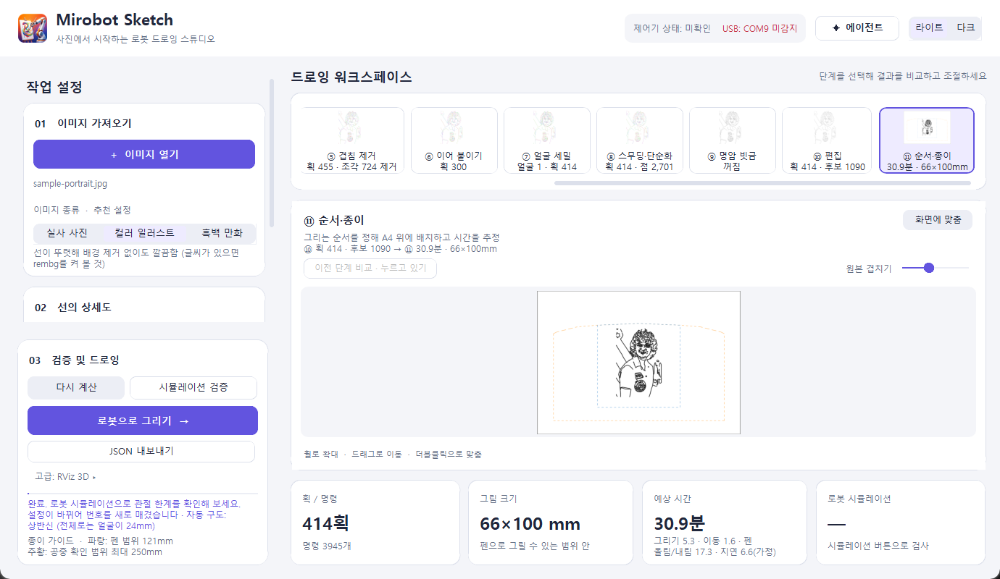
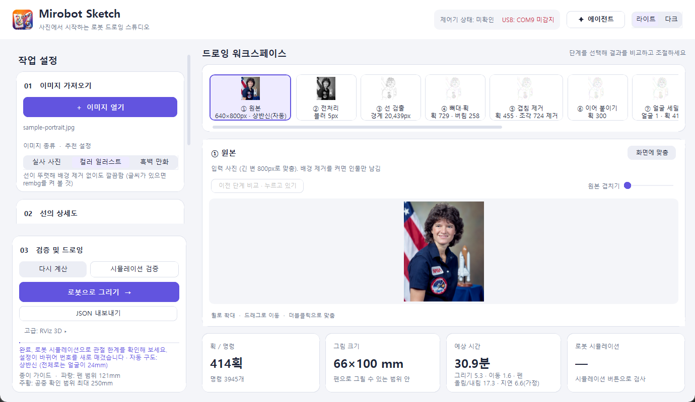
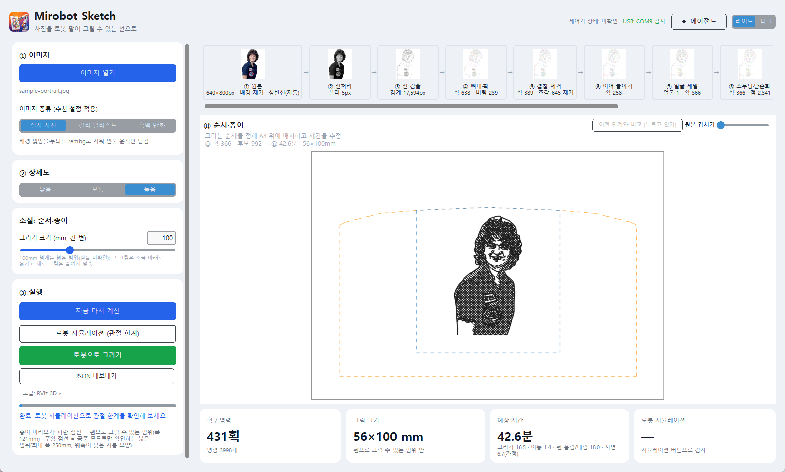
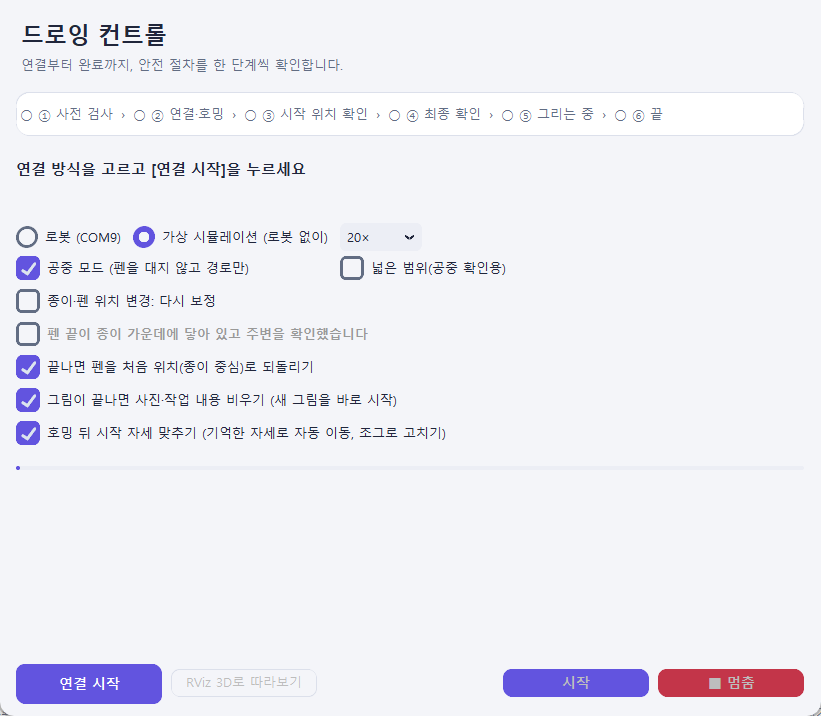
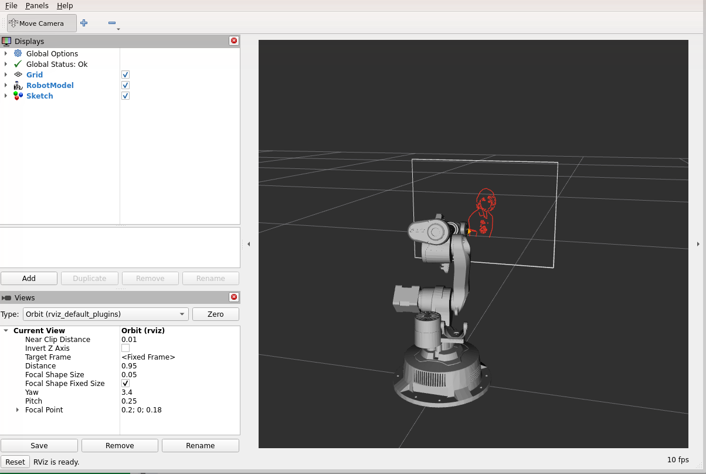
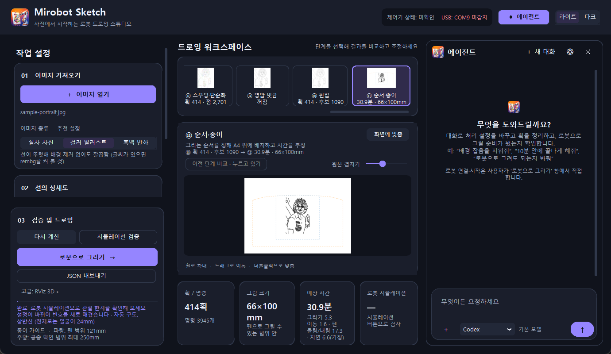

# Mirobot Photo Sketch

[한국어](README.md) | **English**


[](https://github.com/yoobinkim541/OSS-2026-Mirobot-Photo-Sketch/actions/workflows/ci.yml)
[](https://github.com/yoobinkim541/OSS-2026-Mirobot-Photo-Sketch/releases)
[](LICENSE)

An open-source project that turns a photo into line paths with OpenCV and has a [WLKATA Mirobot](https://www.wlkata.com/) robot arm draw them with a pen on an A4 sheet fixed to a wall. You do not need a robot to try the line extraction, the 3D simulation and the virtual simulation.

<p align="center"></p>

```
photo ─▶ line-extraction pipeline ─▶ strokes (paper mm) ─▶ checks (allowed area, joint simulation) ─▶ Mirobot pen drawing
         (OpenCV etc., 11 stages)                                                                     (Windows, USB serial)
                                                            └─▶ (optional) live RViz 3D following (WSL2 + ROS 2)
```

> **The app's on-screen text is currently Korean only**, so the screenshots show a Korean UI. Design and technology choices are described in [docs/ARCHITECTURE.en.md](docs/ARCHITECTURE.en.md). Some deeper notes (work logs in `LOG/`, OpenCV study notes) are in Korean.

## Contents

- [Features](#features)
- [Installation](#installation)
- [Why Ubuntu 22.04 + ROS 2 Humble](#why-ubuntu-2204--ros-2-humble)
- [Usage](#usage)
- [Agent panel](#agent-panel-editing-by-chat)
- [3D simulation](#3d-simulation-check-without-a-robot)
- [Tech stack and design docs](#tech-stack-and-design-docs)
- [Development report](#development-report)
- [Delivery (CI/CD)](#delivery-cicd)
- [Upstream contributions](#upstream-contributions)
- [Tests · folders · license](#tests)

## Features

- **Photo → line paths:** recommended settings for photos / color illustrations / black-and-white manga, face-detection-based framing and detail, optional background removal, optional tone hatching
- **Stage-by-stage view:** click through 11 stages; changing a value recomputes only from the changed stage
- **Draw with the robot:** a safety flow of pre-check → connect & home → start-position check → human final confirmation → drawing → done, plus a virtual simulation without a robot
- **3D simulation:** joint-limit checks; optionally RViz follows the robot's progress while it draws
- **Agent:** change settings and propose stroke edits through chat (it has no tool that moves the robot)

<table>
<tr>
<td></td>
<td></td>
</tr>
<tr>
<td align="center">Stage strip and large view</td>
<td align="center">Tone hatching level 2</td>
</tr>
<tr>
<td></td>
<td></td>
</tr>
<tr>
<td align="center">Draw-with-robot window</td>
<td align="center">RViz 3D following</td>
</tr>
</table>

The sample photo is a public-domain NASA photo ([credit](THIRD_PARTY_NOTICES.md)).

## Installation

| | Windows 10/11 | Robot | RViz 3D (optional) |
|---|---|---|---|
| Requirements | 64-bit Windows (the .exe installer needs no Python) | WLKATA Mirobot + USB (CH340) cable, A4 paper, pen | Windows 11 + WSL2 (or Ubuntu 22.04) |

Without a robot you can still use line extraction, the simulation and the virtual simulation. RViz 3D is optional.

### Option 1. Installer (.exe, recommended)

Download `MirobotSketch-Setup-X.Y.Z.exe` from [Releases](https://github.com/yoobinkim541/OSS-2026-Mirobot-Photo-Sketch/releases) and run it.

- It creates a **Mirobot Sketch** shortcut in the Start menu (and optionally on the desktop) and can be removed from "Apps & features". No administrator rights are needed.
- Tick **"Also install the RViz 3D environment"** during setup and the 3D environment setup helper opens afterwards (about 400 MB download).
- There is no code signing, so Windows SmartScreen may show an "unknown publisher" warning the first time. Click **More info → Run anyway**.

The config file is created on first run at `%APPDATA%\MirobotSketch\drawing_config.json` and run records accumulate in `runs\` in the same folder. Edit that file for calibration values. The robot port defaults to `"port": "auto"` and is found automatically, so it usually needs no change. Background removal (rembg) is not bundled in the .exe because of its size.

### Option 2. zip (no installation)

Unzip `MirobotSketch-vX.Y.Z-windows-x64.zip` from the same release and run `MirobotSketch.exe` (GUI) or `mirobot.exe` (command line: `mirobot draw …`, `mirobot strokes …`, `mirobot sim …`, `mirobot setup-rviz …`).

### Option 3. Developer install (Python 3.10+)

```bash
git clone https://github.com/yoobinkim541/OSS-2026-Mirobot-Photo-Sketch.git
cd OSS-2026-Mirobot-Photo-Sketch
pip install -e .
```

This provides the commands `mirobot-sketch` (GUI), `mirobot-strokes`, `mirobot-svg`, `mirobot-draw` and `mirobot-sim`. Running from the repository uses `robot/drawing_config.json`, `LOG/runs/` and `out/` directly. Install extra features only when needed:

| Extra feature | Command |
|---|---|
| Background removal (downloads a ~170 MB model on first run) | `pip install -e ".[rembg]"` |
| Agent panel (MCP, keyring, requests) | `pip install -e ".[agent]"` |
| Build the .exe | `pip install -e ".[build]"`, then `pyinstaller packaging/mirobot_sketch.spec --noconfirm` |

To launch the repository code from shortcuts, run this once (creates desktop and Start-menu shortcuts, no console window; `-Remove` deletes them):

```bash
powershell -ExecutionPolicy Bypass -File packaging/create_shortcuts.ps1
```

### RViz 3D environment (optional: WSL2 + ROS 2 Humble + Mirobot model)

Only needed for the 3D view and live following. Pick whichever method suits you.

**A. Setup helper (recommended, one click)** — downloads a prebuilt image (about 400 MB, about 2 GB after installation) and imports it as the `MirobotSketch-ROS` distribution (about 2 minutes plus download). Your existing WSL distributions are not touched.

- **GUI:** under the pinned "03 검증 및 드로잉" (validation and drawing) section at the bottom left, `Advanced` → [Install / check RViz 3D environment…] → [Install]. If the download is interrupted, [Resume install] continues where it stopped.
- **Command line:** `mirobot setup-rviz --check | --install | --uninstall | --manual | --wsl`
- **Installer:** tick "Also install the RViz 3D environment". Uninstalling the app asks whether to remove the distribution too.
- **PC without WSL:** [Install WSL (admin)] → approve in Windows → reboot → [Install]. Administrator rights are needed just this once and no password is asked for.

**B. Install directly with the shell script** — run in a terminal of Ubuntu 22.04 (WSL2 or Linux):

```bash
git clone https://github.com/yoobinkim541/OSS-2026-Mirobot-Photo-Sketch.git
cd OSS-2026-Mirobot-Photo-Sketch
bash packaging/wsl/setup_ros_env.sh
```

It installs ROS 2 Humble (`ros-base`, `rviz2`, `robot_state_publisher`) and the WLKATA model (`~/mirobot_ws`), skips steps that are already done, and prints `SETUP_OK` on the last line. It asks for the `sudo` password only where needed, and exits unless the system is Ubuntu 22.04 (jammy). The app automatically finds a WSL distribution that has `/opt/ros/humble` and `~/mirobot_ws`; to use another one, set the environment variable `MIROBOT_WSL_DISTRO`.

**C. The helper's fallback path** — if the image cannot be downloaded, [Manual install (fallback)] downloads Ubuntu's official 22.04 WSL root file (about 230 MB, SHA256-verified), imports it as the dedicated distribution `MirobotSketch-ROS` and runs `setup_ros_env.sh --image` inside it. Your existing distributions are untouched, and no password or extra administrator approval is involved.

To replay by hand, export a trajectory and run in WSL2:

```bash
mirobot-sim out/photo.json --export out/photo_traj.json
wsl -d MirobotSketch-ROS -- bash -lc "cd /mnt/c/<repository path> && bash sim/run_rviz.sh out/photo_traj.json 10"
```

## Why Ubuntu 22.04 + ROS 2 Humble

This combination is for the RViz 3D environment and is **not needed to move the robot** (real control runs on Windows directly over USB serial with G-code).

- **ROS 2 Humble is the LTS release for Ubuntu 22.04 (jammy)**, so it installs straight from binary packages on 22.04. The setup script also refuses other releases.
- For the 3D view, `ros-base` + `rviz2` + `robot_state_publisher` + one WLKATA model package are enough — much smaller than a full desktop install.
- WLKATA's official ROS 2 repository is pinned to commit `c0a7ad4` and confirmed to build on this combination. Other combinations (e.g. Ubuntu 24.04 + Jazzy) were not verified.
- The same script runs in a GitHub Actions `ubuntu:22.04` container to produce the image that WSL imports, which is attached to each release.

For the full reasoning and the Windows ↔ WSL connection, see the [design doc](docs/ARCHITECTURE.en.md#6-why-ubuntu-2204--ros-2-humble).

## Usage

### 1. Photo → strokes JSON

GUI (recommended):

```bash
mirobot-sketch            # or python CV/gui_sketch.py
```

A CustomTkinter studio workspace with a shared light/dark palette, buttons and cards. Start with **Open image** in the empty workspace, then pick the image type (photo / color illustration / black-and-white manga) and line detail in "01 사진과 추천 설정" on the left to load recommended settings. The "02 단계 조절" stage controls scroll independently while **"03 검증 및 드로잉" validation and drawing actions stay pinned at the bottom left**; the progress bar and current task sit in the status bar at the bottom. It previews at real size and pen width on an A4 sheet and shows the estimated time (drawing, travel, pen up/down, command delay) and robot simulation result (joint limits PASS/FAIL) in summary cards.

- **Screen size:** the window opens from the real work area (excluding the taskbar) and the Windows display scale (DPI), and starts maximized on narrow screens such as laptops (below 1800 DPI-adjusted units). Text, buttons and spacing follow the window size (100% at 1280×800, 80%–160%). **화면 크기 [−] [+]** in the header (Ctrl+- / Ctrl+= / Ctrl+0) scales further; the choice is kept for the next start (`%APPDATA%\MirobotSketch\ui.json`). When the workspace is wide the summary cards stand next to the large view; when narrow (for example with the agent panel open) they line up below it.
- **Stage strip:** Source → Preprocess → Edges → Skeleton & strokes → De-duplicate → Join strokes → Face detail → Declutter → Smooth & simplify → Tone hatching → Edit → Order & paper. Clicking a stage switches the large view and the left-hand controls to it and scrolls the controls into view. On a wide strip the buttons share its width; on a narrow one the mouse wheel scrolls it sideways, and offscreen selections are scrolled into view. **← 이전 단계 / 다음 단계 →** or the ←/→ keys also move between stages.
- **Photos of people:** before edge detection the photo is turned into an Informative Drawings line drawing, and that drawing is traced as is. Dark lines and their faint continuations are kept, thick ink blobs (pupils) become outlines, dashed breaks are joined when their directions match, and pieces still shorter than 6 px (1.5× the pen width) are dropped. The line drawing already has single lines, so the Canny-oriented "remove both borders of a thick line" step is skipped (it made close lines such as hair strands, eyelids and lips vanish in pairs). The face is cropped at original resolution and run through the line model once more to redraw eyes, nose and mouth. Line selection works as follows.
  - **Kept:** lines that make a person look like themselves: eyes, brows, nose and mouth, the face outline, the hair shape, and logos and patterns. Text in the photo is removed by default (below).
  - **Removed:** the "Declutter" stage (on by default) removes the lines below. Its strength is set by "short-line limit (mm)" and "faint-line limit (percentile)"; a "line count cap" drops the least important (short, faint) lines outside the face first. Lines inside the face, around it (jaw, hairline, ears) and on the outline of a background-removed person keep the default limits at any strength and are never dropped by the cap. With hair strands on (photo preset), line-art strokes inside the hair area are real strands even when the photo contrast is low, so only specks (shorter than the larger of 2 mm on paper, 4× the pen width, and a third of the short-line limit) are removed. The cap drops them, shortest first, only when it is still exceeded after every other line has gone (keeping them always pushed a long-haired photo past 45 min even at the strongest setting).
    - Wrinkles on skin: short lines with skin colour on both sides, such as on the cheeks or forehead. The skin colour is measured on that photo's cheeks and beside the nose.
    - Short faint clutter: lines outside the face that are shorter than 3 mm on paper and have low photo contrast. Patterns and (with "사진 속 글자 지우기" below turned off) lettering survive because their contrast is high, except that the line count cap (used by auto settings to meet the time target) may drop short letter strokes first.
    - Tooth gaps and specks in the face: a face is only a few cm on paper, so each tooth outline or a 1 mm fragment (eye corners, around the nostrils) drawn with a 0.5 mm pen becomes a blob or a dot. Fragments shorter than 1.25 mm on paper inside the face are dropped. On a frontal face the mouth is redrawn as one smooth outline through the mouth corners (a closed curve for an open smile, a single line for a closed mouth), and an open mouth gets one line for the lower edge of the teeth so the toothy smile stays. Profiles and turned faces keep their mouth lines.
    - Eyes, brows and closed mouths redrawn, jawline completed (on by default): with 478 face landmarks, the lines inside the eyes of a frontal face (glasses glints, lash fragments) are removed and each eye is drawn as the upper-lid curve, the lower lid from the outer corner to just past the middle, the iris circle clipped to the eyelids and one pen-width dot for the pupil; a closed eye gets only the upper lid. Brows become one line midway between their upper and lower outlines (two lines when thick) instead of broken fragments. A closed mouth is drawn as the line where the lips meet (corner to corner) plus the middle part of the upper and lower lip outlines; joining the outlines to the corners made it look open. Jawline gaps the line drawing missed are filled with the landmark curve only where the photo shows an edge. The nose stays as the line drawing has it: drawn from landmarks it looked like a second mouth. Open mouths keep the mouth tidy above, and turned faces (eye-width ratio below 0.6) are left as they are. The landmark model is MediaPipe Face Landmarker's model converted to ONNX (4.9 MB); like the line-drawing model it is downloaded from GitHub Releases on first use and run with onnxruntime. If it cannot be downloaded, drawing works as before and the status bar says why.
    - Text in the photo (on by default): magazine titles, name captions and logo lettering on clothes become illegible smudges with a 0.5 mm pen, so lines inside regions found by a text detector (PP-OCRv3 from OpenCV Zoo, 2.4 MB, downloaded on first use) are removed. Text found inside the face is treated as a false detection and kept. Logo lettering on clothes (such as the portrait's NASA patch) is removed too; turn off "사진 속 글자 지우기" to keep it.
    - Removed lines appear under "Discarded lines" in the Edit stage, each with its reason.
  - **Effect and time:** on four test photos the share of the drawing's lines kept in the final strokes rose from 0.28–0.34 to 0.71–0.77 (before declutter). Drawing takes longer: with a saved pose (20 mm pen lift) the portrait goes from about 21 to 53 min (74 min without declutter). The time card uses the coordinates that will actually be drawn and the pen lift that will actually be used.
  - **Model download:** the model (17 MB) is downloaded from GitHub Releases on first use; offline, basic edge detection is used and the reason is shown in the status bar.
- **Auto settings (45 min target):** **자동 세팅** in "01 사진과 추천 설정" actually computes declutter-strength candidates for the photo and applies the one with the highest likeness score among those estimated within 45 minutes. A sketch is the first step before colouring, so areas are not filled with hatching: hatching is not among the candidates (raise "tone level" by hand if wanted) and hair is drawn with strand lines. If strength alone cannot meet the target, the line count cap is found by binary search. If that still fails (photos with many hair strokes, such as long straight hair), the strand spacing is widened to 3 mm and then 4 mm with the cap searched again, and only as a last resort are strand lines turned off; the result line says "결 간격 4mm(시간)" (strand spacing widened for time) or "머리 결 선 끔(시간)" (strand lines off for time). The score sums eyes/nose/mouth/face-outline recall (0.40), person outline (0.15), photo edge recall (0.15), tone similarity (0.15) and lack of noise (0.15). One photo takes 10–60 s, during which the controls, image opening and drawing are locked. If a face is found but the image type is not "photo", the photo preset is applied first; if the search fails, the previous settings are restored. For several photos use the command line: `python -m mirobot_sketch.autotune photo1 photo2 --target 45 --out out/auto` (saves photo|strokes side by side, the paper preview, a JSON report and a stroke file `<name>_strokes.json` that `mirobot-draw` can draw directly; if the folder already holds results of a different photo with the same name, or two inputs share a name such as `a.webp` and `a.jfif`, the extension is added, e.g. `a_jfif`, so nothing is overwritten).
- **Auto recompute:** 0.3 s after a value changes, only the changed stage and later ones are recomputed (about 0.01 s if only late stages change). ↑/↓ in a number box steps the value by one notch.
- **Join nearby strokes (1 mm by default):** when the next stroke starts within the "가까운 획 이어 그리기" distance of the previous end, it is drawn on without lifting the pen, joined by a short straight line. With the saved pose (20 mm pen lift) each lift and lowering takes about 5 s, which is most of the drawing time. At 1 mm (twice the pen width) three photos got 2.7–7.8 min shorter. Gaps inside the face box (brows to chin) are not joined: at 4× zoom with the real pen width, joins left ticks under the eyes and above the eyelids. Leaving the face out costs 1.0–1.9 min of that saving per photo. Whether the joins show on paper has not been checked yet. 0 turns it off.
- **Hair strands (on in the photo preset):** instead of filling hair with hatching, evenly spaced flow lines follow the photo's strand direction, 2 mm apart by default. Strands the line drawing already has are kept, and strand lines only fill the gaps between them. The direction comes from the edge tangent flow (ETF, Kang 2007), which repeatedly smooths the tangent (perpendicular to the brightness gradient) towards the clear strands nearby; with the earlier structure tensor, strands in short hair circled along the head outline, while ETF lets them fall from the crown towards the fringe. The hair area is the dark region touching the band above and beside the face, cut to the head (one face height above the face box, 0.8 face widths to each side, down to just below the chin), so dark clothes joined to the hair get no strand lines. Like hatching, strand lines are not part of the edit numbering and are merged with the outlines when the drawing order is decided.
- **Tone hatching (off by default):** to add shading, raise "tone level" to 1–3 to fill dark areas with parallel hatching; darker areas get extra lines between the existing ones in the same direction. Levels 2 and up used to cross-hatch at 90°, but with a 0.5 mm pen that made hair look like a basket grid, so it was changed. Consecutive lines are chained in a zigzag without lifting the pen to reduce pen lifts. Hatching follows the photo's brightness, not the line drawing. For photos with a dark background, turn on "Remove background" first; otherwise no hatching is made and a hint is shown. Measured with the old cross-hatching on the microphone photo (background removed), tone similarity rose 0.71 → 0.88 (level 1) → 0.93 (level 2), while estimated time grew 17.8 → 25.1 → 31.2 min. "No hatching on face skin" (on by default) leaves the face below the brows and the skin of the neck and ears unhatched: a face is only a few cm on paper, and hatched skin shadows look like scars or stubble and hide the expression. Hair drawn with strand lines gets no hatching either.
- **Edge modes:** brightness (grayscale Canny) / color difference (Lab Canny, also finds edges between colors of similar brightness) / dark lines (center lines of line art).
- **Faces:** for photos, OpenCV YuNet finds faces ([model license](THIRD_PARTY_NOTICES.md)).
  - **Auto framing:** if the face is smaller than 25 mm on paper (as in a full-body photo), it crops to the upper body at original resolution. You can also choose full / bust / face under "Framing".
  - **Face detail:** re-finds lines only in the face area at original resolution (also on the photo line-drawing path) and merges lines denser than the pen width so they do not smear on paper. Short lines near eyes, nose and mouth are kept.
- **Large view:** wheel or [+]/[−] to zoom, drag to pan, double-click or use **Fit to view** to restore the whole image. Hold **Compare with previous stage** right below the picture to see the preceding result. "Overlay original" shows the color original through the drawing so you can spot missing lines. The Order & paper stage explains the guide lines (blue: pen range, orange: air-check range) above the picture. Controls without an image or comparison target are disabled and greyed out.
- **Edit stage:** every stroke gets a number (only strokes visible in the zoomed range). Turn on "Discarded lines" to see pieces the pipeline dropped as gray dotted lines with numbers. Edits proposed by the agent are shown in red (disappears) and green (appears); remove number tags in the proposal bar below and then [Apply]. Applied edits survive recomputation after settings change.
- **Draw with the robot:** in the [Draw with robot] window under the pinned "03 검증 및 드로잉" section, it goes ① pre-check → ② connect & home → ③ start-position check → ④ final confirmation → ⑤ drawing → ⑥ done. The step bar shows the current step, what to do next and why it stopped. When a drawing finishes, the pen returns to the **start position** (paper center, the start pose with the pen tip lightly touching the paper) (option, on by default; not applicable in air mode), then the photo and working state (strokes, edit history, simulation) are cleared so you can start a new drawing right away (option, on by default; settings such as image type, detail and size are kept). An error during the return is reported as is. The return is sent separately after all drawing commands finish, so it does not disagree with the simulation or RViz progress display.
  - **Pause and resume:** pressing [■ 멈춤] (Stop) while drawing **pauses** the run instead of ending it. When the command in flight finishes, the pen is lifted straight off the paper where it stopped (no sideways move; press again during the lift to stop in place) and the app waits with the connection open. [▶ 이어서 그리기] (Resume) moves fast to just in front of the paper above the stopped point, touches the same point slowly, and sends the remaining commands unchanged (nothing already drawn is drawn again; if the stroke was finished it goes straight to the next one). [⌂ 끝내기] (Finish) ends the run: if it started from the saved standby pose with "return to start position" on, the robot returns through the standby pose to the homing pose (all joints 0) (press again during the return to stop in place); otherwise the pen stays lifted where it stopped. You can pause any number of times; the count is recorded as `pauses` in the run record. Closing the window while drawing or paused ends the run in place without waiting (the pen is not lifted if it was drawing). After an error stop the position cannot be trusted, so the app neither moves automatically nor offers resume.
  - **Automatic USB port:** the app finds the COM port of the robot's USB cable (WCH CH340/CH341/CH9102 chip) and connects to it. Plugging the cable into another USB socket so the COM number changes still works, and other devices such as Bluetooth serial ports are skipped. If `port` in the config names a COM port, that port is preferred when it looks like a robot cable. With several robot USB ports the app does not guess (opening a port resets the device) and asks you to set `port`. A non-CH340 adapter named in `port` is used when no robot cable is present.
  - **Controller direction check:** on a real drawing, after homing and before the first joint or contact move, the app reads `$$` and checks that the direction masks `$3` and `$23` match `controller_settings_expected` in the config (currently 123 and 60). If they differ or cannot be read, the robot does not move and the values read are shown. With the firmware defaults (127 and 56) the arm moves mirrored while the reported angles still look right. The values read go into the run record (`controller_settings`). This read has not yet been run on the real controller through the app; if the values are right but reading fails, set `controller_settings_expected` to `null` to skip the check (the run record notes that it was off).
  - The top of the GUI shows the detected port (e.g. `USB: COM7 자동 감지`) and the controller state. The USB indicator only reads the device list and never opens the port (opening resets the board); the controller state is updated from responses received on a real drawing connection. The port actually used appears on the final confirmation screen and in the run record (`port`).
  - **Camera:** the Draw with robot window shows a live camera preview on the right. The list at the top picks an external USB camera (for example a Logitech BRIO) instead of the built-in laptop camera; press [↻] to re-read the list after plugging one in. The choice is saved by device name (`%APPDATA%\MirobotSketch\camera.json`), so the same camera opens even if another USB socket changes its number; if it is unplugged the app falls back to "자동 (처음 찾은 카메라)" (first camera found). On Windows device names come from DirectShow and cameras are opened in the same order. Drawing continues if the camera is off or missing. When the webcam connects, a Check ready button appears. Draw an X at each paper corner for that drawing; the button only adds whether four X marks and the pen tip are visible to the existing readiness check. It does not judge contact depth and does not move the paper position. The draft design for watching the drawing with the camera is in [docs/specs/2026-11-09-vision-guided-drawing.md](docs/specs/2026-11-09-vision-guided-drawing.md).
  - **Paper position:** [종이 위치 맞추기] (Match paper position) in the camera panel opens a frozen camera photo. Click the paper (board) corners top-left → top-right → bottom-right → bottom-left (drag a point to fix it), check the paper size (A4 landscape 297×210 mm by default) and save. The paper center is where the pen tip rests right after homing, so the + mark should sit on the pen tip. After saving, the preview overlays the planned drawing (purple), the pen range (blue) and the air-check range (orange) on the real paper; toggle it with "계획한 그림 겹쳐 보기". When a run that started drawing ends, the camera photo and the overlaid photo are saved side by side to `out/vision_*.png`. The position is stored per camera (`%APPDATA%\MirobotSketch\vision_registration.json`); move the camera or the board and you must click again. The robot is not moved. Once printing is possible, the markers in `assets/aruco_markers_a4.pdf` will make this automatic.
  - **Automatic fit to corner marks:** draw an X or a plus with a pen or marker right at each paper corner (the mark's centre is the corner). While not drawing, the window looks for them in the camera photo every 3 seconds ("모서리 표시(X·십자)로 종이 위치 확인", on by default) and uses them only after seeing all four at the same place three times in a row. The saved paper position (where the robot draws) is not overwritten; instead the coordinates the robot draws are moved to the paper measured by the marks — its position, rotation and size ("표시에 맞춰 그림 위치·크기 자동 조절", on by default). The drawing is moved to the paper centre, rotated with the paper and scaled with the paper size (the smaller of the width/height ratios, keeping the drawing's aspect). The size changes only when the measured paper matches the configured paper or A3/A4/A5/B5/Letter within 3%; otherwise only position and rotation are fitted and the window warns that the saved paper position may be wrong. If the moved drawing leaves the pen range it is shrunk around the paper centre until it fits (down to 0.3×); otherwise the original position is used and the reason is shown. Simulation, range checks, the camera overlay and the commands sent use the fitted coordinates; editing, the agent and the paper preview keep paper coordinates. The run record keeps the fit used (`paper_fit`). When the marks are missing three times in a row, or the fit is switched off, drawing returns to the original position. Only when no paper position is saved yet do the marks create one, assuming the paper centre sits where the pen tip rests after homing. The [종이 위치 맞추기] window also fills in the four corners when it sees the marks. Marks must be on the white paper and are not checked while drawing because the arm hides them.
  - **Camera resolution lock:** frames are not shown until they arrive at the size set in `camera.json` (for example 3840×2160); if the camera keeps another size, the window says so. A BRIO opened at 640×480 shows only the centre of the 4K view, which looks 1.33× zoomed and breaks the paper position. The paper position now stores the photo size it was made on and is not used on a photo with a different aspect ratio.
  - **Line check while drawing:** with a registered camera, every 8 seconds the app checks whether the finished strokes left a line on the paper. In the preview, strokes with a visible line turn green, strokes without one turn red, and unchecked strokes stay purple; the camera panel shows the counts "보임 · 안 보임 · 가려짐" (seen · missing · hidden by the arm or holder). One more check runs when the run ends and its summary is added to the message. It never stops the robot; only the end tick correction below adjusts contact points of strokes not yet sent, and it does not run in the virtual simulation. Pen lines are faint, so a 4K picture works best. Per-camera capture settings go in `camera.json`, for example `"capture": {"Logitech BRIO": {"width": 3840, "height": 2160, "focus": 15}}` (set the focus only when the camera-to-board distance is fixed).
  - **Plan-to-line alignment:** before measuring, the line check moves the finished strokes (±20 mm) to where they best match the real lines; once at least 30 strokes are finished it also tries rotation (±3°) and scale (0.92–1.08), used only when that raises the overlap by more than 3 points over the shift alone (so a few strokes don't fit noise). A paper that was re-taped or a camera that turned is still measured correctly. Both drawings on 2026-11-16 were off by about +7, −6 mm; before alignment such lines were measured as "missing" and the end tick correction wrongly reduced the backoff. On 11-18 the camera had turned, giving +16, −12 mm, −2° and ×1.06; the old ±10 mm shift-only search barely overlapped, so the line check and automatic correction stopped altogether (re-measured from that test sheet's pictures: 98% overlap, all 48 dashes seen, about 2 s). If even the best fit barely overlaps the lines, the window asks to register the paper again and skips the automatic correction.
  - **Automatic paper position correction (from the drawn lines):** after a real run, if the final line check matched the plan to the real lines with confidence (overlap 60% or more, at least 30 strokes, more than 0.5 mm of movement around the drawing), the saved paper position is corrected by that transform (shift, rotation and scale), keeping the current perspective and adding only the in-plane part. Before overwriting, the old file is kept as `vision_registration_<time>-backup_before_autoregister.json` and its name is shown, so a wrong correction can be undone. The paper position assumes the paper centre is where the pen tip rests after homing; if the paper is not taped exactly there or the camera turns, the overlay and line check are off. From the next drawing the overlay matches where the robot actually draws, so the paper position only needs to be set once with [종이 위치 맞추기] or corner marks (or again after moving the camera or board a lot). After a correction the green paper outline follows where the robot thinks the paper centre is, so a sheet taped off the pen centre shows its outline shifted by that much. On 2026-11-16 this corrected +7.3, −5.8 mm; on 11-18 +16.2, −12.3 mm, ×1.058 and −2.0° were corrected by hand from the 48 test dashes.
  - **End tick correction:** the same check measures, at the start and end point of every finished stroke, any short line running up or down (the mark the pen leaves when it is pressed hard while touching down or lifting). The preview circles them in orange and shows "끝점 세로 줄: 시작 n/N · 끝 n/N" (end ticks: start · end). With [끝점 세로 줄 자동 보정] (auto end tick correction) on (the default), when 20% or more of at least 8 endpoints drawn with the current value have a tick, that side's (start or end) contact point moves 0.2 mm back from the paper; during a run it applies from the next stroke not yet sent. If, after backing off, the share of strokes without a line rises more than 15 points over the previous stretch, it goes back 0.2 mm. While the lift slant (`edge_rise_mm`) is on, end ticks belong to the lift value and start ticks to the touch-down value (`edge_land_mm`, below), and **the backoff does not move automatically at all** (neither raised by ticks nor lowered for missing lines). Two values moving on the same ticks double-correct (11-18 drawing: the end backoff climbed 0.2 → 1.0 while the slant moved too, until the run froze on a contradiction), and since the contact press was reduced by 1 mm on 2026-11-19 the lines are faint and many are counted as "missing" (in a 109-stroke portrait with no missing lines, 54% of the first 40 strokes were counted missing and the start backoff dropped 0.4 → 0.2). The range is 0–1 mm and the value is saved to `pen.start_backoff_mm`/`pen.end_backoff_mm` in `drawing_config.json` after the drawing, for the next drawing. It decides from camera pictures only, with no LLM or network.
  - **Slanted lift and touch-down (`pen.edge_rise_mm`, `pen.edge_land_mm`):** for downward ticks at stroke ends left while the pen drags on the paper as it lifts. The intermediate point `edge_rise_depth_mm` (1.5 mm by default) off the paper is moved up the paper by `edge_rise_mm` (0–3 mm) when lifting, and by `edge_land_mm` when lowering (+ moves it down the paper, − up, within ±3 mm); both 0 turns it off and leaves the commands unchanged. When on, each stroke gets 2 more commands and the range check includes the shifted points. On the 2026-11-16 drawing (261 strokes) the camera found ticks over 1.8 mm, mostly downward (start down 42 / up 13, end down 40 / up 19, median 2.4 mm). **Test sheet (2026-11-16, `LOG/scripts/edge_rise_ladder/`):** four rows (y +40/+10/−25/−55 mm) of twelve 5 mm dashes, each drawn with the same lowering and lifting value of 0/1/2/3 mm, checked from a phone photo. End ticks were about 2 mm down at 0 mm, almost gone at 1 mm, about 0.5 mm up at 2 mm and about 1.5 mm up at 3 mm. Start ticks were about 2.3 mm down even at 0 mm and, approaching from below, grew about 1 mm per mm (the pen touches early and draws that path). Row height made no clear difference. The tip seems to move up about 2.3 mm as the contact load builds (inference), so on 2026-11-18 touch-down from above at 0/−1/−2/−3 mm was drawn the same way (`--knob land`). From the average of 6 camera pictures, on the left half of the paper the start tick shrank 4.2 → 3.5 → 1.3 → 1.2 mm and flipped to 1.9 mm upward at −3 mm. On the right half 3 mm remained even at −3 mm and the end ticks were longer too, so a position-dependent cause is likely (camera lengths are unvalidated; trend only). So the repository robot config lifts at 1.5, lowers at −2, with no extra low on the paper. **Automatic adjustment:** with [끝점 세로 줄 자동 보정] on and `edge_rise_mm` above 0, the line check measures whether each end tick (where the pen lifted) runs up or down the paper (only ends whose tangent is close to horizontal); when at least 8 such endpoints drawn with the current value show downward ticks at 10% or more and more than 5 points above the upward ones, it adds 0.5 mm (up to 3 mm), and the other way round removes 0.5 mm (down to 0.5 mm). `edge_land_mm` follows the same rule on start points only (where the pen touched down): more downward ticks move the touch-down 0.5 mm further from above (down to −3 mm), more upward ticks 0.5 mm less (up to 0); it is left alone while `edge_rise_mm` is 0, since the command count could change. During a run it applies from the next stroke not yet sent, and the value is saved to the config once after the drawing ends.
  - **More lift slant low on the paper (`pen.edge_rise_low_mm`):** added to the lift value as an endpoint goes below y −20 mm, fully from −60 mm down (total up to 3 mm; 0 in the repository config). The automatic correction counts downward and upward ticks separately for the lower (below y −40 mm) and upper (above y −20 mm) endpoints: when only the lower ones show downward ticks at 10% or more and more than 10 points above the upper ones it adds 0.5 mm, and when only the lower ones show that many upward ticks it removes 0.5 mm. The automatic adjustment of `edge_rise_mm` only looks at endpoints high enough not to get this extra.
  - **Back-and-forth settles in the middle, and values save once at the end:** within one drawing, if a value (start or end backoff, lift or touch-down slant, extra low slant) would be changed back in the opposite direction of its last change, the judgements on either side are taken to bracket the right value. It is set halfway between the current and proposed values and locked for the rest of that drawing, while the other values keep being corrected; the window says "판단이 오가서 가운데 값으로 고정: …". Before, this stopped the automatic correction altogether. In the 11-18 drawing the touch-down value went −2 → −1.5 → −1 and stopped just as it wanted to go back to −1.5, so the rest of the strokes were drawn at −1, where the photo shows many downward ticks. Values changed during a run are used for the remaining strokes and saved to the config only once, after the drawing ends. In the 2026-11-16 22:41 drawing the lines were faint, so the "lines missing" and "end ticks" rules alternated; the start backoff went up and down 16 times between 0 and 0.8 mm and the final value was saved and had to be reset by hand. Now the backoff does not move on ticks while the lift slant is on.
  - **Slant values change only on enough endpoints and a clear side:** on top of the rate conditions above, the lift and touch-down slant and the extra low slant change only when at least 30 up/down-classified endpoints have been drawn with the current value and the larger side is unlikely under an even split (one-sided sign test p ≤ 0.05; e.g. 21 vs 10 changes, 6 vs 2 does not; `pen_correction.DIR_MIN_ENDPOINTS`, `DIR_P`). The extra low slant needs 30 each on the lower and upper parts. In the two 2026-11-18 drawings each decision used 10–24 endpoints (e.g. down 5, up 2), and the same touch-down value of −1 mm was read as "downward" at 15:53 and "upward" at 20:44. Re-measured from the finished pictures, both drawings had the same share of start ticks (25% and 24%).
  - **Pen value changes and times in the run record:** the run record (`runs/run-*.json`) keeps `pen_changes`: the values used during the run (start and end backoff, lift and touch-down slant, extra low slant) with the stroke number and time each took effect. `config_snapshot` only holds the values at the end, so before this they had to be reconstructed from the controller trace (capped at 20,000 samples). `started_local` is the start time and `finished_local` the end time; the file name is still the end time.
  - **Remaining time:** for the first minute the progress line shows the precomputed estimate, then scales it by how long the run has actually taken so far. Before, the ratio was taken from about 0.3 s right after the first command, which showed "about 34 min left" at the start of the 22:41 drawing, which took 74 min. The precomputed estimate no longer adds 0.1 s per command (`timing.assumed_command_latency_s` 0), because drawing commands are streamed after each acknowledgement and overlap the motion. In the 17 completed real runs since October 29, the actual time was 0.77–0.92 of the theoretical motion time, so even without the delay the estimate is still 8–30% longer than the actual time. Because estimates are now about 12% shorter, [자동 세팅] (target 45 min) may pick settings with somewhat more strokes. More short strokes mean more start ticks, so set the target to about 40 min to get drawings like before.
  - **J1 direction compensation (experimental, off by default):** the base joint (J1) has play, so the same point lands 1–3 mm to the side depending on whether the pen arrived from the left or the right. Set `pen.j1_direction_offset_deg` in `drawing_config.json` (angle when arriving with J1 increasing minus angle when arriving decreasing, within ±3°) and the executor turns every target half that amount against its arrival direction. Where the direction reverses it first sends the same point again to take up the play (`j1-takeup`). Pen approach and retract follow the line from the base through the contact point so J1 does not turn, and each stroke pre-turns J1 in the air toward its first drawing direction (`j1-approach`). With 0 the commands are unchanged. The value has to be found with a pen test; the value measured in free air had the opposite sign from the one measured with the pen on the paper.
  - **Large view:** [크게 보기] (large view) in the camera panel opens a separate window. "그림 부분" (drawing) crops the area around the drawing at the camera's full resolution; "종이 전체" (paper) and "사진 전체" (whole picture) are also available. It follows the window size, and a double click fills the screen. Turn off "계획 겹쳐 보기" (overlay plan) to see only the pen lines.
  - **Camera sharing:** only one program can open a camera, so while the drawing window has it open, the app writes `out/camera_live/` every 2 seconds: `view.jpg` (drawing area with the plan overlaid), `raw.jpg` (same area, untouched), plus `full.jpg` (whole picture) every 10 seconds and `status.json` (progress and line check text). A terminal or other tool reads these files to see the paper without opening the camera.
  - You must tick "paper, pen and surroundings checked" to start, and air mode is the default.
  - If you moved the paper or the pen, choose "Paper/pen moved: recalibrate". Otherwise it homes and draws right away using the values saved in the config (`plane_compensation`, `limits`) without calibration. Connecting to the real robot without paper calibration shows "no paper calibration" on the final confirmation screen.
  - The app saves the paper coordinates it sent to `out/run_strokes_*.json` and the run record in `LOG/runs/` points to that file. Real pen-down can only start inside the area whose contact was confirmed by calibration. The wide-range option can be used to check air paths beyond that.
  - **Virtual simulation** (no robot, 1–500× speed) tests the same flow. On the command line: `mirobot draw <json> --execute --virtual`.
  - On a PC with WSL2 + ROS 2, **RViz follows the robot's progress (command replies) in real time** while it draws.

Command line:

```bash
mirobot-strokes photo.jpg --type photo --out out/photo
```

- `--type photo|illustration|manga` : recommended settings per image type (`mirobot_sketch/presets.py`)
- `--detail low|medium|high` : detail level. Lower means fewer strokes and less drawing time.
- `--rembg` / `--no-rembg` : background removal (results are cached in `out/cache/`)
- `--median 11` : removes small patterns such as manga screentone dots.
- `--dedupe 4` : merges double lines closer than the pen width (the two edges of a thick line) into one (default 4 px, 0 = off)
- `--merge 4` : joins strokes whose end points meet to reduce pen lifts (default 4 px, 0 = off)
- `--lines dark` : draws the center lines of dark strokes in clean line art.
- `--box W H` : drawing box size in mm. The default is 100 × 100.
- `--svg` : also saves an SVG for pen plotters and GRBL machines (`out/photo.svg`). See [Using other machines](#using-other-machines-svg) below.

This creates `out/photo.json` and a comparison image `out/photo_preview.png` (input / line candidates / strokes / drawing order).

#### Using other machines (SVG)

The strokes JSON uses millimetres from the paper center, so it is not tied to the robot. To use the extracted lines on a pen plotter such as AxiDraw or a GRBL-based machine, export them as SVG.

```bash
mirobot-strokes photo.jpg --type photo --out out/photo --svg   # straight from a photo
mirobot-svg out/photo.json                                      # from an existing JSON (including one saved by the GUI) -> out/photo.svg
```

- The document is the real paper size (A4 landscape, 297 × 210 mm), and one SVG unit is 1 mm. The drawing sits where it is in the JSON (at the paper center).
- Each stroke becomes one `<path>`, in drawing order.
- The SVG can be passed to tools that read SVG, such as AxiDraw (Inkscape extension or `axicli`), [vpype](https://github.com/abey79/vpype), or an SVG → G-code converter. Reading it back with vpype gives the same paper size, position and stroke count as the JSON. It has not been tested on real AxiDraw or GRBL hardware.

### 2. Strokes JSON → robot

```bash
mirobot-draw out/photo.json
```

The default is a **dry run**: the robot does not move and only a G-code file and a summary are produced. Before drawing for real, prepare the following.

1. Power on, hold the center button for 2 seconds to home, and confirm the Idle state.
2. Put the pen tip at the center of the paper.
3. Check the center TCP and signs in `robot/drawing_config.json`. The port is detected automatically (when `port` is `auto` or the named COM port is absent).

When ready, run:

```bash
mirobot-draw out/photo.json --execute
```

Results are saved in `LOG/runs/`. The first time, check left/right and up/down orientation with `trajectories/orientation-test-F.json`.

- `--air` : follow the same path without touching the paper (to check reach and collisions).
- `--pending-limits` : check against the not-yet-verified wide area (a roof-shaped region fitted to the reach map: left/right ±125 · down −85 · up +42.5 to +57.5 mm). Used for the range test (`trajectories/border-test-wide.json`) and large drawings.

**Drawing larger:** "Drawing size" in the GUI can go up to 250 mm. This is one side of the width/height box and the photo's aspect ratio is kept. For example a landscape photo set to 120 mm gives roughly a 120×71 mm drawing. To fit the wide area, large drawings are shifted slightly down and tall drawings are shrunk to the upper limit. The wide area is for checking the robot's air moves and the simulation; to draw with the pen you must calibrate the contact area of the whole drawing on the real robot. Follow `_limits_pending_note` in `robot/drawing_config.json` and the [log](LOG/2026-09-26-bigger-drawing.md) (Korean) for the hardware procedure.

#### Paper plane and drawing-area calibration

After a person sets the gap between paper and wall, the front/back (X) offset and the plane tilt are computed from contact coordinates at the center and the four corners of a rectangle. The robot has no contact sensor, so a person judges pen-tip contact by eye. It runs without a webcam. Calibration never starts automatically: it guides you before drawing only when requested by choosing "Recalibrate" in the GUI or with `mirobot-draw --execute --calibrate`. Even when drawing without calibration, the allowed-area (`limits`) check, the start-position check and the human final confirmation still apply, so drawings outside `limits` cannot be drawn with the pen and only air mode works. The virtual simulation skips the calibration procedure.

When you pick a drawing with an extended range in the GUI, the app follows a rectangle around the drawing's coordinates plus a 1 mm margin in pen-up, asking for confirmation at each corner. Then you confirm contact at the four corners yourself to calibrate the width and height that drawing needs. For example a 120×71 mm photo checks an area of about 122×74 mm. If contact is not confirmed, real pen-down does not start.

Because of the upper reach limit (+55 to 57.5 mm above the paper center), large drawings are placed below the paper center. A 120×120 mm drawing spans −65 to +55 mm vertically, and calibration measures the four corners of that range (relative to the paper center, symmetric left/right). If this area passes, the execution limit is stored as that rectangle (`x_max_mm`, `y_min_mm`, flat upper limit). In theory a square up to about 138 mm fits in the robot's reach (simulation PASS). However, if the measured plane residual exceeds 1 mm (the paper is warped or away from the wall), the configuration is not changed, so fix the paper flat and measure again.

```bash
python -m mirobot_sketch.calibration             # only shows the expected search range
python -m mirobot_sketch.calibration --execute    # real calibration
# After reinstalling the package, the mirobot-calibrate [--execute] command is also available.
```

Connecting power and USB and running this opens the serial connection once (the controller restarts). Home with the center button, then set and fix the paper center and gap. It starts from a 60×60 mm rectangle in pen-up and grows each side by 10 mm. At each corner, check there is no interference and continue with `Enter`. `c` picks the current completed size (the previous safe size while expanding) and `q` cancels. At the four corners of the chosen rectangle, `+`/`-` adjust the X axis by 0.25 mm; for example `++++++++` is a 2 mm move toward the wall. Record with `Enter` right when the pen tip just touches, and do not press hard enough to leave a mark on the paper.

The configuration is updated only if the maximum plane residual over the five contact points is 1 mm or less. When it passes, the center TCP, the plane compensation and the confirmed square limit are saved to `robot/drawing_config.json` and the full measurements are kept in `LOG/calibrations/`. If the deviation is large or the user aborts, the existing configuration is kept. Recalibrate if the robot port or the installation position changes.

## Agent panel (editing by chat)

<p align="center"></p>

The **✦ Agent** button at the top right of the GUI opens a chat panel. Say things like "too many strokes, finish within 15 minutes", "remove background noise" or "keep the hair outline more", and the agent looks at the original and the stage results itself, then changes settings or **proposes** edits. Proposals appear in the edit stage in red/green with numbers, and you can instruct by number, e.g. "apply without number 5". Changes are reflected in the left-hand settings and the preview immediately.

| Backend | Preparation |
|---|---|
| **Claude Code** | Install Claude Code and log in with `claude`. The app runs `claude -p` and connects the app's tools as an MCP server. |
| **Codex** | Install the Codex CLI and log in. The app runs `codex exec`. |
| **OpenRouter** | Enter the API key in the panel's ⚙ settings (stored in the Windows Credential Manager). The default model is `anthropic/claude-opus-5`, and you can choose among models that support tool calls and images. |

The tools the agent uses are: view state, view images (original / stage results / edit / paper), change settings, list strokes, view point coordinates, compare photo and drawing (`compare`: original | drawing | difference image with tone-similarity and outline-reproduction metrics), propose edits (delete, keep, move point, delete point, insert point, smooth, cut, join, draw short line), apply/discard proposals, undo, simulate, and the **robot readiness check (`robot_guide`)**. `robot_guide` is read-only: it tells you whether this drawing is inside the range the pen can draw, whether the simulation passed, whether paper calibration exists, and the order a person follows in the "Draw with robot" window. **There is no tool that moves, connects or starts the robot.** A person must confirm and start real drawing in the app's "Draw with robot" window (when handing over to the command-line executor, export the JSON and type `yes`), and while drawing the agent can only read, not change settings or edits.

To use the agent in a development environment, install the needed packages (mcp, keyring, requests) with `pip install -e ".[agent]"`.

## 3D simulation (check without a robot)

It solves Mirobot kinematics (IK) along the same path as the executor and checks whether joint limits (soft limits) are exceeded.

```bash
mirobot-sim out/photo.json --plot out/joints.png --gif out/sim.gif
mirobot-sim --reach-map out/reach_map.png
```

With the RViz 3D environment installed, `Advanced` → [View in RViz 3D] in the GUI plays the trajectory on the robot-arm model, and while drawing it follows the command replies. Install it by following the [procedure above](#rviz-3d-environment-optional-wsl2--ros-2-humble--mirobot-model).

## Tech stack and design docs

| Area | Used |
|---|---|
| Image processing | [OpenCV](https://opencv.org/) (Canny, median, morphology, `approxPolyDP`, YuNet face detection), [scikit-image](https://scikit-image.org/) (`skeletonize`), [NumPy](https://numpy.org/), [SciPy](https://scipy.org/) |
| Background removal | [rembg](https://github.com/danielgatis/rembg) (optional) |
| UI | [CustomTkinter](https://github.com/TomSchimansky/CustomTkinter) |
| Robot communication | [pyserial](https://github.com/pyserial/pyserial) — USB serial G-code |
| 3D visualization | [ROS 2 Humble](https://docs.ros.org/en/humble/) + [RViz](https://github.com/ros2/rviz) + WLKATA's official URDF (WSL2 Ubuntu 22.04) |
| Agent | [MCP](https://modelcontextprotocol.io/), Claude Code / Codex CLI / OpenRouter |
| Packaging and delivery | [PyInstaller](https://pyinstaller.org/), [Inno Setup](https://jrsoftware.org/isinfo.php), GitHub Actions |

What was chosen for each stage and why, the OpenCV functions used, the Windows ↔ WSL2 bridge design and the packaging are in **[docs/ARCHITECTURE.en.md](docs/ARCHITECTURE.en.md)**.

## Development report

A paper-style report (in Korean) of the implementation and real-robot tests from September 24 to November 19, 2026, including what failed and what was misjudged and later corrected, with numbers and photos.

| Version | Length | Files |
|---|---|---|
| Brief | 15 pages, 15 figures, 4 tables | [PDF](docs/reports/Mirobot_Sketch_report_brief.pdf) · [DOCX](docs/reports/Mirobot_Sketch_report_brief.docx) |
| Full | 67 pages, 31 figures, 20 tables, with contents | [PDF](docs/reports/Mirobot_Sketch_report_full.pdf) · [DOCX](docs/reports/Mirobot_Sketch_report_full.docx) |

Main results:

- **Drawings 1.37 times too wide:** cross, free-air and one-joint-at-a-time tests showed that the J6 motor turns opposite to the firmware model. Fixing the controller settings (`$3`, `$23`) brought the horizontal spacing back from 123.2 mm to 89.0 mm for a planned 90 mm.
- **Paper tilt and height-dependent scale:** a depth ladder fitted the paper plane (about 6 mm between lower left and upper right), and a quadratic pre-warp fitted to 20 measured points brought the row-spacing error from 9 mm to within 1.2 mm.
- **Vertical marks at stroke ends:** four test sheets (slanted lift, touch-down from above, touch-down speed, press depth) showed that speed does not matter while press depth and lift direction do. Lifting at a slant and pressing 1 mm less clearly reduced the marks (start-point marks 23% → 12% by camera).
- **Conditions for automatic correction:** decisions made from 10–24 endpoints flipped between drawings, so changes now need at least 30 endpoints, a sign test, and lock at the midpoint when they reverse.

The report contains portrait photos and the drawings made from them, used to compare the real results.

## Delivery (CI/CD)

- **CI** (`.github/workflows/ci.yml`): on every push to main and every PR, runs tests and the command-line tools on Windows/Ubuntu × Python 3.11/3.13.
- **CD** (`.github/workflows/release.yml`): pushing a `v*` tag builds the Windows .exe, checks it works using the built exe, then uploads a zip and an installer to GitHub Releases. The same release also gets the RViz 3D environment image (a WSL root file built by the setup script in an `ubuntu:22.04` container, with ROS and the model verified, plus its SHA256).
- **Dependabot** (`.github/dependabot.yml`): opens weekly PRs for updates to Actions and dependencies.

Releasing a new version:

```bash
git tag -a v0.3.0 -m "..." && git push origin v0.3.0
```

Also bump `__version__` in `mirobot_sketch/__init__.py`.

## Upstream contributions

This project uses the URDF and meshes from [WLKATA's official ROS 2 repository](https://github.com/wlkata/Wlkata_Mirobot_Ros2), which fails to build on a fresh clone. I traced the causes and sent the fixes upstream as pull requests. Each PR shows a before/after comparison run in a `ros:humble` container.

| PR | Problem | Fix |
|---|---|---|
| [#2](https://github.com/wlkata/Wlkata_Mirobot_Ros2/pull/2) | `wlkata_mirobot_description` tries to install a `textures/` directory that is not in the repository, so the build fails (the error in [issue #1](https://github.com/wlkata/Wlkata_Mirobot_Ros2/issues/1)). | Removed the unused install rule (all meshes are STL). |
| [#3](https://github.com/wlkata/Wlkata_Mirobot_Ros2/pull/3) | `wlkata_mirobot_moveit_config` tries to install a `.setup_assistant` that is not in the repository, so the build fails. Without this file, MoveIt Setup Assistant also cannot reopen the package. | Added `.setup_assistant` based on the package's URDF, SRDF, and ros2_control config. |
| [#4](https://github.com/wlkata/Wlkata_Mirobot_Ros2/pull/4) | `wlkatapython.py` is missing from the sources and exists only in the committed `build/`, so `pip install .` installs old build copies instead of the current sources. | Added the module file, removed `build/`, `egg-info`, and `.pyc` files, and added a `.gitignore`. |

Until these PRs are merged, this project's setup script ([`packaging/wsl/setup_ros_env.sh`](packaging/wsl/setup_ros_env.sh)) pins commit `c0a7ad4` and creates an empty `textures/` directory before building. This project builds only `wlkata_mirobot_description`, so the problems fixed by upstream PRs #3 and #4 do not affect it.

## Tests

```bash
python -m unittest discover -s tests -v
```

## Folders

| Path | Content |
|---|---|
| `mirobot_sketch/` | Python package: CV pipeline, paper coordinates, executor, simulator, GUI (`data/` holds default config, icon, face model) |
| `mirobot_sketch/agent/` | Agent: tool definitions, chat backends (OpenRouter / Claude Code / Codex), MCP server, local bridge, chat panel |
| `CV/` | Repository entry files (`gui_sketch.py`, `make_strokes.py`); `experiments/` holds learning-stage scripts |
| `robot/` | Robot config (`drawing_config.json`), repository executor entry point, early serial/gripper/pump test code |
| `sim/` | Repository simulator entry point, RViz playback (WSL2 ROS 2) |
| `packaging/` | PyInstaller build config, installer (Inno Setup), WSL ROS-environment setup script (`wsl/`) |
| `.github/workflows/` | CI (tests), Release (builds the .exe and image on tag push) |
| `assets/` | App icon, README screenshots and the sample photo |
| `trajectories/` | Shape templates and test paths |
| `docs/` | Design doc ([ARCHITECTURE](docs/ARCHITECTURE.en.md)), OpenCV study notes |
| `LOG/` | Dated work logs and run records (Korean) |
| `tests/` | Regression tests |

## Environment notes

- Real control uses pyserial on Windows. A CH340 port passed through to WSL2 by USB passthrough does not return responses.
- Opening a serial port anew resets the board. While running, make sure no other program opens the same port.
- ROS 2 Humble (WSL2) is used only for the RViz 3D view. ROS is not used for robot control.

## License

[MIT](LICENSE). The origin and license of the bundled third-party files (the YuNet model and the sample photo) are in [THIRD_PARTY_NOTICES.md](THIRD_PARTY_NOTICES.md).

Started as a term project for Open Source Programming (2026-2).
