# Mirobot Photo Sketch

[한국어](README.md) | **English**


[](https://github.com/yoobinkim541/OSS-2026-Mirobot-Photo-Sketch/actions/workflows/ci.yml)
[](https://github.com/yoobinkim541/OSS-2026-Mirobot-Photo-Sketch/releases)
[](LICENSE)

An open-source project in which a robot arm draws **the sketch, the first and hardest step of copying a picture**. Give it a photo or a drawing and it turns it into line paths with OpenCV, then a [WLKATA Mirobot](https://www.wlkata.com/) robot arm draws them lightly with a 0.5 mm mechanical pencil on an A4 sheet fixed to a wall. You do not need a robot to try the line extraction, the 3D simulation and the virtual simulation.

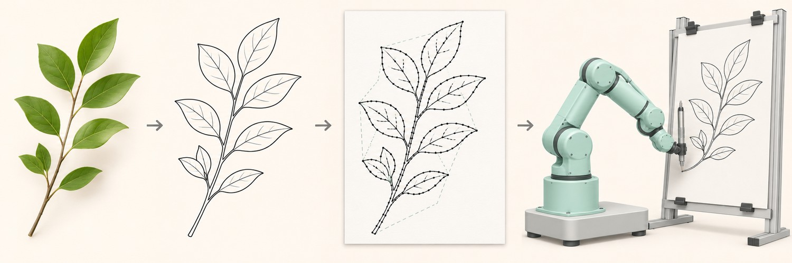

System flow diagram. The app extracts lines, lays out strokes on paper, then checks reach and joint limits. USB serial controls the arm. RViz is an optional 3D view.

> **The app's on-screen text is currently Korean only**, so the screenshots show a Korean UI. Design and technology choices are described in [docs/ARCHITECTURE.en.md](docs/ARCHITECTURE.en.md). Some deeper notes (work logs in `LOG/`, OpenCV study notes) are in Korean.

## Videos

### Robot drawing (2:08)

Real footage (1.5× speed) of the WLKATA Mirobot drawing a sketch with a 0.5 mm mechanical pencil, followed by the real drawings that show how the vertical marks at stroke ends were reduced. Narration and captions are in Korean.

https://github.com/user-attachments/assets/5a8c62d1-4544-4af9-aa52-beab30442bdd

### App demo (4:33)

A recording of the real app: open a photo → the 12 stages → photo, color illustration and black-and-white comic compared → change values → tone hatching → paper layout → editing by chat in the agent panel → joint simulation → checking the paper position with the webcam → virtual drawing without a robot → camera line check while drawing. Narration and captions are in Korean.

https://github.com/user-attachments/assets/d86eb715-7366-45a1-9d15-5b5d03f53f15

The original files are in [Releases: media-v1](https://github.com/yoobinkim541/OSS-2026-Mirobot-Photo-Sketch/releases/tag/media-v1). The narration was generated locally with Qwen3-TTS.

## Why

Copying a picture or a photo usually takes three steps.

| Step | What it is | In this project |
|---|---|---|
| 1. Sketch | lay down the shapes and proportions as an underdrawing | **drawn by the robot arm** |
| 2. Line art | draw clean lines over the underdrawing | a person |
| 3. Coloring | fill the shapes with color | a person |

People who are not used to drawing get stuck at the first step. Placing the eyes, nose and mouth, getting the proportions of the face and body and the tilt of the head right is hard without practice, and every mistake means erasing and starting over, so it also takes the most time. Line art and coloring, by contrast, only need an underdrawing to follow. So this project takes on the first step only.

- **A sketch from one image:** photos, color illustrations and black-and-white comics each go through their own process to become line paths ([Image types](#image-types-process-and-results)), and the robot arm draws them on A4 paper.
- **Drawn lightly:** a sketch is an underdrawing, so its lines are not pressed hard. The aim is that after you ink clean lines over it and color it, the underdrawing does not show through. Pressing the pen 1 mm less to reduce the vertical marks at stroke ends points the same way ([Real drawings](#real-drawings-fewer-vertical-marks-at-stroke-ends)).
- **An underdrawing you shape:** you check each stage, change values, and remove or restore strokes by chat until the underdrawing is what you want, then draw. Before the robot moves, a person checks the paper and its surroundings.

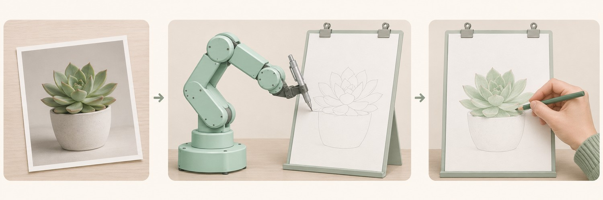

Workflow diagram. The arm draws a light sketch. A person inks and colors it.

## Contents

- [Videos](#videos)
- [Why](#why)
- [Features](#features)
- [Installation](#installation)
- [Why Ubuntu 22.04 + ROS 2 Humble](#why-ubuntu-2204--ros-2-humble)
- [Usage](#usage)
- [Agent panel](#agent-panel-editing-by-chat)
- [3D simulation](#3d-simulation-check-without-a-robot)
- [Image types: process and results](#image-types-process-and-results)
- [Real drawings: fewer vertical marks at stroke ends](#real-drawings-fewer-vertical-marks-at-stroke-ends)
- [Limits and next steps](#limits-and-next-steps)
- [Tech stack and design docs](#tech-stack-and-design-docs)
- [Development report](#development-report)
- [Delivery (CI/CD)](#delivery-cicd)
- [Upstream contributions](#upstream-contributions)
- [Tests · folders · license](#tests)

## Features

- **Photo → line paths:** recommended settings for photos / color illustrations / black-and-white manga, face-detection-based framing and detail, optional background removal, optional tone hatching
- **Stage-by-stage view:** select a stage from the strip and adjust its settings. The app recomputes from that stage onward
- **Draw with the robot:** a safety flow of pre-check → connect & home → start-position check → human final confirmation → drawing → done, plus a virtual simulation without a robot
- **3D simulation:** joint-limit checks; optionally RViz follows the robot's progress while it draws
- **Agent:** change settings and propose stroke edits through chat (it has no tool that moves the robot)

The sample images are a public-domain NASA photo, a Wikipe-tan illustration (CC BY-SA 3.0) and a 1902 comic (public domain) ([credits](THIRD_PARTY_NOTICES.md)).

## Installation

The app runs on 64-bit Windows 10/11. For physical drawing, prepare a WLKATA Mirobot, a USB (CH340) cable, A4 paper, and a pen. Line extraction, joint-limit checks, and virtual drawing work without a robot.

| Installation option | Getting started |
|---|---|
| Installer (.exe, recommended) | Download and run `MirobotSketch-Setup-X.Y.Z.exe` from [Releases](https://github.com/yoobinkim541/OSS-2026-Mirobot-Photo-Sketch/releases). The installer requires no separate Python installation. |
| ZIP | Extract `MirobotSketch-vX.Y.Z-windows-x64.zip` from the same release. Run `MirobotSketch.exe` for the GUI or `mirobot.exe` for the command line. |
| Developer install | Clone and install the repository with Python 3.10 or later using the commands below. |
| RViz 3D (optional) | Use Windows 11 with WSL2 or Ubuntu 22.04. In the app, choose **Advanced → Install or check the RViz 3D environment**. |

```bash
git clone https://github.com/yoobinkim541/OSS-2026-Mirobot-Photo-Sketch.git
cd OSS-2026-Mirobot-Photo-Sketch
pip install -e .
```

The [installation reference](docs/USAGE.en.md#installation) covers configuration paths, optional packages, SmartScreen, and manual RViz setup.

## Why Ubuntu 22.04 + ROS 2 Humble

This combination is for the RViz 3D environment and is **not needed to move the robot** (real control runs on Windows directly over USB serial with G-code).

- **ROS 2 Humble is the LTS release for Ubuntu 22.04 (jammy)**, so it installs straight from binary packages on 22.04. The setup script also refuses other releases.
- For the 3D view, `ros-base` + `rviz2` + `robot_state_publisher` + one WLKATA model package are enough — much smaller than a full desktop install.
- WLKATA's official ROS 2 repository is pinned to commit `c0a7ad4` and confirmed to build on this combination. Other combinations (e.g. Ubuntu 24.04 + Jazzy) were not verified.
- The same script runs in a GitHub Actions `ubuntu:22.04` container to produce the image that WSL imports, which is attached to each release.

For the full reasoning and the Windows ↔ WSL connection, see the [design doc](docs/ARCHITECTURE.en.md#6-why-ubuntu-2204--ros-2-humble).

## Usage

Open **Mirobot Sketch** on Windows. In a development environment, run `mirobot-sketch` or `python CV/gui_sketch.py`. The screenshots use the public sample illustration. [Sample credits](THIRD_PARTY_NOTICES.md)

### 1. Open an image

Choose **Open image** (**이미지 열기**) in the center of the welcome screen.


### 2. Choose the image type and detail level

In the first panel on the left (**01 사진과 추천 설정**), select **Photo**, **Color illustration**, or **Black-and-white comic**. Choose **Low**, **Medium**, or **High** detail. The app applies the recommended settings.

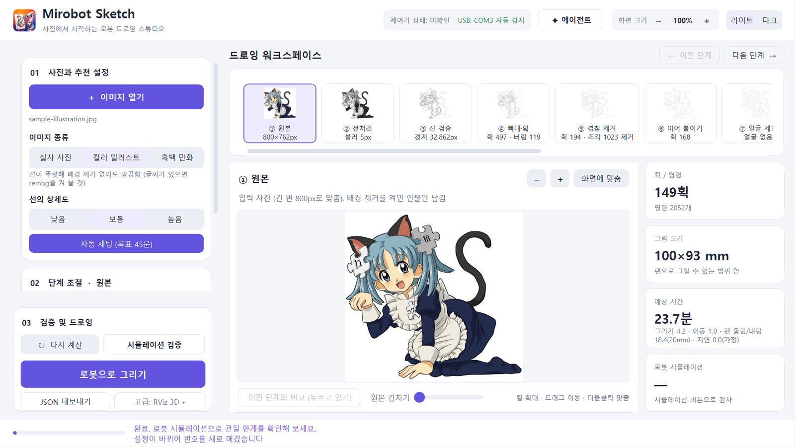

### 3. Review the stages and adjust settings

Select a stage such as **Edges** (**선 검출**) to switch the large preview and the controls on the left. Changing a value recomputes the result from that stage onward. To add shading, raise the tone level in **Tone hatching** (**명암 빗금**).


<details>
<summary>View the result with tone hatching set to 2</summary>


</details>

### 4. Check the paper layout and estimated time

In **Order & paper** (**순서·종이**), review the A4 layout, drawing size, stroke count, and estimated time. Run **Verify simulation** (**시뮬레이션 검증**) to check joint limits. The screenshot below keeps the edge-detection change from step 3, so its numbers differ slightly from the [image-type results](#image-types-process-and-results) with recommended settings (159 strokes, 25.2 min).


### 5. Draw with the robot

In the **Draw with robot** (**로봇으로 그리기**) window, choose a connection mode (robot or virtual simulation) and click **Start connection** (**연결 시작**). The app runs the preflight check, connection and homing, start position check, and final confirmation. For a physical drawing, tick the box confirming that the pen tip touches the center of the paper and the surroundings are clear, then click **Start** (**시작**). Virtual simulation lets you rehearse the same sequence without a robot.

With a webcam connected, the right side of the window overlays the planned drawing and pen range on the real paper so you can check that the paper is registered correctly. During a physical drawing, every 8 seconds it checks whether the finished strokes left a line, marking seen strokes green and missing ones red (not measured in virtual simulation).

<p>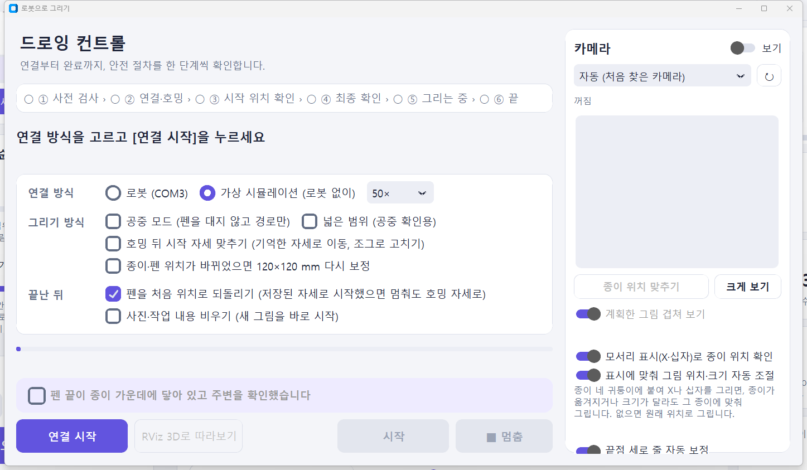</p>

<details>
<summary>Virtual drawing in progress</summary>

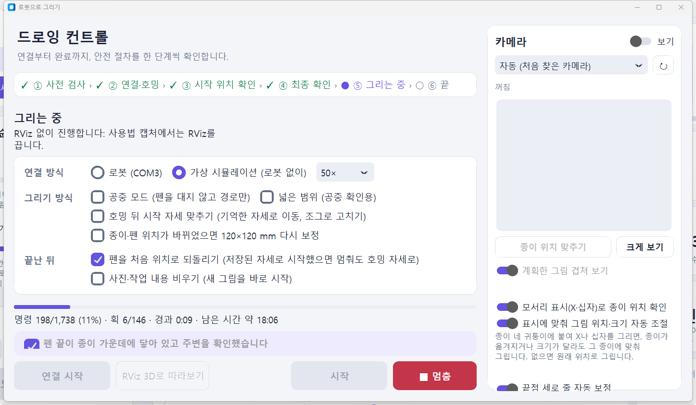

</details>

The camera, paper registration, automatic correction, pen settings, command line and SVG are covered in the [usage reference](docs/USAGE.en.md#usage).

## Agent panel (editing by chat)

<p align="center"></p>

The **✦ Agent** button at the top right of the GUI opens a chat panel. Say things like "too many strokes, finish within 15 minutes", "remove background noise" or "keep the hair outline more", and the agent looks at the original and the stage results itself, then changes settings or **proposes** edits. Proposals appear in the edit stage in red/green with numbers, and you can instruct by number, e.g. "apply without number 5". Changes are reflected in the left-hand settings and the preview immediately.

| Backend | Preparation |
|---|---|
| **Claude Code** | Install Claude Code and log in with `claude`. The app runs `claude -p` and connects the app's tools as an MCP server. |
| **Codex** | Install the Codex CLI and log in. The app runs `codex exec`. |
| **OpenRouter** | Enter the API key in the panel's ⚙ settings (stored in the Windows Credential Manager). The default model is `anthropic/claude-opus-5`, and you can choose among models that support tool calls and images. |

The tools the agent uses are: view state, view images (original / stage results / edit / paper), change settings, list strokes, view point coordinates, compare photo and drawing (`compare`: original | drawing | difference image with tone-similarity and outline-reproduction metrics), propose edits (delete, keep, move point, delete point, insert point, smooth, cut, join, draw short line), apply/discard proposals, undo, simulate, and the **robot readiness check (`robot_guide`)**. `robot_guide` is read-only: it tells you whether this drawing is inside the range the pen can draw, whether the simulation passed, whether paper calibration exists, and the order a person follows in the "Draw with robot" window. **There is no tool that moves, connects or starts the robot.** A person must confirm and start real drawing in the app's "Draw with robot" window (when handing over to the command-line executor, export the JSON and type `yes`), and while drawing the agent can only read, not change settings or edits.

To use the agent in a development environment, install the needed packages (mcp, keyring, requests) with `pip install -e ".[agent]"`.

## 3D simulation (check without a robot)

It solves Mirobot kinematics (IK) along the same path as the executor and checks whether joint limits (soft limits) are exceeded.

```bash
mirobot-sim out/photo.json --plot out/joints.png --gif out/sim.gif
mirobot-sim --reach-map out/reach_map.png
```

With the RViz 3D environment installed, `Advanced` → [View in RViz 3D] in the GUI plays the trajectory on the robot-arm model, and while drawing it follows the command replies. Install it by following the [RViz setup guide](docs/USAGE.en.md#rviz-3d-environment-optional-wsl2--ros-2-humble--mirobot-model).

## Image types: process and results

Choosing the image type under "01 사진과 추천 설정" (`--type` on the command line) changes the stage settings. A photo has no drawn lines, so lines are made from it; an illustration or a comic already has lines, so they are followed. The figures below run three sample images with each type's recommended settings unchanged. Only the stages that change most for that type are shown, and the numbers under them are the summaries from the app's stage strip. The drawing size is 100 mm on the long side (regenerate with `assets/make_pipeline_figures.py`).

| | Photo (`photo`) | Color illustration (`illustration`) | Black-and-white comic (`manga`) |
|---|---|---|---|
| Background | removed with rembg | kept | kept |
| Preprocessing | 5 px blur | 5 px blur | 11 px median to remove screentone, then 5 px blur |
| Making lines | a line-drawing model turns the photo into line art, and its lines are followed | brightness edges (Canny) | brightness edges (Canny) |
| Face | the face is traced again at full resolution, and face landmarks redraw the eyes, brows and mouth | the face detector (YuNet) is trained on real faces and found none in this sample | same |
| Other | clutter cleanup (193 removed), hair-flow lines (8 strokes) | clutter cleanup only runs with the line-drawing model, so it is off | same |
| Result | 189 strokes · 56×100 mm · est. 27.7 min | 159 strokes · 100×93 mm · est. 25.2 min | 344 strokes · 100×99 mm · est. 51.2 min |

### Photo

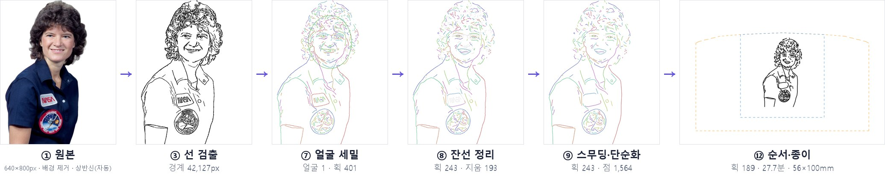

Tracing a photo's brightness edges directly turns skin texture and shadows into lines. So after the background is removed, a line-drawing model (Informative Drawings) turns the photo into line art and its lines are followed (③). When a face is found, the face is traced again at full resolution (⑦). Clutter cleanup (⑧) removes wrinkles and short faint lines on skin while keeping the eyes, nose, mouth and outline, and for a frontal face this stage also redraws the eyes, brows and closed mouth from 478 face landmarks. Here it removed 193, leaving 243 strokes; joining nearby strokes gives 189.

### Color illustration


An illustration already has clear outlines, so without background removal or the line-drawing model it is converted to grayscale and lightly blurred (②), then brightness edges are found (③). The edges are thinned to a one-pixel skeleton and turned into strokes (④, 610 strokes); merging double lines closer than the pen width, joining broken lines and smoothing leaves 180, and joining nearby strokes gives 159. If two areas of different color have similar brightness and the edge is missed, switch the edge mode to "색 차이" (color difference).

### Black-and-white comic


In a printed comic, every dot of screentone or print noise would become a short stroke. So a median blur (11 px at 800 px) removes small patterns before lines are found (②). The rest is the same as for an illustration. Panel borders and lettering are lines too and get drawn; to leave them out, ask the agent to remove them in the edit stage. This sample is a 1902 print with a lot of noise, so it has the most strokes of the three (344).

## Real drawings: fewer vertical marks at stroke ends

### Physical setup and calibration

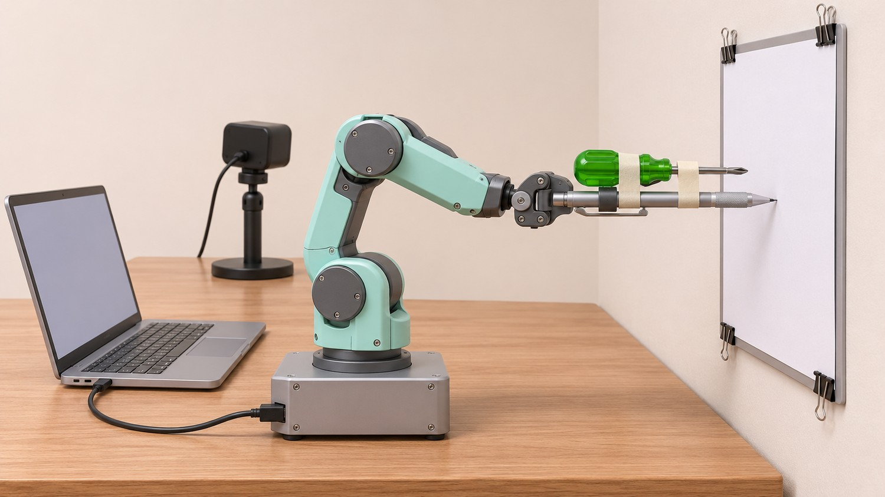

Hardware diagram. The green-handled screwdriver acts as a weight to reduce pencil tip vibration.

| Problem | What we tried |
|---|---|
| The pencil tip shook in the holder and left wobbly lines. | We taped a green-handled screwdriver above the mechanical pencil to add weight. |
| The arm had no way to measure depth or pressure, and struggled to leave a line against a rigid wall. | We placed a thin, flexible backing behind the paper so it could give under pressure. |
| Pressing too far pushed the backing in and left vertical marks as the pencil lifted. The paper surface also varied in depth. | We used WLKATA Studio to set the starting pose and initial pencil contact position. The app photographed horizontal and vertical test lines with a Logitech BRIO, and the agent reviewed the photos and adjusted the paths and settings over repeated trials. |

[Cross test](LOG/2026-11-12-j6-direction.md) · [Paper tilt and plane calibration](LOG/2026-11-12-j6-direction.md) · [Automatic correction for vertical marks](LOG/2026-11-18-land-from-above.md) · [Press depth test](LOG/2026-11-19-depth-ladder.md) (Korean)

### Stroke-end comparison

Every time the pen touched down or lifted, it left a 2–3 mm vertical mark at the stroke end. At first these marks made the whole drawing look like a comb. Below are phone photos of paper the robot drew on. All four had uneven lighting flattened and contrast raised by the same rule. Small thumbnails of the source photos are included so you can judge the likeness ([sources](#sources-of-the-real-drawing-originals)).

<table>
<tr>
<td align="center"><br>Source for ①–③</td>
<td align="center"><br>Source for ④</td>
</tr>
<tr>
<td>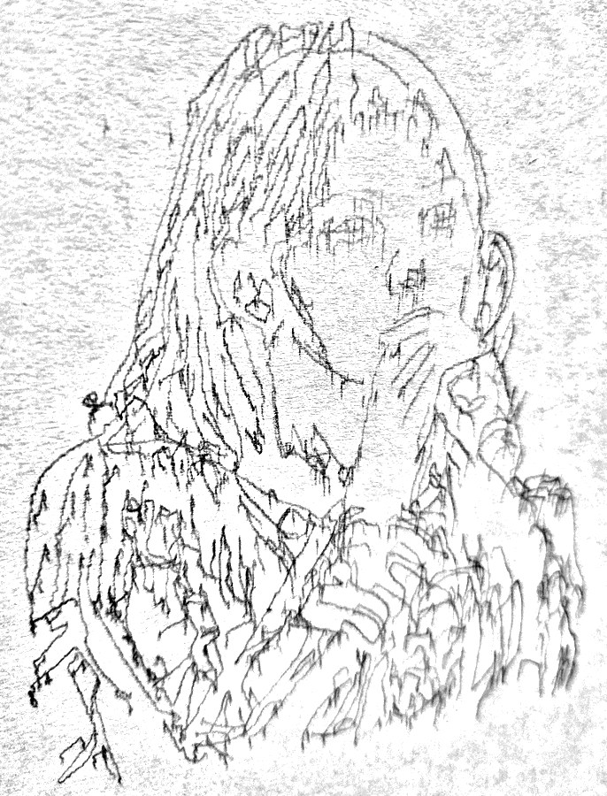</td>
<td>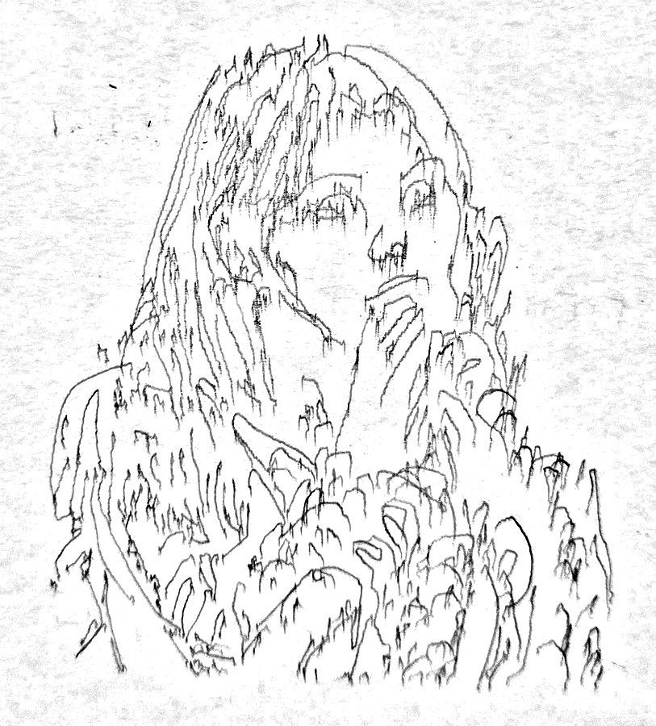</td>
</tr>
<tr>
<td align="center">① 11-16 22:41 · 489 strokes</td>
<td align="center">② 11-18 15:53 · 488 strokes (same source as ①)</td>
</tr>
<tr>
<td></td>
<td>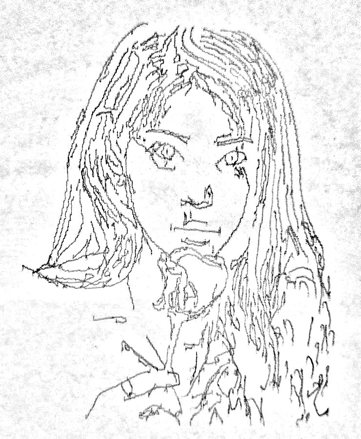</td>
</tr>
<tr>
<td align="center">③ 11-18 20:44 · 424 strokes (same source as ①)</td>
<td align="center">④ 11-24 20:44 · 372 strokes (different source)</td>
</tr>
</table>

| Drawing | Slanted lift (`edge_rise_mm`) | Touch-down (`edge_land_mm`) | Press (`down_extra_mm`) | Result |
|---|---|---|---|---|
| ① 11-16 22:41 | 1.0 | 0 | −0.4 | The whole drawing was covered in marks hanging downward. The eyes looked like combs: a horizontal line with vertical lines under it. |
| ② 11-18 15:53 | 1.5 | −2 → −1.0 (adjusted while drawing, −1.0 from stroke 121) | −0.4 | Marks over 1.8 mm at 25% of start points and 24% of end points (camera, out of 485 strokes with a visible line). |
| ③ 11-18 20:44 | 1.5 → 1.75 (from stroke 51) | −2 → −0.75 (fixed from stroke 204) | −0.4 | Only end-point marks dropped, to 18%; start points stayed at 24% (out of 398 visible strokes). The photo looks much like ②. |
| 11-19 15:14 (same source and strokes as ③) | 1.75 | −0.75 | **−1.4** | Compared with ③, start-point marks fell from 96 to 52 and end-point marks from 71 to 44 (23% → 12% and 17% → 10% of 424 planned strokes). The user also confirmed it on the paper. |
| ④ 11-24 20:44 | 0.75 → 1.25 → 1.75 (adjusted while drawing) | −1.25 | −1.4 | In the phone photo, hanging marks in the hair, face and clothes are barely visible (no camera numbers). The source photo differs, so no numbers are compared. |

- **What did not help:** lifting at a slant and touching down from above left the start-point marks unchanged (② → ③). Test sheets also showed that touch-down speed (50–400 mm/min) has no effect on mark length.
- **What helped:** pressing the whole line 1 mm less (`down_extra_mm` −0.4 → −1.4). The likely cause is that the pen tip is pushed up as pressure builds and drops back as it lifts, leaving the mark (inference).
- **Cost:** lighter pressure means fainter lines. Strokes the app's line check counted as missing rose from 23 to 44, but looking at the paper the user found the lines only lighter, none missing; the camera likely picks up faint lines less (inference). That suits an underdrawing.

Measurement details are in [LOG/2026-11-16](LOG/2026-11-16-end-ticks-edge-rise.md), [11-18](LOG/2026-11-18-land-from-above.md) and [11-19](LOG/2026-11-19-depth-ladder.md) (Korean).

### Portrait of the professor

<table>
<tr>
<td align="center"><br>Source (with consent)</td>
<td align="center">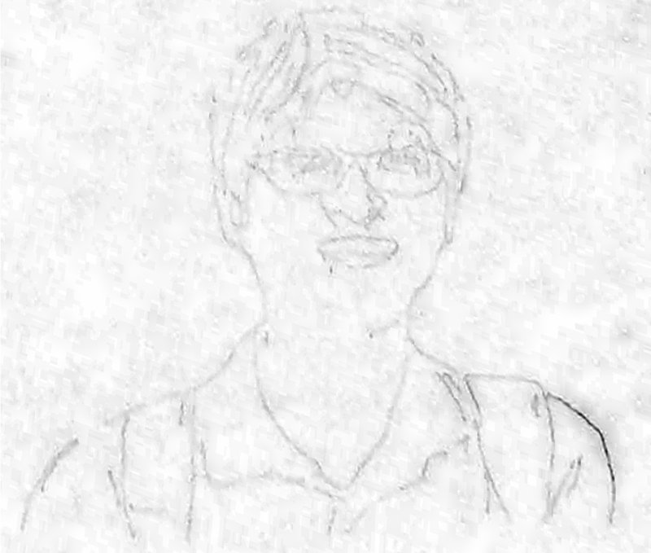<br>11-19 16:38 · 109 strokes · 14.5 min (pressing 1 mm less)</td>
</tr>
</table>

Drawn with the 1 mm lighter press. The app's line check counted 24 of 109 strokes as missing, but none were missing on the paper.

### Physical drawing of an anime scene

<table>
<tr>
<td align="center"><br>Source</td>
<td align="center"><br>Real drawing</td>
</tr>
</table>

Likely the September 30 run (inferred, 205 strokes), based on the line shapes from two runs of the same scene. [September 30 run](LOG/runs/run-20260930-211640.json) · [November 3 run](LOG/runs/run-20261103-194436.json)

#### Sources of the real-drawing originals

The source thumbnails are quoted at a small size (200 px on the long side) only to compare the robot drawings with their originals. Copyright stays with each rights holder, and any of them will be removed on request.

- ①–③: a stage photo published online (photographer unknown).
- ④: a photo of the singer IU published online (photographer unknown).
- Portrait of the professor: included with the professor's consent.
- Anime: a scene from *SPY×FAMILY* (© Tatsuya Endo/Shueisha, SPY×FAMILY Project).

## Limits and next steps

- **Clearer lines:** pressing 1 mm less reduced vertical marks and made the pencil lines lighter. The next challenge is to make faint lines more visible while keeping the marks down.
- **More lifelike sketches:** test line placement and hatching that carry more of the photo’s tone and texture.
- **Learning in simulation:** paths are now sent with inverse kinematics (IK) and G-code. A digital twin in Isaac Sim could model backing deflection and pencil contact, and Isaac Lab could train a policy with reinforcement or imitation learning for transfer to the physical arm (sim-to-real). This lets the policy train across varied contact conditions, with extra work to match the simulator to the physical setup and verify the learned motions. [Isaac Lab documentation](https://docs.nvidia.com/isaaclab/isaac-lab)
- **Comparison with ROS 2 MoveIt 2:** MoveIt 2 can plan paths and check joint constraints and collisions. It would need integration with the current USB serial executor, and adapting to pen pressure would require separate contact control or learning. [MoveIt documentation](https://moveit.ai/documentation/concepts/)

## Tech stack and design docs

| Area | Used |
|---|---|
| Image processing | [OpenCV](https://opencv.org/) (Canny, median, morphology, `approxPolyDP`, YuNet face detection), [scikit-image](https://scikit-image.org/) (`skeletonize`), [NumPy](https://numpy.org/), [SciPy](https://scipy.org/) |
| Background removal | [rembg](https://github.com/danielgatis/rembg) (optional) |
| UI | [CustomTkinter](https://github.com/TomSchimansky/CustomTkinter) |
| Robot communication | [pyserial](https://github.com/pyserial/pyserial) — USB serial G-code |
| 3D visualization | [ROS 2 Humble](https://docs.ros.org/en/humble/) + [RViz](https://github.com/ros2/rviz) + WLKATA's official URDF (WSL2 Ubuntu 22.04) |
| Agent | [MCP](https://modelcontextprotocol.io/), Claude Code / Codex CLI / OpenRouter |
| Packaging and delivery | [PyInstaller](https://pyinstaller.org/), [Inno Setup](https://jrsoftware.org/isinfo.php), GitHub Actions |

What was chosen for each stage and why, the OpenCV functions used, the Windows ↔ WSL2 bridge design and the packaging are in **[docs/ARCHITECTURE.en.md](docs/ARCHITECTURE.en.md)**.

## Development report

A report (in Korean) of the implementation and real-robot tests from September 24 to November 26, 2026, written as a narrative of why each step was taken and what it gained and cost: starting from grayscale, edges and centerlines, the layers added for photos, physical problems such as the pencil, backing board and camera calibration, and the limits and next steps (line clarity, lifelike rendering, Isaac Sim learning, MoveIt 2).

| Version | Length | Files |
|---|---|---|
| Brief | 15 pages, 11 figures, 2 tables | [PDF](docs/reports/Mirobot_Sketch_report_brief.pdf) · [DOCX](docs/reports/Mirobot_Sketch_report_brief.docx) |
| Full | 25 pages, 14 figures, 5 tables, with contents | [PDF](docs/reports/Mirobot_Sketch_report_full.pdf) · [DOCX](docs/reports/Mirobot_Sketch_report_full.docx) |

Main results:

- **Drawings 1.37 times too wide:** cross, free-air and one-joint-at-a-time tests showed that the J6 motor turns opposite to the firmware model. Fixing the controller settings (`$3`, `$23`) brought the horizontal spacing back from 123.2 mm to 89.0 mm for a planned 90 mm.
- **Paper tilt and height-dependent scale:** a depth ladder fitted the paper plane (about 6 mm between lower left and upper right), and a quadratic pre-warp fitted to 20 measured points brought the row-spacing error from 9 mm to within 1.2 mm.
- **Vertical marks at stroke ends:** four test sheets (slanted lift, touch-down from above, touch-down speed, press depth) showed that speed does not matter while press depth and lift direction do. Redrawing the same picture with the slant values unchanged but pressing 1 mm less clearly reduced the marks (start-point marks 23% → 12% by camera); the slanted lift only helped end-point marks.
- **Conditions for automatic correction:** decisions made from 10–24 endpoints flipped between drawings, so changes now need at least 30 endpoints, a sign test, and lock at the midpoint when they reverse.

The report contains portrait photos and the drawings made from them, used to compare the real results.

## Delivery (CI/CD)

- **CI** (`.github/workflows/ci.yml`): on every push to main and every PR, runs tests and the command-line tools on Windows/Ubuntu × Python 3.11/3.13.
- **CD** (`.github/workflows/release.yml`): pushing a `v*` tag builds the Windows .exe, checks it works using the built exe, then uploads a zip and an installer to GitHub Releases. The same release also gets the RViz 3D environment image (a WSL root file built by the setup script in an `ubuntu:22.04` container, with ROS and the model verified, plus its SHA256).
- **Dependabot** (`.github/dependabot.yml`): opens weekly PRs for updates to Actions and dependencies.

Releasing a new version:

```bash
git tag -a v0.3.0 -m "..." && git push origin v0.3.0
```

Also bump `__version__` in `mirobot_sketch/__init__.py`.

## Upstream contributions

This project uses the URDF and meshes from [WLKATA's official ROS 2 repository](https://github.com/wlkata/Wlkata_Mirobot_Ros2), which fails to build on a fresh clone. I traced the causes and sent the fixes upstream as pull requests. Each PR shows a before/after comparison run in a `ros:humble` container.

| PR | Problem | Fix |
|---|---|---|
| [#2](https://github.com/wlkata/Wlkata_Mirobot_Ros2/pull/2) | `wlkata_mirobot_description` tries to install a `textures/` directory that is not in the repository, so the build fails (the error in [issue #1](https://github.com/wlkata/Wlkata_Mirobot_Ros2/issues/1)). | Removed the unused install rule (all meshes are STL). |
| [#3](https://github.com/wlkata/Wlkata_Mirobot_Ros2/pull/3) | `wlkata_mirobot_moveit_config` tries to install a `.setup_assistant` that is not in the repository, so the build fails. Without this file, MoveIt Setup Assistant also cannot reopen the package. | Added `.setup_assistant` based on the package's URDF, SRDF, and ros2_control config. |
| [#4](https://github.com/wlkata/Wlkata_Mirobot_Ros2/pull/4) | `wlkatapython.py` is missing from the sources and exists only in the committed `build/`, so `pip install .` installs old build copies instead of the current sources. | Added the module file, removed `build/`, `egg-info`, and `.pyc` files, and added a `.gitignore`. |

Until these PRs are merged, this project's setup script ([`packaging/wsl/setup_ros_env.sh`](packaging/wsl/setup_ros_env.sh)) pins commit `c0a7ad4` and creates an empty `textures/` directory before building. This project builds only `wlkata_mirobot_description`, so the problems fixed by upstream PRs #3 and #4 do not affect it.

## Tests

```bash
python -m unittest discover -s tests -v
```

## Folders

| Path | Content |
|---|---|
| `mirobot_sketch/` | Python package: CV pipeline, paper coordinates, executor, simulator, GUI (`data/` holds default config, icon, face model) |
| `mirobot_sketch/agent/` | Agent: tool definitions, chat backends (OpenRouter / Claude Code / Codex), MCP server, local bridge, chat panel |
| `CV/` | Repository entry files (`gui_sketch.py`, `make_strokes.py`); `experiments/` holds learning-stage scripts |
| `robot/` | Robot config (`drawing_config.json`), repository executor entry point, early serial/gripper/pump test code |
| `sim/` | Repository simulator entry point, RViz playback (WSL2 ROS 2) |
| `packaging/` | PyInstaller build config, installer (Inno Setup), WSL ROS-environment setup script (`wsl/`) |
| `.github/workflows/` | CI (tests), Release (builds the .exe and image on tag push) |
| `assets/` | App icon, README screenshots and the sample images |
| `trajectories/` | Shape templates and test paths |
| `docs/` | Design doc ([ARCHITECTURE](docs/ARCHITECTURE.en.md)), usage reference ([USAGE](docs/USAGE.en.md)), development reports (`docs/reports/`), OpenCV study notes |
| `LOG/` | Dated work logs and run records (Korean) |
| `tests/` | Regression tests |

## Environment notes

- Real control uses pyserial on Windows. A CH340 port passed through to WSL2 by USB passthrough does not return responses.
- Opening a serial port anew resets the board. While running, make sure no other program opens the same port.
- ROS 2 Humble (WSL2) is used only for the RViz 3D view. ROS is not used for robot control.

## License

[MIT](LICENSE). The origin and license of the bundled third-party files (the YuNet model and the sample images) are in [THIRD_PARTY_NOTICES.md](THIRD_PARTY_NOTICES.md).

Started as a term project for Open Source Programming (2026-2).
