# Mirobot Photo Sketch


[](https://github.com/yoobinkim541/OSS-2026-Mirobot-Photo-Sketch/actions/workflows/ci.yml)
[](https://github.com/yoobinkim541/OSS-2026-Mirobot-Photo-Sketch/releases)
[](LICENSE)

그림을 보고 따라 그릴 때 가장 어렵고 오래 걸리는 첫 단계, **스케치를 로봇팔이 대신 그려 주는** 오픈소스 프로젝트입니다. 사진이나 그림을 넣으면 OpenCV로 선 경로를 만들고, [WLKATA Mirobot](https://www.wlkata.com/) 로봇팔이 벽에 붙인 A4 용지에 0.5 mm 샤프로 연하게 그립니다. 로봇이 없어도 선 추출, 3D 시뮬레이션, 가상 시뮬레이션을 모두 써 볼 수 있습니다.

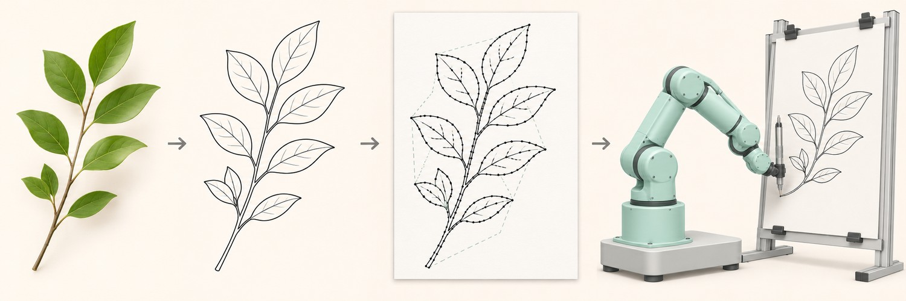

시스템 흐름 개념도. 사진에서 선을 뽑고 종이 위 획 경로를 만든 뒤, 도달 범위와 관절 한계를 검사합니다. 실물은 USB 시리얼로 제어하고, 선택 기능인 RViz는 움직임을 화면에 표시합니다.

> 앱의 화면 문구는 현재 **한국어만** 지원합니다. 설계와 기술 선택은 [docs/ARCHITECTURE.md](docs/ARCHITECTURE.md)에 정리했습니다.

## 영상

### 실물 시연 (2:08)

WLKATA Mirobot이 0.5 mm 샤프로 스케치를 그리는 실제 촬영(1.5배속)과, 획 끝 세로 자국을 줄여 온 실물 사진입니다.

https://github.com/user-attachments/assets/5a8c62d1-4544-4af9-aa52-beab30442bdd

### 앱 데모 (4:33)

실제 앱 화면입니다. 사진 열기 → 12단계 → 실사 사진·컬러 일러스트·흑백 만화 비교 → 값 조절 → 명암 빗금 → 종이 배치 → 에이전트 패널로 대화하며 편집 → 관절 시뮬레이션 → 웹캠으로 종이 위치 확인 → 로봇 없는 가상 그리기 → 그리는 동안 카메라 선 확인 순서입니다.

https://github.com/user-attachments/assets/d86eb715-7366-45a1-9d15-5b5d03f53f15

원본 파일은 [Releases의 media-v1](https://github.com/yoobinkim541/OSS-2026-Mirobot-Photo-Sketch/releases/tag/media-v1)에서 받을 수 있습니다. 내레이션은 로컬 Qwen3-TTS로 만들었습니다.

## 왜 만들었나

그림이나 사진을 보고 따라 그릴 때는 보통 세 단계를 거칩니다.

| 단계 | 하는 일 | 이 프로젝트에서 |
|---|---|---|
| 1. 스케치 | 형태와 비율을 잡아 밑그림을 그림 | **로봇팔이 대신 그림** |
| 2. 선 따기 | 밑그림 위에 깨끗한 선을 다시 그음 | 사람 |
| 3. 채색 | 선 안을 칠함 | 사람 |

그림이 서툰 사람이 가장 막히는 곳은 첫 단계입니다. 눈·코·입의 자리, 얼굴과 몸의 비율, 고개의 기울기를 맞추는 일은 연습 없이는 어렵습니다. 맞지 않으면 지우고 다시 그려야 해서 시간도 가장 많이 듭니다. 반면 선 따기와 채색은 밑그림만 있으면 그 선을 따라가면 됩니다. 그래서 이 프로젝트는 첫 단계만 맡습니다.

- **사진 한 장으로 스케치:** 실사 사진, 컬러 일러스트, 흑백 만화를 각각에 맞는 과정으로 선 경로로 바꾸고([이미지 종류별 과정과 결과](#이미지-종류별-과정과-결과)), 로봇팔이 A4 용지에 그립니다.
- **연하게 그리기:** 스케치는 밑그림이라 선을 진하게 긋지 않습니다. 그 위에 펜으로 선을 또렷하게 따고 채색해도 밑그림이 드러나지 않게 하려는 것입니다. 펜을 1 mm 덜 누르게 바꿔 획 끝 세로 자국을 줄인 것도 같은 방향입니다([실물 그림](#실물-그림-획-끝-세로-자국-줄이기)).
- **사람이 다듬는 밑그림:** 단계마다 결과를 보며 값을 바꾸고, 대화로 획을 지우거나 살려 원하는 밑그림을 만든 뒤에 그립니다. 로봇을 움직이기 전에는 사람이 종이와 주변을 확인합니다.

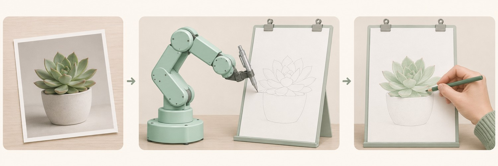

작업 흐름 개념도. 로봇팔이 연한 밑그림을 그리면 사람이 선을 따고 채색합니다.

## 목차

- [영상](#영상)
- [왜 만들었나](#왜-만들었나)
- [주요 기능](#주요-기능)
- [설치](#설치)
- [왜 Ubuntu 22.04 + ROS 2 Humble인가](#왜-ubuntu-2204--ros-2-humble인가)
- [사용법](#사용법)
- [에이전트 패널](#에이전트-패널-대화로-편집)
- [3D 시뮬레이션](#3d-시뮬레이션-로봇-없이-확인)
- [이미지 종류별 과정과 결과](#이미지-종류별-과정과-결과)
- [실물 그림: 획 끝 세로 자국 줄이기](#실물-그림-획-끝-세로-자국-줄이기)
- [한계와 다음 단계](#한계와-다음-단계)
- [기술 스택과 설계 문서](#기술-스택과-설계-문서)
- [개발 보고서](#개발-보고서)
- [배포 (CI/CD)](#배포-cicd)
- [업스트림 기여](#업스트림-기여)
- [테스트 · 폴더 · 라이선스](#테스트)

## 주요 기능

- **사진 → 선 경로:** 실사 사진 / 컬러 일러스트 / 흑백 만화별 추천 설정, 얼굴 인식 기반 구도·세밀 처리, 배경 제거(선택), 명암 빗금(선택)
- **단계별 화면:** 단계 띠에서 값을 바꾸면 바뀐 단계부터 자동으로 다시 계산
- **로봇으로 그리기:** 사전 검사 → 연결·호밍 → 시작 위치 확인 → 사람의 최종 확인 → 그리는 중 → 끝의 안전 절차, 로봇 없는 가상 시뮬레이션
- **3D 시뮬레이션:** 관절 한계 검사, 그리는 동안 RViz가 로봇 진행을 따라감 (선택)
- **에이전트:** 대화로 설정 변경·획 편집 제안 (로봇을 움직이는 도구는 없음)

예시 이미지는 NASA 공개 도메인 사진, Wikipe-tan 일러스트(CC BY-SA 3.0), 1902년 만화(공개 도메인)입니다([출처](THIRD_PARTY_NOTICES.md)).

## 설치

앱은 64비트 Windows 10/11에서 실행합니다. 실물로 그리려면 WLKATA Mirobot, USB(CH340) 케이블, A4 용지와 펜을 준비합니다. 로봇 없이도 선 추출, 관절 검사, 가상 그리기를 사용할 수 있습니다.

| 설치 방법 | 시작하기 |
|---|---|
| 설치 프로그램 (.exe, 추천) | [Releases](https://github.com/yoobinkim541/OSS-2026-Mirobot-Photo-Sketch/releases)에서 `MirobotSketch-Setup-X.Y.Z.exe`를 받아 실행합니다. 파이썬 설치 없이 사용할 수 있습니다. |
| ZIP | 같은 릴리스에서 `MirobotSketch-vX.Y.Z-windows-x64.zip`을 풀고 GUI는 `MirobotSketch.exe`, 명령줄은 `mirobot.exe`로 실행합니다. |
| 개발자 설치 | Python 3.10 이상 환경에서 저장소를 받은 뒤 아래 명령을 실행합니다. |
| RViz 3D (선택) | Windows 11 + WSL2 또는 Ubuntu 22.04가 필요합니다. 앱에서 **고급 → RViz 3D 환경 설치·확인…**을 엽니다. |

```bash
git clone https://github.com/yoobinkim541/OSS-2026-Mirobot-Photo-Sketch.git
cd OSS-2026-Mirobot-Photo-Sketch
pip install -e .
```

[설치 세부 절차](docs/USAGE.md#설치)에서 설정 파일 위치, 추가 패키지, SmartScreen, RViz 수동 설치를 확인할 수 있습니다.

## 왜 Ubuntu 22.04 + ROS 2 Humble인가

RViz 3D 환경을 위한 조합이며, **로봇을 움직이는 데는 필요 없습니다**(실물 제어는 Windows에서 USB 시리얼 G-code로 직접 합니다).

- **ROS 2 Humble은 Ubuntu 22.04(jammy)용 LTS 배포판**이라 22.04에서 바이너리 패키지로 바로 설치됩니다. 설치 스크립트도 jammy가 아니면 거부합니다.
- 3D 보기에는 `ros-base` + `rviz2` + `robot_state_publisher` + WLKATA 모델 패키지 하나면 충분해 전체 데스크톱 설치보다 훨씬 작습니다.
- WLKATA 공식 ROS 2 저장소를 커밋 `c0a7ad4`에 고정해 이 조합에서 빌드되는 것을 확인했습니다. 다른 조합(예: Ubuntu 24.04 + Jazzy)은 확인하지 않았습니다.
- 같은 스크립트를 GitHub Actions의 `ubuntu:22.04` 컨테이너에서 돌려 WSL로 가져올 수 있는 이미지를 릴리스에 올립니다.

자세한 이유와 Windows ↔ WSL 연결 방식은 [설계 문서](docs/ARCHITECTURE.md#6-왜-ubuntu-2204--ros-2-humble인가)를 보세요.

## 사용법

Windows 앱 **Mirobot Sketch**를 엽니다. 개발 환경에서는 `mirobot-sketch` 또는 `python CV/gui_sketch.py`로 실행합니다. 아래 화면은 공개 예시 일러스트로 캡처했습니다. [예시 출처](THIRD_PARTY_NOTICES.md)

### 1. 사진 열기

첫 화면 중앙의 **이미지 열기**를 눌러 작업할 파일을 선택합니다.

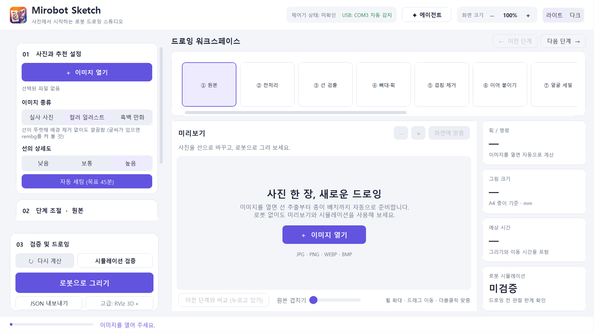

### 2. 종류와 상세도 고르기

왼쪽 **01 사진과 추천 설정**에서 **실사 사진**, **컬러 일러스트**, **흑백 만화** 중 하나를 고릅니다. 상세도는 **낮음**, **보통**, **높음** 중에서 선택합니다. 앱이 추천 설정을 적용합니다.

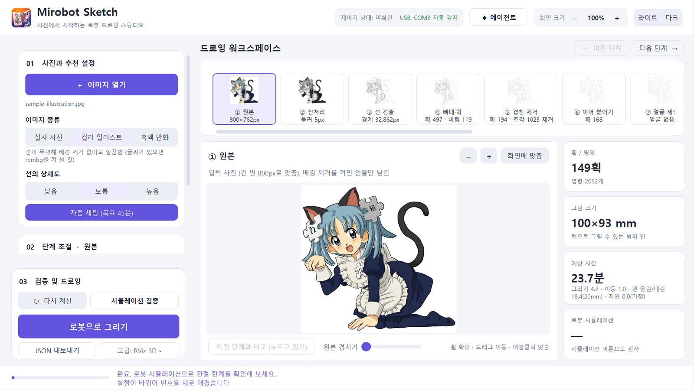

### 3. 단계 보며 조절하기

단계 띠에서 **선 검출** 등을 고르면 큰 보기와 왼쪽 조절 칸이 해당 단계로 바뀝니다. 값을 바꾸면 해당 단계부터 다시 계산합니다. 명암을 더하려면 **명암 빗금** 단계에서 명암 단계를 올립니다.

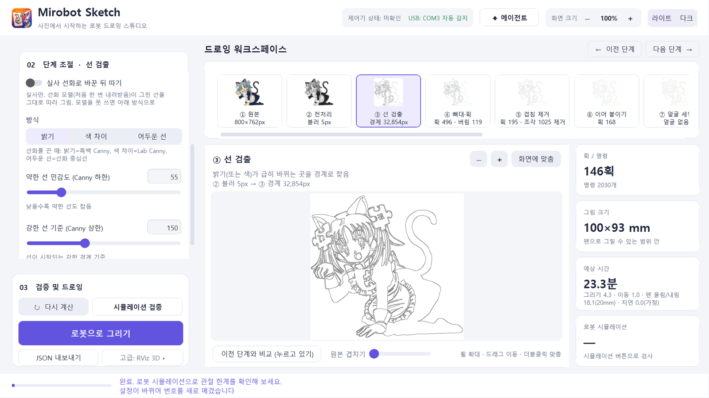

<details>
<summary>명암 빗금 2단계 적용 화면</summary>

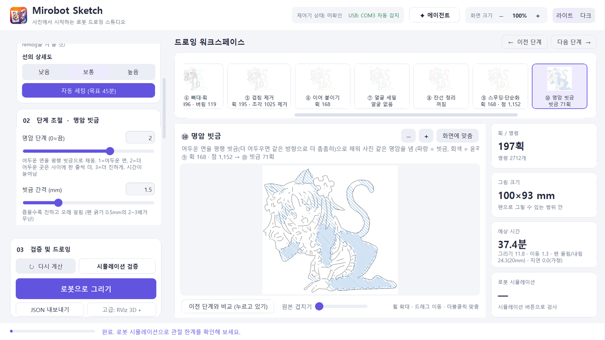

</details>

### 4. 종이 배치와 시간 확인하기

**순서·종이**에서 A4 용지의 배치와 크기, 획 수, 예상 시간을 확인합니다. **시뮬레이션 검증**을 눌러 관절 한계 검사 결과를 봅니다. 아래 화면은 3단계에서 선 검출 값을 바꾼 상태라, 추천 설정 그대로 돌린 [이미지 종류별 결과](#이미지-종류별-과정과-결과)(159획, 25.2분)와 숫자가 조금 다릅니다.

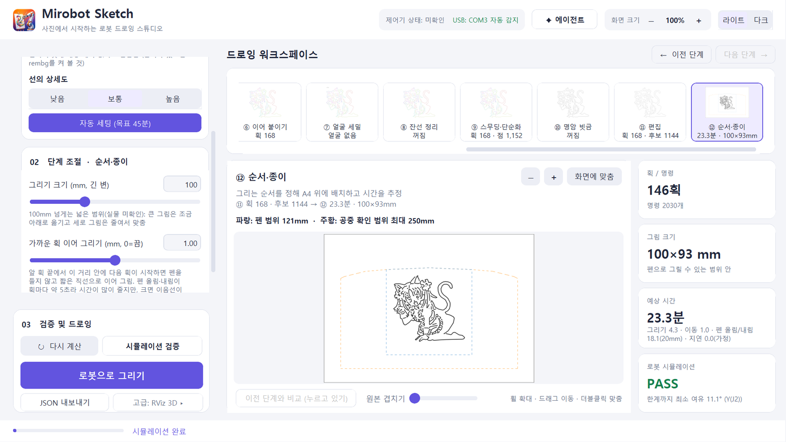

### 5. 로봇으로 그리기

**로봇으로 그리기** 창에서 연결 방식(로봇 또는 가상 시뮬레이션)을 고르고 **연결 시작**을 누르면 사전 검사 → 연결·호밍 → 시작 위치 확인 → 최종 확인 순으로 진행합니다. 실물에서는 펜 끝이 종이 가운데에 닿아 있고 주변이 비었는지 확인하는 칸에 체크한 뒤 **시작**을 누릅니다. 가상 시뮬레이션으로 같은 절차를 로봇 없이 연습할 수 있습니다.

웹캠이 연결되어 있으면 창 오른쪽에서 실제 종이 위에 계획한 그림과 펜 범위를 겹쳐 보며 종이 위치가 맞는지 확인합니다. 실물로 그리는 동안에는 8초마다 다 그린 획에 선이 생겼는지 재서 보인 획은 초록, 안 보인 획은 빨강으로 표시합니다(가상 시뮬레이션에서는 재지 않음).

<p>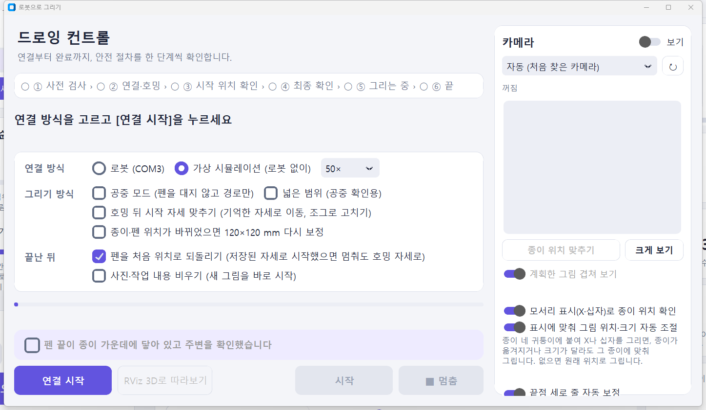</p>

<details>
<summary>가상 시뮬레이션 진행 화면</summary>

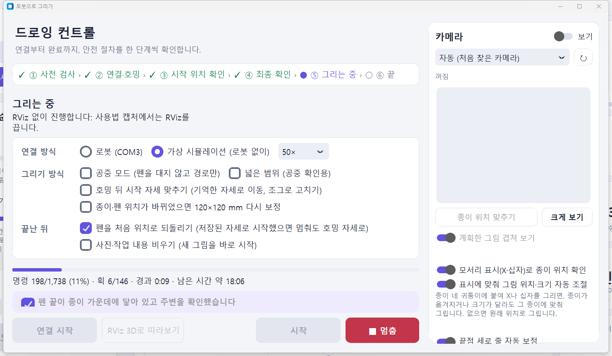

</details>

카메라, 종이 위치 맞추기, 자동 보정, 펜 설정, 명령줄·SVG는 [사용법 상세](docs/USAGE.md#사용법)에 정리했습니다.

## 에이전트 패널 (대화로 편집)

<p align="center">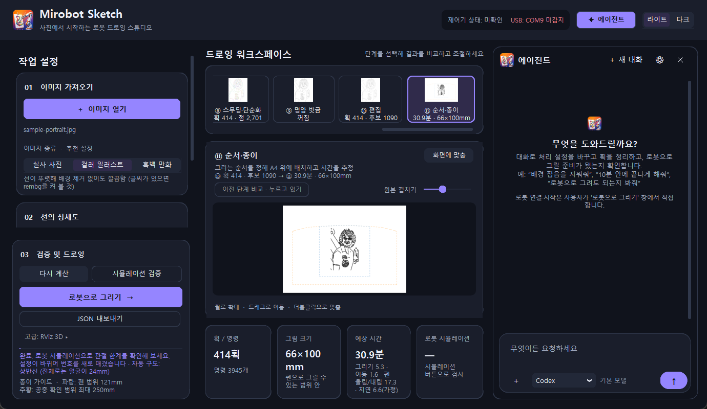</p>

GUI 오른쪽 위 **✦ 에이전트** 버튼을 누르면 채팅 패널이 열립니다. "획이 너무 많아, 15분 안에 끝나게 해줘", "배경 잡음을 지워줘", "머리카락 윤곽을 더 살려줘"처럼 말하면, 에이전트가 원본과 단계별 결과를 직접 보고 설정을 바꾸거나 편집을 **제안**합니다. 제안은 편집 단계에 빨강·초록과 번호로 표시되고, "5번 빼고 적용해"처럼 번호로 지시하면 됩니다. 바뀐 내용은 왼쪽 설정과 미리보기에 바로 반영됩니다.

| 연결 방식 | 준비 |
|---|---|
| **Claude Code** | Claude Code를 설치하고 `claude`로 로그인해 둡니다. 앱이 `claude -p`를 실행하고, 앱 도구는 MCP 서버로 연결합니다. |
| **Codex** | Codex CLI를 설치하고 로그인해 둡니다. 앱이 `codex exec`를 실행합니다. |
| **OpenRouter** | 패널의 ⚙ 설정에서 API 키를 입력합니다(Windows 자격 증명 관리자에 저장). 기본 모델은 `anthropic/claude-opus-5`이고, 도구 호출과 이미지를 지원하는 모델 중에서 고를 수 있습니다. |

에이전트가 쓰는 도구는 상태 보기, 그림 보기(원본 / 단계별 결과 / 편집 / 종이), 설정 변경, 획 목록, 점 좌표 보기, 사진과 그림 비교(`compare`: 원본 | 그림 | 차이 그림과 명암 닮음·윤곽 재현 지표), 편집 제안(지우기·살리기·점 옮기기·점 지우기·점 넣기·매끄럽게·자르기·잇기·짧은 선 긋기), 제안 적용·취소, 되돌리기, 시뮬레이션, 그리고 **로봇 준비 확인(`robot_guide`)**입니다. `robot_guide`는 읽기 전용으로, 이 그림이 펜으로 그릴 수 있는 범위 안인지, 시뮬레이션이 통과했는지, 종이 보정이 있는지, 사람이 '로봇으로 그리기' 창에서 할 순서를 알려 줍니다. **로봇을 움직이거나 연결·시작하는 도구는 없습니다.** 실제 드로잉은 사용자가 앱의 '로봇으로 그리기' 창에서 직접 확인하고 시작해야 하며(명령줄 실행기로 넘길 때는 JSON을 내보내 `yes`를 입력), 그리는 동안에는 에이전트가 설정·편집을 바꿀 수 없고 읽기만 합니다.

개발 환경에서 에이전트를 쓰려면 `pip install -e ".[agent]"`로 필요한 패키지(mcp, keyring, requests)를 설치합니다.

## 3D 시뮬레이션 (로봇 없이 확인)

실행기와 같은 경로로 Mirobot 기구학(IK)을 풀어 관절 한계(Soft limit)를 넘는지 검사합니다.

```bash
mirobot-sim out/photo.json --plot out/joints.png --gif out/sim.gif
mirobot-sim --reach-map out/reach_map.png
```

RViz 3D 환경이 있으면 GUI의 `고급` → [RViz 3D로 보기]로 로봇팔 모델이 궤적을 재생하는 것을 볼 수 있고, 그리는 동안에는 명령 응답을 따라갑니다. 설치는 [RViz 설치 절차](docs/USAGE.md#rviz-3d-환경-설치-선택-wsl2--ros-2-humble--mirobot-모델)를 따르세요.

## 이미지 종류별 과정과 결과

왼쪽 "01 사진과 추천 설정"(명령줄은 `--type`)에서 이미지 종류를 고르면 단계별 설정이 바뀝니다. 실사 사진에는 그어진 선이 없으므로 선을 새로 만들고, 일러스트와 만화는 이미 그려진 선을 따라갑니다. 아래 그림은 예시 이미지 세 장을 각 종류의 추천 설정 그대로 돌린 결과입니다. 그 종류에서 결과가 크게 바뀌는 단계만 골랐고, 그림 아래 숫자는 앱의 단계 띠에 나오는 요약입니다. 그리기 크기는 긴 변 100 mm입니다(`assets/make_pipeline_figures.py`로 다시 만듦).

| | 실사 사진 (`photo`) | 컬러 일러스트 (`illustration`) | 흑백 만화 (`manga`) |
|---|---|---|---|
| 배경 | rembg로 지움 | 그대로 | 그대로 |
| 전처리 | 블러 5 px | 블러 5 px | 미디언 11 px로 망점을 지우고 블러 5 px |
| 선 만들기 | 선화 모델이 사진을 선화로 바꾼 뒤 그 선을 따라감 | 밝기 경계(Canny) | 밝기 경계(Canny) |
| 얼굴 | 얼굴 부분을 원본 해상도로 한 번 더 따고, 얼굴 점으로 눈·눈썹·입을 다시 그림 | 얼굴 검출(YuNet)이 실사 얼굴용이라 이 예시에서는 찾지 못함 | 같음 |
| 그 밖 | 잔선 정리(193개 지움), 머리카락 결 선(8획) | 잔선 정리는 선화 모델을 쓸 때만 돌아 꺼짐 | 같음 |
| 결과 | 189획 · 56×100 mm · 예상 27.7분 | 159획 · 100×93 mm · 예상 25.2분 | 344획 · 100×99 mm · 예상 51.2분 |

### 실사 사진

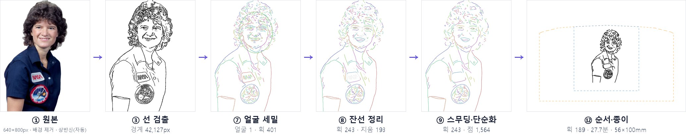

사진의 밝기 경계를 그대로 따면 피부 결과 그림자까지 선이 됩니다. 그래서 배경을 지운 뒤 선화 모델(Informative Drawings)이 사진을 선화로 바꾸고, 그 선을 따라 그립니다(③). 얼굴을 찾으면 얼굴 부분을 원본 해상도로 한 번 더 땁니다(⑦). 잔선 정리(⑧)는 피부 위 주름과 짧고 흐린 잔선을 지우고 눈·코·입·윤곽은 남기며, 정면 얼굴은 이 단계에서 얼굴 점 478개로 눈·눈썹·다문 입을 다시 그립니다. 이 사진에서는 193개를 지워 243획이 남았고, 가까운 획을 이어 그려 189획이 됐습니다.

### 컬러 일러스트

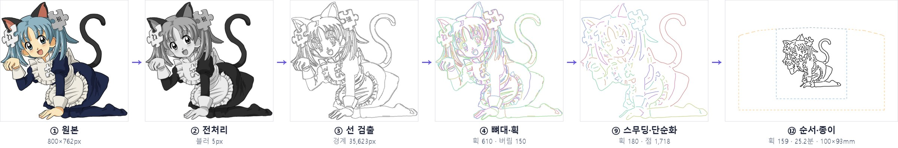

일러스트는 윤곽선이 이미 또렷해서, 배경 제거나 선화 모델 없이 흑백으로 바꿔 살짝 흐리게 한 뒤(②) 밝기 경계를 찾습니다(③). 경계를 한 픽셀 굵기 뼈대로 줄여 획으로 만들고(④, 610획), 펜 굵기보다 가까운 이중선을 합치고 끊긴 선을 이은 뒤 매끄럽게 다듬으면 180획, 가까운 획을 이어 그리면 159획이 됩니다. 색이 다른 두 면의 밝기가 비슷해 경계가 안 잡히면 선 검출 방식을 "색 차이"로 바꿉니다.

### 흑백 만화

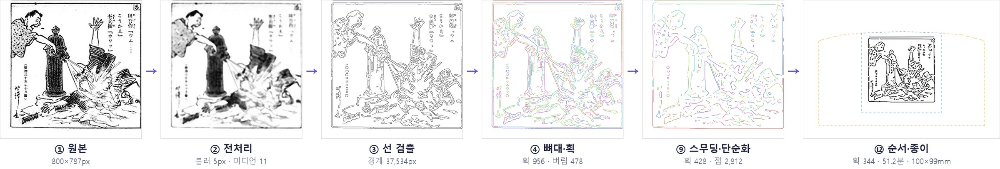

인쇄된 만화의 스크린톤(망점)과 잡티는 그대로 두면 점 하나하나가 짧은 획이 됩니다. 그래서 선을 찾기 전에 미디언 블러(800 px 기준 11 px)로 작은 무늬를 지웁니다(②). 그 뒤는 일러스트와 같습니다. 칸 테두리와 글자도 선이라 함께 그려지므로, 빼고 싶으면 에이전트에게 지우기를 요청해 편집 단계에서 뺍니다. 이 예시는 1902년 인쇄본이라 잡티가 많아 세 종류 중 획이 가장 많습니다(344획).

## 실물 그림: 획 끝 세로 자국 줄이기

### 실물에서 생긴 문제와 보정

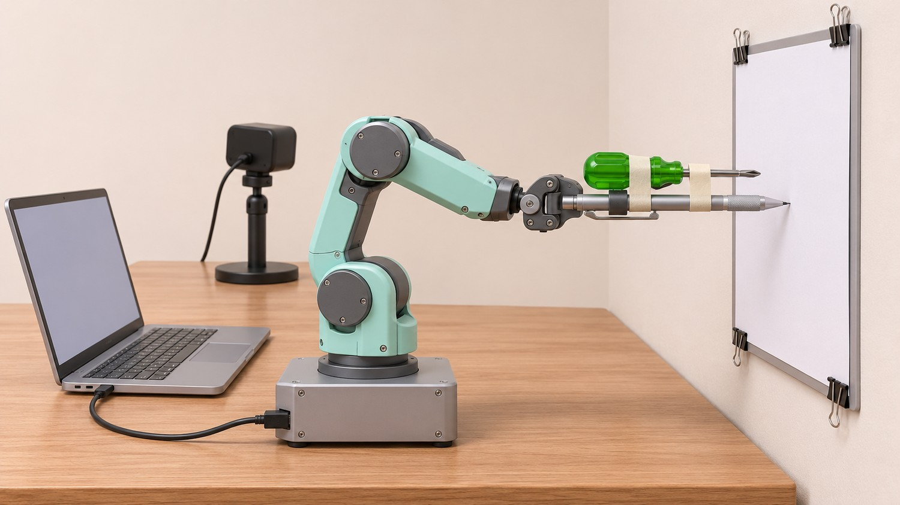

하드웨어 개념도. 초록 손잡이 드라이버는 샤프의 떨림을 줄이기 위해 붙인 무게추입니다.

| 문제 | 실물에서 시도한 방법 |
|---|---|
| 홀더에 끼운 샤프 끝이 떨려 선에 흔들림이 남았습니다. | 샤프 위에 초록 손잡이 드라이버를 테이프로 붙여 무게를 더했습니다. |
| 로봇팔에 깊이와 압력을 잴 수단이 없어 딱딱한 벽에는 선이 제대로 그려지지 않았습니다. | 종이 뒤에, 누르면 안쪽으로 부드럽게 들어가는 얇은 판을 댔습니다. |
| 깊게 누르면 뒷판이 밀려 획을 뗄 때 세로 자국이 남았습니다. 종이 면의 높낮이도 일정하지 않았습니다. | WLKATA Studio로 시작 자세와 샤프가 종이에 닿는 초기 위치를 맞췄습니다. 가로·세로 시험선을 그려 프로그램이 로지텍 BRIO로 결과를 찍고, 에이전트가 사진을 보며 경로와 세부값을 반복 조정했습니다. |

[십자 시험](LOG/2026-11-12-j6-direction.md) · [종이 면 기울기와 평면 보정](LOG/2026-11-12-j6-direction.md) · [세로 자국 자동 보정](LOG/2026-11-18-land-from-above.md) · [누르는 깊이 시험](LOG/2026-11-19-depth-ladder.md)

### 획 끝 비교

펜이 종이에 닿고 떨어질 때 획 끝마다 2~3 mm짜리 세로 자국이 남았습니다. 처음에는 이 자국 때문에 그림 전체가 빗살처럼 보였습니다. 아래는 로봇이 그린 종이를 휴대폰으로 찍은 사진입니다. 네 장 모두 조명 얼룩을 고르게 펴고 같은 기준으로 대비를 높였습니다.

<table>
<tr>
<td>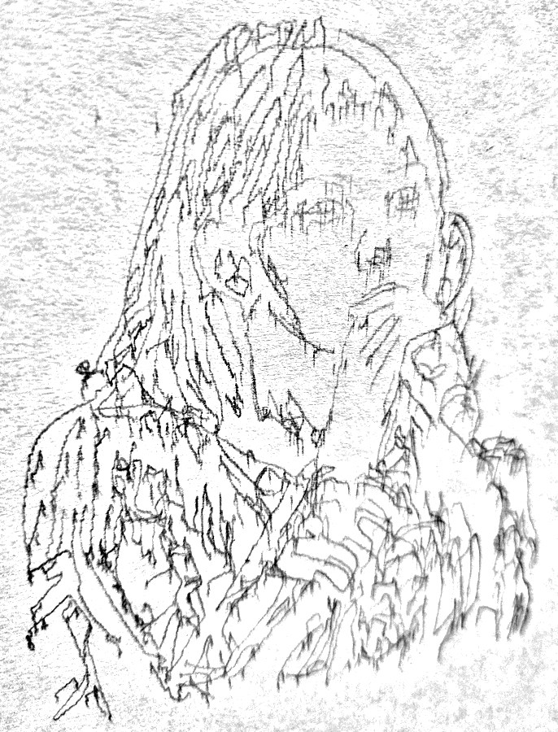</td>
<td>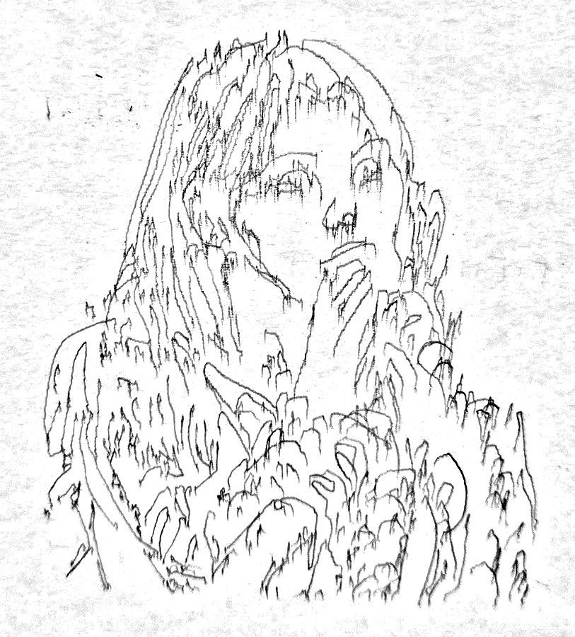</td>
</tr>
<tr>
<td align="center">① 11-16 22:41 · 489획</td>
<td align="center">② 11-18 15:53 · 488획 (①과 같은 원본)</td>
</tr>
<tr>
<td>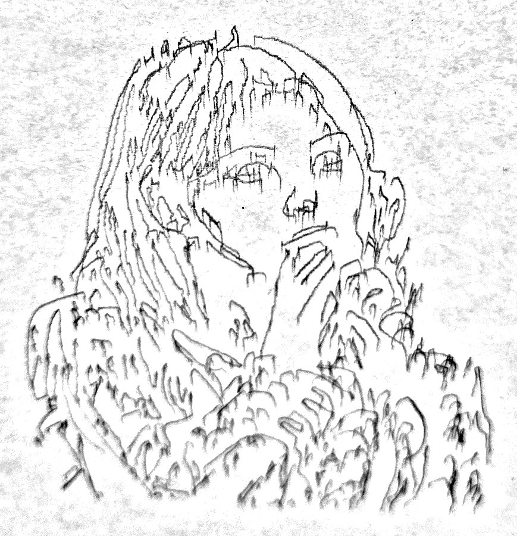</td>
<td>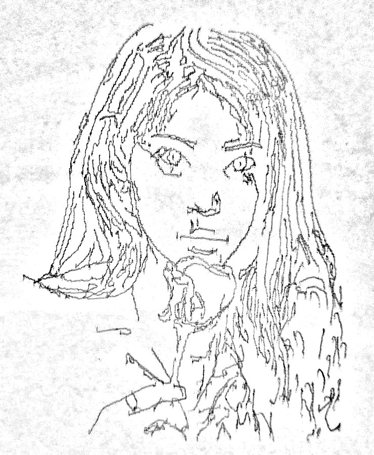</td>
</tr>
<tr>
<td align="center">③ 11-18 20:44 · 424획 (①과 같은 원본)</td>
<td align="center">④ 11-24 20:44 · 372획 (다른 원본)</td>
</tr>
</table>

| 그림 | 뗄 때 비스듬히 (`edge_rise_mm`) | 댈 때 (`edge_land_mm`) | 누름 (`down_extra_mm`) | 결과 |
|---|---|---|---|---|
| ① 11-16 22:41 | 1.0 | 0 | −0.4 | 그림 전체가 아래로 늘어진 세로 자국에 덮였습니다. 눈은 가로선 밑에 세로 줄이 달린 빗 모양이었습니다. |
| ② 11-18 15:53 | 1.5 | −2 → −1.0 (그리는 중 자동 조절, 121획부터 −1.0) | −0.4 | 1.8 mm 넘는 자국이 시작점 25%, 끝점 24%였습니다(카메라, 선이 보인 획 485개 기준). |
| ③ 11-18 20:44 | 1.5 → 1.75 (51획부터) | −2 → −0.75 (204획부터 고정) | −0.4 | 끝점 자국만 18%로 줄고 시작점은 24% 그대로였습니다(선이 보인 획 398개 기준). 사진으로 봐도 ②와 크게 다르지 않습니다. |
| 11-19 15:14 (③과 같은 원본·획) | 1.75 | −0.75 | **−1.4** | ③과 비교해 시작점 자국이 96개에서 52개, 끝점 자국이 71개에서 44개로 줄었습니다(계획 획 424개 중 23% → 12%, 17% → 10%). 사용자도 종이에서 직접 확인했습니다. |
| ④ 11-24 20:44 | 0.75 → 1.25 → 1.75 (그리는 중 자동 조절) | −1.25 | −1.4 | 휴대폰 사진으로 보면 머리 결, 얼굴, 옷에서 늘어진 자국이 거의 보이지 않습니다(카메라 수치 없음). 원본 사진이 달라 수치로 비교하지는 않았습니다. |

- **효과가 없던 것:** 펜을 비스듬히 떼고 위에서 내려오며 대도 시작점 자국은 그대로였습니다(②→③). 시험 종이로 재 보니 닿는 속도(50~400 mm/min)도 자국 길이와 상관이 없었습니다.
- **효과가 있던 것:** 선 전체를 1 mm 덜 누르기(`down_extra_mm` −0.4 → −1.4)였습니다. 누르는 힘이 붙으면서 펜 끝이 위로 밀렸다가, 뗄 때 다시 내려오며 자국을 남긴 것으로 봅니다(추정).
- **대가:** 덜 누르면 선이 옅어집니다. 앱의 선 확인에서 '안 보인 획'이 23개에서 44개로 늘었지만, 사용자가 종이를 직접 보니 옅어졌을 뿐 빠진 선은 없었습니다. 카메라가 옅은 선을 덜 잡는 것으로 봅니다(추정). 밑그림으로는 맞는 방향입니다.

자세한 측정은 [LOG/2026-11-16](LOG/2026-11-16-end-ticks-edge-rise.md), [11-18](LOG/2026-11-18-land-from-above.md), [11-19](LOG/2026-11-19-depth-ladder.md)에 있습니다.

### 애니메이션 장면 실물 그림

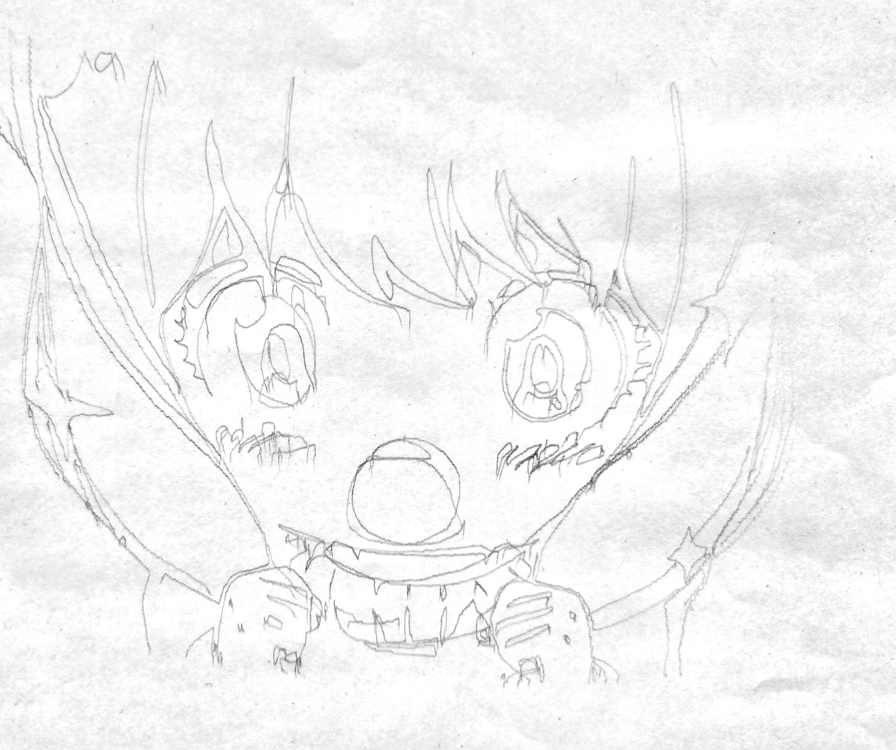

9-30 실행으로 보입니다(추정, 205획). 같은 장면을 그린 두 기록을 선 모양으로 비교했습니다. [9-30 실행](LOG/runs/run-20260930-211640.json) · [11-03 실행](LOG/runs/run-20261103-194436.json)

## 한계와 다음 단계

- **선 선명도:** 1 mm 덜 누른 뒤 세로 자국이 줄고 선이 옅어졌습니다. 자국을 줄인 상태에서 옅은 선도 분명히 보이게 하는 방법이 남았습니다.
- **실사 표현:** 사진의 명암과 질감을 살리는 선 배치와 빗금 표현을 더 시험할 수 있습니다.
- **시뮬레이션에서 학습:** 지금은 역기구학(IK)과 G-code로 경로를 보냅니다. 앞으로는 Isaac Sim 디지털 트윈에서 뒷판 변형과 샤프 접촉을 모델링하고, Isaac Lab의 강화학습·모방학습으로 동작을 익혀 실물에 옮기는 방향(sim-to-real)을 검토합니다. 접촉 조건이 달라지는 상황을 학습할 수 있지만, 시뮬레이션을 실물에 맞추고 학습한 동작을 다시 검증해야 합니다. [Isaac Lab 문서](https://docs.nvidia.com/isaaclab/isaac-lab)
- **ROS 2 MoveIt 2와 비교:** MoveIt 2는 관절 제약과 충돌을 검사하며 경로를 계획하는 데 쓸 수 있습니다. 기존 USB 시리얼 실행과 연결하는 작업이 필요하고, 펜 압력에 적응하려면 접촉 제어나 학습을 별도로 구현해야 합니다. [MoveIt 문서](https://moveit.ai/documentation/concepts/)

## 기술 스택과 설계 문서

| 영역 | 사용한 것 |
|---|---|
| 영상 처리 | [OpenCV](https://opencv.org/) (Canny, 미디언, 형태학, `approxPolyDP`, YuNet 얼굴 검출), [scikit-image](https://scikit-image.org/) (`skeletonize`), [NumPy](https://numpy.org/), [SciPy](https://scipy.org/) |
| 배경 제거 | [rembg](https://github.com/danielgatis/rembg) (선택) |
| UI | [CustomTkinter](https://github.com/TomSchimansky/CustomTkinter) |
| 로봇 통신 | [pyserial](https://github.com/pyserial/pyserial) — USB 시리얼 G-code |
| 3D 시각화 | [ROS 2 Humble](https://docs.ros.org/en/humble/) + [RViz](https://github.com/ros2/rviz) + WLKATA 공식 URDF (WSL2 Ubuntu 22.04) |
| 에이전트 | [MCP](https://modelcontextprotocol.io/), Claude Code / Codex CLI / OpenRouter |
| 패키징·배포 | [PyInstaller](https://pyinstaller.org/), [Inno Setup](https://jrsoftware.org/isinfo.php), GitHub Actions |

각 단계에 무엇을 왜 골랐는지, 사용한 OpenCV 함수, Windows ↔ WSL2 브리지 설계, 패키징은 **[docs/ARCHITECTURE.md](docs/ARCHITECTURE.md)** 에 있습니다.

## 개발 보고서

2026년 9월 24일부터 11월 26일까지의 구현과 실물 시험을, 왜 그렇게 했고 무엇을 얻고 잃었는지 흐름대로 정리한 보고서입니다. 회색조·경계·중심선 방식에서 출발해 실사 사진을 위해 레이어를 더한 과정, 샤프·뒷판·카메라 보정 같은 실물 문제, 한계와 다음 단계(선 선명도, 실사 표현, Isaac Sim 학습, MoveIt 2)를 다룹니다.

| 판 | 분량 | 파일 |
|---|---|---|
| 간략판 | 15쪽, 그림 11·표 2 | [PDF](docs/reports/Mirobot_Sketch_report_brief.pdf) · [DOCX](docs/reports/Mirobot_Sketch_report_brief.docx) |
| 상세판 | 25쪽, 그림 14·표 5, 목차 포함 | [PDF](docs/reports/Mirobot_Sketch_report_full.pdf) · [DOCX](docs/reports/Mirobot_Sketch_report_full.docx) |

주요 결과:

- **가로 1.37배 확대:** 십자·공중·관절 하나씩 시험으로 J6 모터 회전 방향이 펌웨어 모델과 반대인 것을 찾았습니다. 컨트롤러 설정(`$3`, `$23`)을 고쳐 가로 간격이 계획 90 mm에 대해 123.2 mm에서 89.0 mm로 돌아왔습니다.
- **종이 면 기울기와 높이별 배율:** 깊이 사다리로 종이 면을 맞추고(아래 왼쪽과 위 오른쪽의 차이 약 6 mm), 실측 20점 2차식으로 그림 좌표를 미리 비틀어 줄 간격 오차를 9 mm에서 1.2 mm 안으로 줄였습니다.
- **획 끝 세로 자국:** 시험 종이 네 장(비스듬히 떼기, 위에서 내려오며 대기, 닿는 속도, 누르는 깊이)으로 닿는 속도는 무관하고 누르는 깊이와 떼는 방향이 중요함을 확인했습니다. 같은 그림을 비스듬히 떼기 값은 그대로 두고 1 mm 덜 누르자 세로 자국이 뚜렷이 줄었습니다(카메라 기준 시작점 자국 23% → 12%). 비스듬히 떼기는 끝점 자국에만 효과가 있었습니다.
- **자동 보정의 조건:** 끝점 10~24개로 내린 판단이 그림마다 반대로 나와, 끝점 30개 이상·부호 검정·가운데 값 고정 조건을 넣었습니다.

보고서에는 실물 그림 비교를 위해 인물 사진과 그 사진으로 그린 그림이 들어 있습니다.

## 배포 (CI/CD)

- **CI** (`.github/workflows/ci.yml`): main push와 PR마다 Windows/Ubuntu × Python 3.11/3.13에서 테스트와 명령줄 도구 동작을 확인합니다.
- **CD** (`.github/workflows/release.yml`): `v*` 태그를 push하면 Windows .exe를 빌드하고, 빌드된 exe로 동작을 확인한 뒤 GitHub Releases에 zip과 설치 프로그램으로 올립니다. 같은 릴리스에 RViz 3D 환경 이미지(`ubuntu:22.04` 컨테이너에서 설치 스크립트로 만들고 ROS·모델을 확인한 WSL 루트 파일, SHA256 포함)도 올립니다.
- **Dependabot** (`.github/dependabot.yml`): Actions와 의존성 업데이트를 매주 PR로 알려 줍니다.

새 버전 배포:

```bash
git tag -a v0.3.0 -m "..." && git push origin v0.3.0
```

`mirobot_sketch/__init__.py`의 `__version__`도 함께 올립니다.

## 업스트림 기여

이 프로젝트는 [WLKATA 공식 ROS 2 저장소](https://github.com/wlkata/Wlkata_Mirobot_Ros2)의 URDF와 메시를 사용합니다. 그런데 이 저장소는 새로 받아 빌드하면 실패합니다. 원인을 찾아 고친 내용을 업스트림에 PR로 올렸습니다. 각 PR에는 `ros:humble` 컨테이너에서 수정 전후를 비교한 결과를 적었습니다.

| PR | 문제 | 수정 |
|---|---|---|
| [#2](https://github.com/wlkata/Wlkata_Mirobot_Ros2/pull/2) | `wlkata_mirobot_description`이 저장소에 없는 `textures/` 폴더를 설치하려다 빌드에 실패합니다([이슈 #1](https://github.com/wlkata/Wlkata_Mirobot_Ros2/issues/1)의 오류). | 쓰이지 않는 설치 규칙을 지웠습니다(메시는 모두 STL). |
| [#3](https://github.com/wlkata/Wlkata_Mirobot_Ros2/pull/3) | `wlkata_mirobot_moveit_config`가 저장소에 없는 `.setup_assistant`를 설치하려다 빌드에 실패합니다. 이 파일이 없으면 MoveIt Setup Assistant로 패키지를 다시 열 수도 없습니다. | 패키지 안의 URDF·SRDF·ros2_control 설정에 맞춰 `.setup_assistant`를 추가했습니다. |
| [#4](https://github.com/wlkata/Wlkata_Mirobot_Ros2/pull/4) | `wlkatapython.py`가 소스에 없고 커밋된 `build/`에만 있습니다. 그래서 `pip install .`이 현재 소스가 아닌 예전 빌드 파일을 설치합니다. | 모듈 파일을 추가하고, `build/`·`egg-info`·`.pyc`를 지우고, `.gitignore`를 추가했습니다. |

PR이 병합되기 전까지 이 프로젝트의 설치 스크립트([`packaging/wsl/setup_ros_env.sh`](packaging/wsl/setup_ros_env.sh))는 커밋 `c0a7ad4`를 고정하고, 빈 `textures/` 폴더를 만든 뒤 빌드합니다. 이 프로젝트는 `wlkata_mirobot_description`만 빌드하므로 업스트림 PR #3·#4가 다루는 문제에는 영향을 받지 않습니다.

## 테스트

```bash
python -m unittest discover -s tests -v
```

## 폴더

| 경로 | 내용 |
|---|---|
| `mirobot_sketch/` | 파이썬 패키지: CV 파이프라인, 종이 좌표, 실행기, 시뮬레이터, GUI (`data/`에 기본 설정·아이콘·얼굴 모델) |
| `mirobot_sketch/agent/` | 에이전트: 도구 정의, 대화 백엔드(OpenRouter / Claude Code / Codex), MCP 서버, 로컬 브리지, 채팅 패널 |
| `CV/` | 저장소용 실행 파일(`gui_sketch.py`, `make_strokes.py`), `experiments/`는 학습 단계 스크립트 |
| `robot/` | 로봇 설정(`drawing_config.json`), 저장소용 실행기 진입점, 초기 시리얼·그리퍼·펌프 시험 코드 |
| `sim/` | 저장소용 시뮬레이터 진입점, RViz 재생(WSL2 ROS 2) |
| `packaging/` | PyInstaller 빌드 설정, 설치 프로그램(Inno Setup), WSL ROS 환경 설치 스크립트(`wsl/`) |
| `.github/workflows/` | CI(테스트), Release(태그 push 시 .exe·이미지 빌드) |
| `assets/` | 앱 아이콘, README 스크린샷과 예시 사진 |
| `trajectories/` | 도형 템플릿과 테스트 경로 |
| `docs/` | 설계 문서([ARCHITECTURE](docs/ARCHITECTURE.md)), 사용법 상세([USAGE](docs/USAGE.md)), 개발 보고서(`docs/reports/`), OpenCV 학습 자료 |
| `LOG/` | 날짜별 작업 기록, 실행 기록 |
| `tests/` | 회귀 테스트 |

## 환경 메모

- 실물 제어는 Windows pyserial로 합니다. WSL2에 USB 패스스루한 CH340 포트는 응답을 읽지 못합니다.
- 시리얼 포트를 새로 열면 보드가 리셋됩니다. 실행 중에는 다른 프로그램이 같은 포트를 열지 않게 합니다.
- ROS 2 Humble(WSL2)은 RViz 3D 보기에만 씁니다. 로봇 제어에는 ROS를 쓰지 않습니다.

## 라이선스

[MIT](LICENSE). 포함된 서드파티 파일(YuNet 모델, 예시 사진)의 출처와 라이선스는 [THIRD_PARTY_NOTICES.md](THIRD_PARTY_NOTICES.md)에 있습니다.

오픈소스프로그래밍(2026-2) 텀프로젝트로 시작했습니다.
