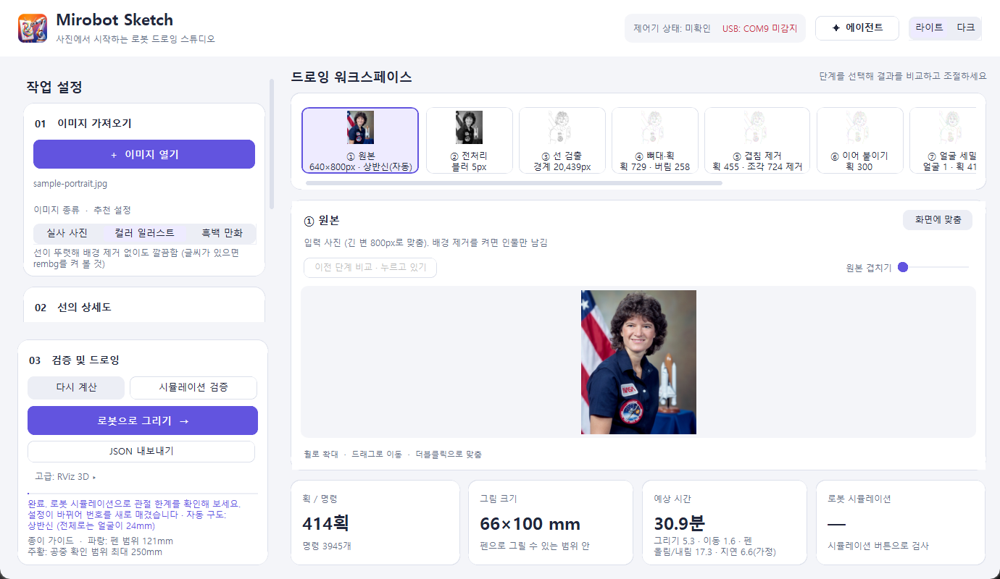
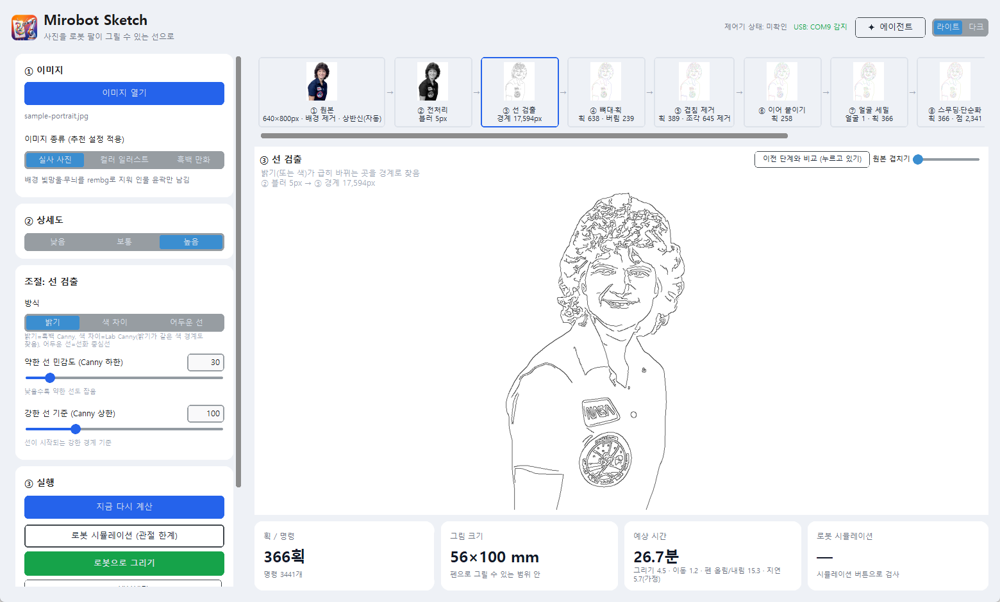
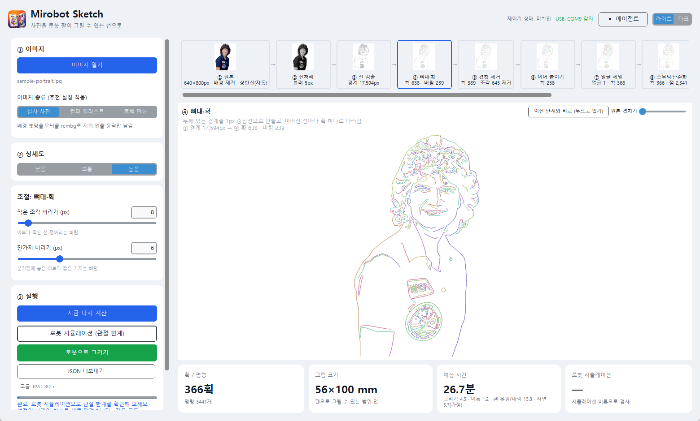
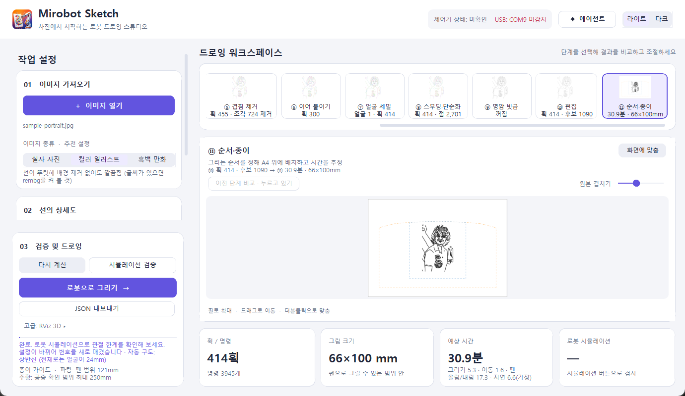
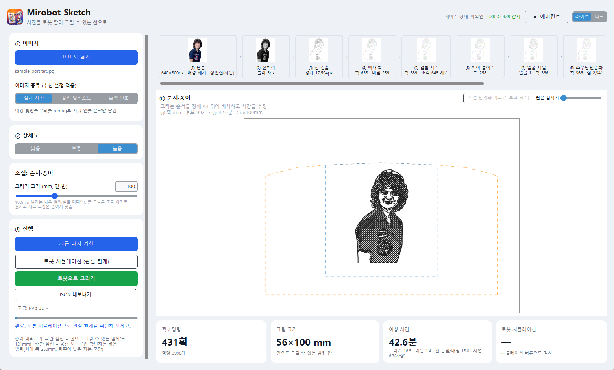
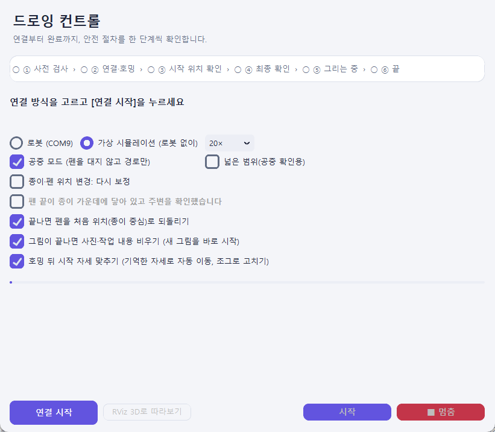
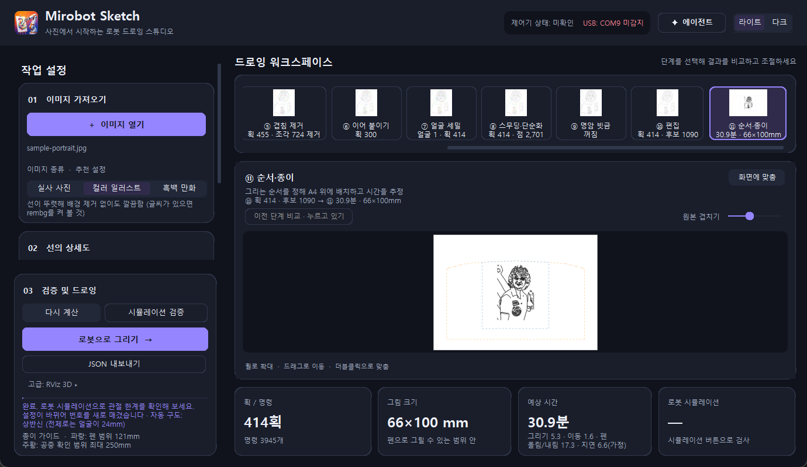
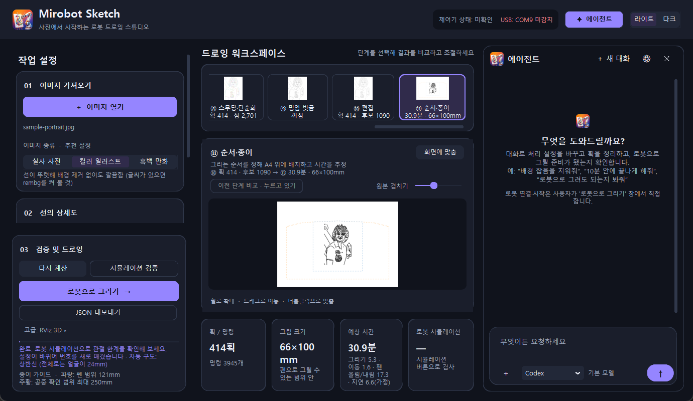

# 설계와 기술 선택

**한국어** | [English](ARCHITECTURE.en.md) · [← README](../README.md)

이 문서는 Mirobot Sketch가 **어떤 구조로 동작하는지**, 각 단계에 **어떤 라이브러리·기술·오픈소스를 왜 골랐는지**, Windows와 WSL2 사이를 **어떻게 연결했는지**를 설명합니다. 사용법과 설치는 [README](../README.md)에 있습니다.

## 목차

1. [전체 구조](#1-전체-구조)
2. [사진 → 획 파이프라인 (레이어별 기술)](#2-사진--획-파이프라인-레이어별-기술)
3. [사용한 OpenCV 함수](#3-사용한-opencv-함수)
4. [종이 좌표와 실행 전 검증](#4-종이-좌표와-실행-전-검증)
5. [로봇 실행 (DrawJob)](#5-로봇-실행-drawjob)
6. [왜 Ubuntu 22.04 + ROS 2 Humble인가](#6-왜-ubuntu-2204--ros-2-humble인가)
7. [ROS와 로봇 제어의 관계](#7-ros와-로봇-제어의-관계)
8. [WSL2 ↔ Windows 브리지 설계](#8-wsl2--windows-브리지-설계)
9. [패키징과 배포](#9-패키징과-배포)
10. [UI](#10-ui)
11. [에이전트](#11-에이전트)
12. [알려진 한계](#12-알려진-한계)
13. [사용한 오픈소스 목록](#13-사용한-오픈소스-목록)

---

## 1. 전체 구조

```
                     Windows (앱·로봇 제어)                                  WSL2 Ubuntu 22.04 (3D 보기, 선택)
┌──────────────────────────────────────────────────────┐        ┌───────────────────────────────────────┐
│ 사진 ─▶ 선 추출 파이프라인 ─▶ 획(종이 mm)             │        │ ROS 2 Humble                           │
│         (OpenCV, scikit-image, ...)                   │        │  robot_state_publisher ─▶ RViz2        │
│            │                                          │        │  rviz_playback.py (마커·관절 발행)      │
│            ▼                                          │        │        ▲                               │
│  검증: 허용 범위 · URDF 기구학(IK) 시뮬레이션         │  파일  │        │ 읽기                          │
│            │                                          │ ─────▶ │  관절 궤적 JSON  +  진행 파일(JSON)    │
│            ▼                                          │ /mnt/c │   (Windows가 쓰고 WSL이 읽음)          │
│  DrawJob (①~⑥) ── G-code + ok 응답 ──▶ USB 시리얼    │        └───────────────────────────────────────┘
│            │                                  │       │
│            └─ 진행 파일 갱신 (ok마다) ────────┘       │
└──────────────────────────────┬───────────────────────┘
                               ▼
                       WLKATA Mirobot (펜)
```

핵심 결정은 셋입니다.

- **앱과 실물 제어는 Windows에 둡니다.** GUI·USB 시리얼(CH340)·설치 프로그램이 모두 Windows에서 가장 단순하게 동작하고, WSL2로 넘긴 USB 시리얼 포트는 응답을 읽지 못하는 문제가 있었습니다.
- **ROS 2는 3D 시각화에만 씁니다.** 실물 제어 경로에는 ROS가 없습니다([7절](#7-ros와-로봇-제어의-관계)).
- **두 쪽은 파일로 연결합니다.** 소켓이나 ROS 브리지 없이 Windows가 쓴 JSON을 WSL이 읽습니다([8절](#8-wsl2--windows-브리지-설계)).

## 2. 사진 → 획 파이프라인 (레이어별 기술)

사진은 아래 단계를 순서대로 거쳐 **종이 위 mm 좌표의 획(stroke) 목록**이 됩니다. 각 단계는 결과를 캐시(키 = 앞 단계 키 + 단계 + 파라미터)해서, 값을 바꾸면 바뀐 단계부터만 다시 계산합니다. 단계 정의는 [`mirobot_sketch/stages.py`](../mirobot_sketch/stages.py)에 있습니다.

| 원본 | 선 검출 | 뼈대·획 | 순서·종이 (A4 배치) |
|:-:|:-:|:-:|:-:|
|  |  |  |  |

(예시 사진: NASA 공개 도메인 사진, [출처](../THIRD_PARTY_NOTICES.md))

| # | 단계 | 하는 일 | 사용 기술 | 선택 이유 |
|---|---|---|---|---|
| ① | 원본 | 긴 변 800px로 정규화, 선택적 배경 제거, 구도(전신/상반신/얼굴) 자르기 | [OpenCV](https://opencv.org/) `resize`·`imdecode`, [rembg](https://github.com/danielgatis/rembg) (U²-Net 계열 모델, ONNX Runtime) | 파라미터(px)가 사진 해상도에 좌우되지 않게 정규화. rembg는 한 줄로 인물만 남길 수 있고 CPU에서 돌아감. 모델·런타임이 커서(약 170MB+) .exe에는 넣지 않고 선택 설치 |
| ② | 전처리 | 흑백 변환, 블러, 미디언(만화 망점 제거) | OpenCV `cvtColor`·`GaussianBlur`·`medianBlur` | 잔무늬를 줄이면 이후 선 검출의 잡선이 줄어듦. 미디언은 스크린톤 같은 점무늬에 효과적 |
| ③ | 선 검출 | 밝기 변화가 급한 곳을 경계로 찾음. 밝기 / 색 차이(Lab) / 어두운 선(Otsu) 세 방식 | OpenCV `Canny`, `cvtColor`(Lab), `threshold`(Otsu), `morphologyEx` | Canny는 얇고 연속적인 경계를 주어 펜 경로에 적합. Lab은 밝기가 같은 색 경계를, Otsu는 깨끗한 선화의 중심선을 잡기 위한 대안 |
| ④ | 뼈대·획 | 두꺼운 경계를 1px 중심선으로 만들고, 픽셀 그래프를 따라가며 이어진 선마다 획 하나로 분리 | [scikit-image](https://scikit-image.org/) `skeletonize`, [NumPy](https://numpy.org/), OpenCV `connectedComponentsWithStats` | `findContours`는 얇은 선의 양쪽 경계를 돌아와 **같은 선을 두 번 그림**(280px 직선이 윤곽 559px로 실측). 중심선을 한 번씩만 지나는 획이 펜에 맞음 |
| ⑤ | 겹침 제거 | 펜 굵기보다 가까운 이중선을 하나로 | [SciPy](https://scipy.org/) `cKDTree` | 굵은 선의 양쪽 경계가 두 줄로 잡히면 종이에서 뭉개짐. 최근접 탐색을 빠르게 하려고 KD-트리 사용 |
| ⑤′ | (실사 선화 경로) | 선화는 이미 한 줄짜리 선이므로 "굵은 선 양쪽 경계(사이가 먹인 나란한 두 선) 지우기"를 건너뛰고 펜 굵기 안에서 겹친 선만 지움 | 자체 구현 | 이 단계를 선화에 쓰면 머리카락·눈꺼풀·입술처럼 가까운 선이 서로 쌍으로 지워짐(사진 4장에서 선화가 그린 선 중 남는 비율 0.95 → 0.41). 끄고 나서 최종 획의 남는 비율이 0.28~0.34 → 0.71~0.77 |
| ⑥ | 이어 붙이기 | 끝점이 닿는 획을 이어 펜 올림 횟수 줄임 | NumPy | 펜 올림/내림은 시간이 오래 걸려 총 시간의 큰 부분 |
| ⑦ | 얼굴 세밀 | 얼굴을 찾아 원본 해상도로 다시 따라가고 펜 굵기에 맞는 밀도로 바꿔 넣음. 실사 선화 경로에서는 얼굴 조각에 선화 모델을 한 번 더 돌림 | OpenCV **YuNet**(`FaceDetectorYN`, [OpenCV Zoo](https://github.com/opencv/opencv_zoo/tree/main/models/face_detection_yunet), MIT), Informative Drawings ONNX | 모델이 작고(ONNX 파일 하나) OpenCV에 내장된 API로 돌아가 별도 딥러닝 프레임워크가 필요 없음. 라이선스가 MIT라 배포 가능. 작업 이미지(긴 변 800px)에서는 얼굴이 작아 눈·입 선이 뭉개지므로 얼굴만 원본 해상도로 다시 그림 |
| ⑧ | 잔선 정리 | 실사 선화 경로에서 잔선을 지움(`declutter.py`): 피부 위 주름(선 양옆이 그 사진의 피부색, 눈코입 영역·랜드마크 근처 밖, 얼굴 폭의 45%보다 짧음)과 얼굴 밖의 짧고 흐린 선(기본 종이 3mm 미만, Lab 대비가 그 사진 선들의 60번째 백분위 미만, 단 대비 150 이상은 항상 남김). 강도(`clutter_mm`·`clutter_pct`)와 선 개수 상한(`clutter_max`, 얼굴 밖 길이×대비가 낮은 선부터 뺌)을 조절. 얼굴 둘레(얼굴 상자의 0.85배 타원)와 배경을 지운 인물 외곽선은 강도를 올려도 기본 기준을 쓰고 상한에서도 지킴. 머리 결을 켜면 머리 영역(⑩과 같은 마스크)에 60% 넘게 든 획은 대비와 상관없이 max(2mm, `clutter_mm`/3) 이상이면 남기고, 상한에서는 보통 선을 다 뺀 뒤에도 넘을 때만 짧은 것부터 뺌. 얼굴 점이 있으면(`face_mesh.py`, `face_mesh` 켬) 정면 얼굴의 눈·눈썹·다문 입 영역(펜 1.5배 넓힘)의 선을 잘라 내고 눈꺼풀·홍채·눈동자 점, 눈썹 가운데 선, 입술 사이 선·입술 바깥선 가운데로 다시 그림. 벌린 입은 기존 입 정리. 턱선은 가까이(펜 2배)에 선이 없고 사진 대비가 40 이상인 구간만 얼굴 점 곡선으로 채움. 사진 속 글자(`texts.py`, `remove_text` 켬)는 얼굴 밖 글자 영역(펜 굵기만큼 넓힘)의 선을 맨 먼저 잘라 냄 | OpenCV `Sobel`(Lab), [MediaPipe Face Landmarker](https://ai.google.dev/edge/mediapipe/solutions/vision/face_landmarker)의 478점 모델을 ONNX로 바꿔 onnxruntime으로(Apache-2.0), OpenCV `TextDetectionModel_DB` + PP-OCRv3(OpenCV Zoo, Apache-2.0), 자체 구현 | 사람은 눈코입·윤곽·머리 모양·글자로 닮음을 판단하고, 주름과 결은 펜으로 그리면 얼룩이 됨. 피부색은 사진마다 볼에서 재고, 대비 문턱은 사진마다 백분위로 정해 사진별로 맞춤(글자가 많은 사진에서도 뚜렷한 획은 남게 상한을 둠). 얼굴 세밀과 나눠 강도만 바꾸면 이 단계만 다시 돌아 1초 안팎(자동 세팅이 후보를 빠르게 비교). 사진 4장에서 윤곽 획이 21~35% 줄고, 초상 시간이 74 → 53분(앱 카드, 펜 20mm 올림). 머리 안의 선화 획은 사진 대비가 약해 잔선으로 지워졌고(초상 116개), 그 자리를 합성 결 선이 채워 곱슬머리가 매끈한 줄무늬가 됐음. 2mm(펜 굵기 4배)보다 짧은 결 토막은 점·쉼표로 읽혀 뺌. 머리 결을 상한에서 끝까지 지키면 긴 생머리 사진이 가장 강한 정리로도 48.7분이라 목표를 못 맞췄음. YuNet 다섯 점으로는 눈꺼풀·입술 모양을 몰라, 눈 속 짧은 선을 지우면 눈이 사라지고 다문 입의 위·아래 윤곽이 벌린 입처럼 그려졌음. 얼굴 점 모델은 작고(4.9MB) 라이선스가 배포에 맞음. mediapipe 패키지는 opencv-contrib-python을 끌어와 opencv-python과 `cv2`를 덮어써서, 모델만 ONNX로 바꾸고 앞뒤 처리(YuNet 상자로 기울어진 영역을 잘라 한 번, 나온 점으로 영역을 다시 잡아 한 번 더)는 직접 짬. 정면 사진 7장에서 MediaPipe와 평균 차이는 두 눈 사이 거리의 0.5~1.6%. 코를 얼굴 점(콧볼~코끝 밑 한 줄)으로 그려 보니 둘째 입처럼 보이고 콧구멍 모양이 사라져 선화 그대로 둠. 글자는 0.5mm 펜으로 뭉개져 읽히지 않고 펜 올림만 늘림 |
| ⑨ | 스무딩·단순화 | 계단·흔들림 제거, 점 수(=로봇 명령 수) 줄임, 모서리 둥글리기 | 가우시안 스무딩, OpenCV `approxPolyDP`(Douglas–Peucker) | 점이 적을수록 G-code가 짧고 빠름. 모양을 유지하는 단순화 알고리즘이 표준 |
| ⑩ | 명암 빗금·머리 결 | 머리카락 결(`hair_flow`, 실사 프리셋 켬): 머리 영역 안에서 사진의 결 방향을 따라 고르게 띄운 흐름선. 선화가 이미 그린 머리 결(⑧에서 지킴)은 이미 그은 선으로 쳐서 그 사이 빈 곳만 채움. 명암 빗금(기본 꺼짐): 어두운 면을 평행 빗금으로 채우고, 더 어두운 곳은 같은 방향 줄 사이에 줄을 더 넣음 | OpenCV `Sobel`·`GaussianBlur`, 경계 접선 흐름(ETF, Kang·Lee·Chui 2007), Jobard–Lefer 흐름선, `morphologyEx`·`dilate`, NumPy | 스케치는 채색 전 첫 단계라 면을 메우기보다 결을 선으로 남기는 편이 자연스러움(사용자 결정). 결 방향은 ETF: 밝기 기울기에 수직인 접선을 반경(= 결 간격) 안의 이웃 접선으로 4번 다듬음(기울기가 큰 이웃·방향이 비슷한 이웃에 가중). 구조 텐서는 짧은 머리에서 결이 머리 윤곽을 따라 동심원으로 돌았음. 선끼리 간격의 절반보다 가까워지면 멈춰 고르게 띄움. 교차 빗금은 0.5mm 펜으로 그리면 머리카락이 격자로 보여 쓰지 않음 |
| ⑪ | 편집 | 획마다 번호, 살리기·지우기·점 편집 제안을 확인하고 적용 | 자체 구현 | 사람과 에이전트가 같은 편집 모델을 씀. 적용한 편집은 설정을 바꿔 다시 계산해도 유지 |
| ⑫ | 순서·종이 | 그리는 순서(가까운 끝점 우선)를 정해 A4 위에 배치하고 시간 추정. 앞 획 끝에서 `pen_join_mm`(기본 1mm, 펜 굵기 2배) 안에 다음 획이 시작하면 펜을 들지 않고 짧은 직선으로 이어 그림(얼굴 상자 안은 잇지 않음). 배치는 로봇에 실제로 보낼(`drawing_warp`로 비튼) 좌표가 범위 안에 들어갈 때까지 줄임. 시간은 종이 맞춤과 비틀기를 적용한 좌표, 실제로 쓸 펜 올림(저장된 자세로 그리면 20mm)과 누름 깊이로 계산 | NumPy, 자체 구현 | 펜업 이동 거리를 줄이는 탐욕(greedy) 최근접 순서. 단순하고 빠르며 결과가 예측 가능. 펜 20mm 올림이면 획마다 올림·내림이 약 5초로 시간의 대부분(긴 생머리 사진 2,841초 중 2,078초, 73%)이고 이동 거리는 작음(82초): 순서를 다듬기(2-opt)보다 펜 올림 횟수를 줄이는 쪽이 효과가 큼. 1mm로 사진 3장이 2.7~7.8분 줄었음. 얼굴은 종이 위 수 cm라 4배 확대·실제 펜 굵기로 보니 이음선이 눈 밑·눈꺼풀 위에 삐친 자국으로 남아 얼굴 상자 안은 뺌(사진마다 1.0~1.9분 덜 줄어듦). 얼굴 세밀 타원(상자 1.3×1.4배)까지 빼면 이마·옆머리 결까지 펜을 들어 긴 머리 사진이 2.8분 늘었음. 종이에서의 이음선은 실물 미확인. 미리보기·시간 카드·실행기 검사가 같은 좌표를 봐야 시작 직전에 범위 밖으로 거절되거나 시간이 틀리지 않음 |

**자동 세팅(`autotune.py`)**: 잔선 정리 강도 8단계(기본보다 느슨한 2mm/50부터)를 실제 파이프라인으로 계산해, 앱 시간 카드와 같은 예상 시간이 목표(기본 45분) 안에 드는 후보 중 닮음 점수가 가장 높은 것을 적용. 강도만으로 안 되면 선 개수 상한을 이분 탐색. 그래도 안 되면 머리 결 간격을 3mm, 4mm로 넓혀 상한을 다시 찾고, 마지막에만 결 선을 끔: 결 선은 상한 대상이 아니라서, 긴 생머리 사진은 상한 20개로도 47.4분(결 선 39획, 결 없이는 39.7분)이었음. 스케치는 머리를 결 선으로 묘사하므로(사용자 결정) 끄기보다 성기게 하는 쪽을 먼저 씀. 명암 빗금은 후보에 넣지 않음: 스케치는 채색 전 첫 단계라 면을 메우지 않고 머리카락은 결 선(실사 프리셋)으로 그림(사용자 결정). 그 전에 빗금을 후보로 썼을 때도 2단계 1.5mm·3단계는 뺐음: 0.5mm 펜으로는 머리·옷을 검게 메우거나 줄무늬를 흐리는데, 흐린 명암 비교로는 그 손해가 점수에 잡히지 않았음. 닮음 점수 = 눈·눈썹/코/입 영역(입은 이 사이를 일부러 그리지 않으므로 안쪽 55%를 빼고 입술 윤곽 띠만)과 얼굴 윤곽 띠의 사진 윤곽 재현율 평균 0.40 + 인물 외곽선 재현율 0.15 + 전체 윤곽 재현율 0.15 + 명암 닮음 0.15 + 윤곽 정확도 0.15(얼굴이 없으면 0.30/0.25/0.20/0.25). 사진 4장에서 프리셋 49~83분 → 43.8~45.0분, 얼굴 점수는 4장 모두 그대로(0.855/0.913/0.97/0.97, 후보·점수를 바꾸기 전 기준).

|  명암 빗금 없음 | 명암 빗금 2단계 |
|:-:|:-:|
|  |  |

명암 빗금은 사진과의 닮음(명암 상관)을 올립니다. 마이크 사진(배경 제거) 기준 0.71 → 0.88(1단계) → 0.93(2단계)이며, 예상 시간은 17.8 → 25.1 → 31.2분으로 늘어납니다(`compare` 도구 지표).

## 3. 사용한 OpenCV 함수

`opencv-python>=4.8`을 씁니다. 코드에서 실제로 부르는 함수는 다음과 같습니다.

| 목적 | 함수 |
|---|---|
| 읽기·쓰기 (한글 경로 안전) | `imdecode`, `imencode` |
| 크기·색 변환 | `resize`, `cvtColor`(BGR↔Gray/Lab), `convertScaleAbs` |
| 노이즈 제거 | `GaussianBlur`, `medianBlur` |
| 선 검출 | `Canny`, `threshold`(Otsu), `morphologyEx`, `getStructuringElement`, `dilate` |
| 분석 | `connectedComponentsWithStats`, `findContours`(비교용), `arcLength` |
| 단순화 | `approxPolyDP` (Douglas–Peucker) |
| 얼굴 | `FaceDetectorYN` (YuNet) |
| 미리보기·화면 | `polylines`, `line`, `circle`, `ellipse`, `rectangle`, `drawMarker`, `putText`, `applyColorMap` |

`findContours`를 기본으로 쓰지 않는 이유는 위 ④단계 표에 있습니다(비교용 `extract_strokes_contour()`만 남겨 두었습니다). 학습 기록은 [`docs/opencv-study`](opencv-study/)에 있습니다.

## 4. 종이 좌표와 실행 전 검증

- **종이 좌표:** 픽셀을 종이 mm로 바꾸는 변환(`pixels_to_paper`)과 그림 크기·위치 결정은 `paper_mapping.py`·`session.py`에 있습니다. 큰 그림은 로봇의 위쪽 도달 한계 때문에 종이 중심보다 아래로 배치합니다.
- **허용 범위(`limits`):** 실물 펜다운은 설정의 허용 영역 안에서만 시작할 수 있습니다. 밖의 경로는 공중 모드만 됩니다.
- **기구학 시뮬레이션:** 실행기와 같은 G-code 경로를 1mm 간격으로 나눠 **역기구학(IK)** 을 풀고 관절 한계를 검사합니다([`mirobot_sim.py`](../mirobot_sketch/mirobot_sim.py)).
  - 관절 구조·한계는 WLKATA 공식 ROS 2 저장소의 URDF(`wlkata_mirobot_description.urdf`)에서 옮겼습니다.
  - 홈 자세에서 URDF와 컨트롤러가 보고한 TCP의 차이(플랜지 방향 24.52mm)를 공구 오프셋으로 두면 순기구학이 컨트롤러 값과 1µm 이내로 일치합니다.
  - 유한차분 야코비안을 쓰는 감쇠 최소제곱 IK를 NumPy로 구현하고, 배치 계산과 앞선 두 점으로 다음 자세를 예측하는 시작값으로 **3.2~3.6배** 빨라졌습니다(58.8초 → 약 18초, 관절각 차이 1e-5 rad 이하).
- **종이 평면 보정(선택):** 펜 끝이 종이에 닿는 접촉 좌표 5점으로 앞뒤(X) 편차와 기울기를 최소제곱으로 구합니다. 평면 잔차가 1mm를 넘으면 설정을 바꾸지 않습니다. 자동으로 시작하지 않고 요청했을 때만 합니다.
- **그림 좌표 미리 비틀기(선택, `drawing_warp`):** 팔이 위치에 따라 그림을 다른 크기로 그리면(예: 위로 갈수록 가로·세로가 커지고 세로선이 부채꼴로 기움), 설정 하나로 그은 세로선 무늬를 카메라로 잽니다. 그 결과로 실제 위치 → 계획 위치의 2차식(상수항 없음, 종이 중심 고정)을 맞추고, 실행기는 계획 좌표를 이 식으로 바꿔 보냅니다. 범위 검사도 바꾼 좌표로 합니다. 값이 없으면 끕니다(`LOG/scripts/depth_ladder/fit_warp.py`).

## 5. 로봇 실행 (DrawJob)

`DrawJob`([`draw_job.py`](../mirobot_sketch/draw_job.py))은 작업 스레드에서 아래 순서로 진행하고, GUI는 UI 큐로만 상태를 받습니다.

```
① 사전 검사 → ② 연결·호밍 → ③ 시작 위치 확인 → ④ 최종 확인(사람) → ⑤ 그리는 중 → ⑥ 끝
```

<p align="center"></p>

- **통신:** USB 시리얼(pyserial)로 G-code(`M20 G90 G01 X Y Z A B C F`)를 한 줄 보내고 `ok`를 기다립니다. 포트를 새로 열면 CH340이 보드를 리셋하므로 연결은 한 번만 열어 재사용하고, 호밍은 사람이 버튼으로 합니다(자동 호밍 명령은 보내지 않음).
- **펜 접근:** 펜을 내릴 때 종이 위 여유 높이까지는 빠르게, 마지막 구간은 천천히 내려갑니다(`pen.up_clearance_mm`, `pen.slow_zone_mm`).
- **안전 절차:** ①~④ 어디서든 문제가 있으면 시작하지 않고 포트를 닫습니다. ④에서는 "종이·펜·주변 확인"을 사람이 체크해야 [시작]이 켜지고, 멈춤·취소가 들어와도 포트는 항상 닫습니다.
- **끝난 뒤:** 펜을 처음 위치(종이 중심)로 되돌리고 작업 내용을 비웁니다. 오류·취소일 때는 자동으로 움직이지 않습니다.
- **멈춤·이어 그리기:** ⑤에서 멈춤은 작업을 끝내지 않고 일시정지합니다(`DrawJob.stop`). 펜을 그 자리에서 종이 반대쪽으로 곧게 떼고 연결을 연 채 기다리다가, 이어서(`resume`)를 고르면 `draw_executor.resume_commands`가 정한 대로 멈춘 접촉점에 펜을 다시 대고 같은 명령 목록의 다음 번호부터(`execute(..., start=)`) 보냅니다. 끝내기(`finish`)는 저장된 대기 자세로 시작했으면 대기 자세를 거쳐 호밍 자세(관절 0)로 돌아갑니다(돌아가는 중에 누르면 그 자리에서 멈춤). 창을 닫으면(`end`) 일시정지에서 기다리지 않고 끝냅니다.
- **가상 시뮬레이션:** 로봇 없이 같은 절차를 시험합니다. 호밍과 명령 지연, 오류·시간 초과를 흉내 내고 1~500배속을 지원합니다.
- **기록:** 실행 기록은 `LOG/runs/`(설치판은 사용자 폴더)에 남고, 저장할 때 사용자 폴더 같은 절대 경로는 저장소 기준 상대 경로나 파일 이름으로 바꿉니다.

## 6. 왜 Ubuntu 22.04 + ROS 2 Humble인가

이 조합은 **3D 보기(RViz)** 를 위한 것입니다. 로봇을 움직이는 데는 필요 없습니다.

- **짝이 정해진 조합입니다.** ROS 2 Humble Hawksbill은 Ubuntu 22.04(jammy)를 대상으로 하는 장기 지원(LTS) 배포판으로, 바이너리 패키지(`ros-humble-*`)가 22.04용으로 배포됩니다. 그래서 `packaging/wsl/setup_ros_env.sh`는 jammy가 아니면 종료 코드 3으로 거부합니다.
- **필요한 것만 최소로 설치합니다.** RViz에는 `ros-base` + `rviz2` + `robot_state_publisher` + WLKATA 모델 패키지 하나면 됩니다. 전체 데스크톱 설치(수 GB)보다 훨씬 작습니다.
- **확인된 조합입니다.** WLKATA의 ROS 2 저장소를 커밋 `c0a7ad4`에 고정하고 이 조합에서 빌드되는 것을 확인했습니다(공식 저장소에 빠진 `textures` 폴더만 보충). 다른 배포판(예: Ubuntu 24.04 + Jazzy)에서는 확인하지 않았습니다.
- **재현 가능한 이미지로 만들 수 있습니다.** 같은 스크립트를 GitHub Actions의 `ubuntu:22.04` 컨테이너에서 돌려 WSL로 가져올 수 있는 루트 파일 이미지(약 401MB)를 만듭니다.
- **WSL2로 충분합니다.** WSLg가 Windows 11에서 리눅스 GUI 창(RViz)을 바로 띄워 줍니다.

## 7. ROS와 로봇 제어의 관계

| | 실물 로봇 제어 | 3D 시각화 |
|---|---|---|
| 위치 | Windows | WSL2 Ubuntu 22.04 |
| 통신 | USB 시리얼, G-code | ROS 2 토픽(`/joint_states`, 마커) |
| ROS 사용 | **없음** | ROS 2 Humble (rviz2, robot_state_publisher) |

- **ROS 없이 시리얼 G-code로 제어하는 이유:** 앱이 GUI와 USB 시리얼을 쓰는 Windows 프로그램이라 ROS를 거치면 (WSL USB 패스스루 등) 층이 늘고, 실물 제어에서 필요한 것은 "명령 한 줄 → ok" 절차뿐입니다. 그래서 컨트롤러의 G-code 인터페이스를 직접 씁니다.
- **ROS 2에서 가져다 쓰는 것:** WLKATA의 공식 ROS 2 저장소에서 **URDF와 3D 메시**만 가져옵니다. 이 모델로 (1) RViz에서 로봇팔을 3D로 보여 주고 (2) [4절](#4-종이-좌표와-실행-전-검증)의 기구학 시뮬레이션의 관절 구조·한계를 얻습니다.
- **MoveIt 등 ROS의 경로 계획은 쓰지 않습니다.** 경로는 앱이 종이 좌표에서 직접 만들고, 관절 한계는 자체 IK 시뮬레이션으로 검사합니다.
- **RViz 재생 노드(`rviz_playback.py`):** 관절 상태(`/joint_states`)와 종이·펜·자국 마커를 발행하는 작은 ROS 2 파이썬 노드입니다. `robot_state_publisher`가 URDF와 관절 상태로 로봇 모델의 변환을 계산해 RViz에 보여 줍니다.

## 8. WSL2 ↔ Windows 브리지 설계

Windows의 앱이 WSL2의 RViz를 띄우고, 그리는 동안 진행 상황을 넘겨 RViz가 로봇을 따라가게 합니다. 구성은 다음과 같습니다.

### 8.1 실행: Windows → WSL

- `wsl.exe -d <배포판> -- bash -lc "<명령>"`으로 WSL 안의 `sim/run_rviz.sh`를 콘솔 창 없이 실행합니다([`rviz_launch.py`](../mirobot_sketch/rviz_launch.py)).
- **배포판 찾기:** `wsl -l -q`(UTF-16LE 출력)에서 목록을 읽고 docker-desktop은 제외한 뒤, `/opt/ros/humble`과 `~/mirobot_ws`가 있는 배포판을 고릅니다. 앱이 만든 전용 배포판 `MirobotSketch-ROS`를 먼저 보고, 환경 변수 `MIROBOT_WSL_DISTRO`로 직접 지정할 수도 있습니다. ROS가 없으면 실행하지 않고 설치 도우미로 안내합니다.
- **경로 변환:** Windows 경로를 `/mnt/c/...`로 바꾸고 공백이 있으면 따옴표로 감쌉니다.
- **RViz 창:** WSLg가 Windows 화면에 띄웁니다. 창을 닫으면 `run_rviz.sh`가 재생·상태 발행 프로세스도 함께 정리합니다(다시 열 때 중복 실행도 막음).

### 8.2 데이터: 파일 두 개

| 파일 | 만드는 쪽 | 읽는 쪽 | 내용 |
|---|---|---|---|
| 관절 궤적 JSON | Windows (시뮬레이션 결과) | WSL `rviz_playback.py` | 점마다 관절각, G-code 명령 번호(`cmd`), 명령별 속도 |
| 진행 파일(JSON) | Windows `DrawJob` (ok마다 갱신) | WSL `rviz_playback.py --follow` | 상태(homing/running/stopped/done/error), 확정된 명령 수, 총 명령 수 |

- **왜 파일인가:** WSL2는 `/mnt/c`로 Windows 파일을 그대로 읽을 수 있어 소켓·포트 포워딩·ROS 브리지 없이 연결됩니다. 프로세스 사이 결합이 없어 한쪽이 죽어도 다른 쪽에 영향이 없고, 파일 두 개라 디버깅도 쉽습니다.
- **원자적 쓰기:** 진행 파일은 임시 파일에 쓴 뒤 `os.replace`로 바꿔 넣어, 읽는 쪽이 반쪽짜리 JSON을 보지 않게 합니다. Windows에서 백신이나 읽는 쪽이 파일을 잠깐 잡으면 다시 시도합니다.
- **쓰기 실패가 드로잉을 막지 않게:** 진행 파일은 보조 정보라, 쓰기가 계속 실패해도 예외를 내지 않고 `last_error`에 기록하며 재시도를 줄여 실제 드로잉을 늦추지 않습니다.
- **표준 라이브러리만:** `live_progress.py`는 WSL의 ROS 파이썬에서도 불러 쓰므로 표준 라이브러리만 씁니다. 설치판(.exe)에는 이 파일과 재생 스크립트를 데이터로 넣어 둡니다.

### 8.3 따라가기 위치 계산

로봇 컨트롤러는 명령마다 `ok`를 보내므로, **`ok`를 받은 명령까지는 확정**하고 그 뒤는 예상 속도로 보간하되 **다음 명령의 끝을 넘지 않게** 합니다(`FollowTrack`). 컨트롤러가 명령을 버퍼에 받아 두면 `ok`가 이동 완료보다 먼저 올 수 있어 화면이 실물보다 앞설 수 있습니다. 실제 로봇에서 재 본 뒤 보정값(`display_lag_s`)을 정할 자리만 두었고, 필요하면 상태 조회(`?`)로 실제 좌표를 읽는 방식을 붙일 계획입니다(미확인).

### 8.4 겪은 문제

| 증상 | 원인 | 해결 |
|---|---|---|
| RViz 창이 투명하게 뜸 (`[WARN:COPY MODE]`) | WSLg가 복사 방식으로 창을 전달 | `wsl --shutdown`으로 WSLg 재시작, 기본을 소프트웨어 렌더링(`LIBGL_ALWAYS_SOFTWARE=1`)으로 (GPU는 `MIROBOT_RVIZ_GPU=1`) |
| `$'\r': command not found` | Windows에서 저장한 스크립트가 CRLF | `.gitattributes`로 `*.sh`를 LF 고정 |
| [시작] 뒤 10초간 명령이 안 나감 | WSL이 깨어나는 동안 RViz 실행이 드로잉 스레드를 막음 | RViz 실행을 별도 스레드로 분리, RViz는 진행 파일로 따라잡음 |
| RViz를 닫아도 재생이 계속됨 | 재생 스크립트를 따로 두었음 | `run_rviz.sh`가 RViz를 기다렸다가 함께 정리, 시작할 때 이전 프로세스 정리 |
| 한국어 콘솔(cp949)에서 명령줄이 죽음 | 출력할 수 없는 기호 | `safe_console()`로 출력 불가 글자를 `?`로 대체 |

### 8.5 설치 도우미

WSL이 없거나 ROS 환경이 없는 PC를 위해 [`rviz_setup.py`](../mirobot_sketch/rviz_setup.py)가 세 단계(① WSL 기능 ② RViz 환경 ③ 동작 확인)를 매번 처음부터 확인하며 갖춥니다.

- 릴리스 이미지(약 401MB)를 `Range` 요청으로 이어받고, SHA256을 확인한 뒤 압축을 풀어 `wsl --import MirobotSketch-ROS`로 가져옵니다. 기존 배포판은 건드리지 않습니다.
- 받기 전에 디스크 여유 공간을 확인하고, 공간 부족은 "손상"과 구분해서 알립니다.
- 관리자 권한이 필요한 것은 `wsl --install --no-distribution` 하나뿐이며 비밀번호는 다루지 않습니다.
- 이미지를 받을 수 없으면 Ubuntu 공식 22.04 루트 파일(SHA256 확인)로 전용 배포판을 만들고 그 안에서 `setup_ros_env.sh --image`를 실행하는 예비 경로가 있습니다.

## 9. 패키징과 배포

### 9.1 파이썬 패키지

- 공용 코드는 `mirobot_sketch/` 패키지에 두고 상대 import를 씁니다. `CV/`, `robot/`, `sim/`의 진입 파일은 예전 명령이 그대로 동작하게 하는 얇은 래퍼입니다.
- `pyproject.toml`(setuptools ≥ 77, MIT 라이선스 표기)이 의존성과 실행 명령(`mirobot-sketch`(GUI), `mirobot-strokes`, `mirobot-svg`, `mirobot-draw`, `mirobot-sim`, `mirobot-setup-rviz`, `mirobot-calibrate`)을 정의하고, 선택 설치로 `[rembg]`(배경 제거), `[agent]`(에이전트), `[build]`(PyInstaller)를 둡니다.
- **파일 위치 규칙**은 [`paths.py`](../mirobot_sketch/paths.py) 한곳에 있습니다. 저장소에서 실행하면 `robot/drawing_config.json`, `LOG/runs/`, `out/`을 쓰고, 설치판이나 .exe는 `%APPDATA%\MirobotSketch\`를 씁니다(기본 설정은 패키지 안 파일을 복사). 환경 변수 `MIROBOT_CONFIG`로 설정 파일을 직접 지정할 수 있습니다.

### 9.2 Windows .exe (PyInstaller)

- [`packaging/mirobot_sketch.spec`](../packaging/mirobot_sketch.spec): **폴더형(onedir)** 빌드. `MirobotSketch.exe`(GUI, 콘솔 없음)와 `mirobot.exe`(명령줄: `draw`·`strokes`·`svg`·`sim`·`setup-rviz`·`mcp`)가 한 폴더에 들어갑니다.
- **onefile이 아니라 onedir인 이유:** 실행이 빠르고 백신 오탐이 적습니다.
- rembg·onnxruntime은 용량 때문에 제외하고, 깨끗한 빌드 전용 가상환경에서 빌드합니다. 그래서 .exe에는 배경 제거, 실사 선화와 그 뒤의 잔선 정리·얼굴 점(눈·눈썹·입 다시 그리기)·사진 속 글자 지우기가 없습니다(잔선 정리 단계는 선화를 쓴 경우에만 돌고, 글자 지우기는 그 단계 안에 있음). RViz 재생 스크립트, 설치 스크립트, 얼굴 모델은 데이터로 포함합니다.
- 하위 명령이 모듈을 문자열 이름으로 불러오므로 `collect_submodules`로 숨은 import를 알려 줍니다.

### 9.3 설치 프로그램 (Inno Setup)

- [`packaging/installer.iss`](../packaging/installer.iss): 관리자 권한 없이 사용자 폴더에 설치하고, 시작 메뉴·바탕화면(선택) 바로가기와 제거 프로그램, MIT 라이선스 동의 화면, 한국어/영어 설치 화면을 만듭니다.
- AppId를 고정해 새 버전을 설치하면 업그레이드됩니다. 선택 항목 "RViz 3D 환경도 설치"는 설치 후 설치 도우미를 엽니다.
- 작업표시줄에서 파이썬 아이콘으로 묶이지 않도록 앱 고유 ID(AppUserModelID)를 지정합니다.
- 코드 서명이 없어 SmartScreen이 "알 수 없는 게시자" 경고를 띄울 수 있습니다.

### 9.4 도커를 쓰지 않은 이유

이 앱은 GUI 창과 USB 시리얼을 씁니다. Windows의 도커는 가상 머신 위에서 돌아 둘 다 추가 설정(WSLg/X 서버, usbipd)이 필요하고, WSL2에서 CH340 응답을 읽지 못하는 문제 위에 한 겹을 더 얹게 됩니다. 도커는 **ROS 환경을 재현하는 릴리스 CI**에서만 씁니다.

### 9.5 CI/CD (GitHub Actions)

- **CI**([`ci.yml`](../.github/workflows/ci.yml)): main push와 PR마다 Windows/Ubuntu × Python 3.11/3.13에서 테스트와 명령줄 도구 동작을 확인합니다. main 브랜치는 이 검사 4개를 통과해야 병합됩니다(브랜치 보호).
- **릴리스**([`release.yml`](../.github/workflows/release.yml)): `v*` 태그를 push하면
  1. Windows에서 테스트 → PyInstaller 빌드 → **빌드된 exe로 draw/sim/가상 실행 확인** → Inno Setup 설치 프로그램 빌드 → **러너에서 조용히 설치·실행·제거 검증** → zip과 Setup.exe를 릴리스에 올립니다.
  2. 별도 작업이 `ubuntu:22.04` 컨테이너에서 `setup_ros_env.sh --image`로 ROS 환경 이미지를 만들고 ROS·모델·`robot_state_publisher`를 확인한 뒤 SHA256과 함께 올립니다(크기 1900MB 이하 검사).
- **Dependabot:** Actions와 pip 의존성을 매주 PR로 알려 줍니다.

## 10. UI

<p align="center"></p>

- **[CustomTkinter](https://github.com/TomSchimansky/CustomTkinter)** 로 카드형 화면을 만들었고 라이트/다크 모드를 지원합니다.
- **왜 CustomTkinter인가:** 파이썬 표준 Tk 위에서 현대적인 모양을 내면서 의존성이 작고 PyInstaller로 묶기 쉽습니다. 실제 제품의 데스크톱 앱은 Qt(PySide6)나 웹 기술(Electron/Tauri)을 많이 쓰지만, 이 프로젝트의 중심은 영상 처리와 로봇 파이프라인이라 UI를 다시 쓰기보다 배포와 재현성에 시간을 썼습니다.
- **반응성:** 무거운 계산(파이프라인, 시뮬레이션, 로봇 통신)은 작업 스레드에서 하고 결과는 UI 큐로 넘깁니다. 파이썬 GIL 때문에 시뮬레이션이 화면을 붙잡지 않도록 스레드 전환 간격을 줄였습니다(`sys.setswitchinterval`). Tk 객체는 메인 스레드에서만 정리합니다.
- **자동 재계산:** 값을 바꾸고 0.3초 뒤, 바뀐 단계부터만 다시 계산합니다.

| 다크 모드 | 에이전트 패널 |
|:-:|:-:|
|  |  |

앱의 문구는 현재 **한국어만** 지원합니다.

## 11. 에이전트

GUI의 ✦ 에이전트 패널은 대화로 설정을 바꾸고 획을 편집하도록 돕습니다. 로봇을 **움직이는 도구는 없습니다.**

- **도구:** 상태 보기, 그림 보기(원본/단계별/편집/종이), 설정 변경, 획 목록·좌표 보기, 사진·그림 비교(`compare`), 편집 제안(지우기·살리기·점 옮기기·자르기·잇기 등), 제안 적용·취소, 되돌리기, 시뮬레이션, 로봇 준비 확인(`robot_guide`, 읽기 전용).
- **연결 방식:** Claude Code CLI(`claude -p`), Codex CLI(`codex exec`), OpenRouter API. CLI 방식은 앱 도구를 **[MCP](https://modelcontextprotocol.io/) 서버**로 노출하고, API 키는 [keyring](https://github.com/jaraco/keyring)으로 Windows 자격 증명 관리자에 저장합니다.
- **왜 MCP인가:** 이미 로그인해 둔 CLI 에이전트가 같은 도구를 쓸 수 있고, 앱이 특정 모델 API에 묶이지 않습니다.
- **안전:** 그리는 동안(`drawing_lock`)에는 읽기 도구만 허용합니다. 실제 드로잉은 사람이 '로봇으로 그리기' 창에서 직접 시작합니다.

## 12. 알려진 한계

- **실물 미확인 항목:** 명암 빗금 그림의 실제 선질과 시간, 처음 위치로 되돌릴 때 종이 중심에 잉크 점이 남는지, 120mm 넘는 범위의 접촉, 에이전트 모델이 새 도구를 잘 쓰는지, `paper_x_to_robot_y_sign`(좌우 부호)의 실물 확인은 하지 못했습니다.
- **종이 평면:** 종이가 완전히 평평하지 않으면 접촉이 균일하지 않습니다(보정의 잔차 게이트가 1mm).
- **충돌 검사 없음:** 팔·펜홀더와 벽·종이의 충돌은 검사하지 않습니다.
- **3D 보기 조건:** WSL2 + ROS 2 Humble 환경이 있는 PC에서만 동작합니다. 없으면 기존 로봇 시뮬레이션(관절 여유 검사)만 됩니다.
- **화면 추종 지연:** `ok`가 이동 완료보다 먼저 올 수 있어 RViz가 실물보다 앞설 수 있습니다.
- **UI 언어:** 한국어만 지원합니다.

## 13. 사용한 오픈소스 목록

| 영역 | 프로젝트 |
|---|---|
| 영상 처리 | [OpenCV](https://opencv.org/), [OpenCV Zoo YuNet](https://github.com/opencv/opencv_zoo) |
| 영상·수치 | [NumPy](https://numpy.org/), [SciPy](https://scipy.org/), [scikit-image](https://scikit-image.org/), [Pillow](https://python-pillow.org/), [Matplotlib](https://matplotlib.org/) |
| 배경 제거 | [rembg](https://github.com/danielgatis/rembg) (선택) |
| UI | [CustomTkinter](https://github.com/TomSchimansky/CustomTkinter) |
| 로봇 통신 | [pyserial](https://github.com/pyserial/pyserial) |
| 3D 시각화 | [ROS 2 Humble](https://docs.ros.org/en/humble/), [RViz](https://github.com/ros2/rviz), [robot_state_publisher](https://github.com/ros/robot_state_publisher), [WLKATA Mirobot ROS 2](https://github.com/wlkata/Wlkata_Mirobot_Ros2) (URDF·메시) |
| 에이전트 | [MCP Python SDK](https://github.com/modelcontextprotocol/python-sdk), [keyring](https://github.com/jaraco/keyring), [requests](https://requests.readthedocs.io/), [OpenRouter](https://openrouter.ai/), Claude Code, [Codex CLI](https://github.com/openai/codex) |
| 패키징·배포 | [PyInstaller](https://pyinstaller.org/), [Inno Setup](https://jrsoftware.org/isinfo.php), [GitHub Actions](https://docs.github.com/actions), [Dependabot](https://docs.github.com/code-security/dependabot) |
| 실행 환경 | [WSL2·WSLg](https://learn.microsoft.com/windows/wsl/), Ubuntu 22.04 |

각 프로젝트의 라이선스는 해당 저장소를 확인하세요. 이 저장소에 포함된 서드파티 파일(YuNet 모델, 예시 사진)의 출처와 라이선스는 [THIRD_PARTY_NOTICES.md](../THIRD_PARTY_NOTICES.md)에 있습니다.
