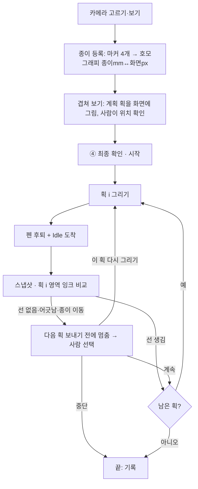

# 카메라로 로봇을 보면서 그리기 (설계 초안)

상태: V1(손으로 귀퉁이 찍기)과 V2의 "보기만 하는 획 단위 확인"이 구현됨(2026-11-10). 멈춤 게이트·V3는 초안. 마커 인쇄 전까지는 손으로 찍는 등록을 쓴다.

## 왜

지금은 그리는 동안 사람이 로봇과 종이를 계속 지켜봐야 한다. 펜이 종이에 안 닿아 선이 안 나오거나(펜 간격·종이 휨),
종이가 밀렸거나, 획이 계획과 다른 자리에 그려져도 앱은 알지 못한다. 컨트롤러 응답(좌표·Idle)은 "로봇이 그 자리에 갔다"까지만
알려 주고 "종이에 선이 생겼다"는 알려 주지 않는다. 외장 웹캠(Logitech BRIO 등)으로 종이를 보면 그 빈칸을 채울 수 있다.

## 목표

1. 그리기 전에 계획한 그림이 실제 종이의 어디에 그려질지 카메라 화면 위에 겹쳐 보여 준다.
2. 그리는 동안 획 단위로 "선이 생겼는지"를 확인하고, 안 생겼거나 엉뚱한 곳에 생기면 다음 획을 보내기 전에 멈추고 묻는다.
3. 끝나면 계획한 그림과 실제 결과를 겹친 기록(사진·획별 판정)을 실행 기록에 남긴다.

## 하지 않는 것

- 카메라 판단만으로 로봇을 새 위치로 움직이지 않는다. 카메라는 멈추기·묻기·기록만 한다(1차).
  펜 깊이 보정이나 다시 그리기는 사람이 버튼으로 승인할 때만, 그리고 이미 보정한 접촉 범위(`limits`) 안에서만.
- 픽셀만으로 접촉력·접촉 깊이를 판정하지 않는다(선이 생겼는지만 본다).
- 카메라가 없거나 끊겨도 그리기는 지금처럼 진행된다(카메라는 덧붙는 감시자).

## 지금 있는 것 (재사용)

| 있는 것 | 위치 | 쓰임 |
|---|---|---|
| 카메라 미리보기·장치 고르기(이름으로 저장) | `camera.py`, 그리기 창 오른쪽 | 프레임 공급 |
| 종이 모서리 X 4개·펜 끝 후보 찾기 | `camera_marks.observe_setup` | 첫 버전 등록의 예비 수단 |
| 종이 mm ↔ 로봇 좌표, 접촉 평면 보정 | `paper_mapping.py`, `calibration.py` | 계획 획을 종이 mm로 이미 가짐 |
| 획 경계에서 Idle·위치 도착을 기다림 | `draw_executor.execute` (`stroke N pen-up` 뒤 `wait_until_pose`) | 판정 시점, 멈춤 지점 |
| 실행 기록 | `LOG/runs/run-*.json` | 판정 결과 저장 |

## 전체 흐름

### 1. 종이 등록 (화면 px ↔ 종이 mm)

종이는 평면이라 호모그래피 하나면 된다(카메라 내부 보정 불필요, BRIO의 렌즈 왜곡은 작음).

- 기본: 판(종이) 네 귀퉁이 바깥 여백에 ArUco 마커(DICT_4X4_50, 0=왼쪽 위, 1=오른쪽 위, 2=오른쪽 아래, 3=왼쪽 아래, 한 변 30 mm + 흰 여백 6 mm)를 붙인다.
  인쇄용 A4는 `assets/make_aruco_sheet.py` → `assets/aruco_markers_a4.pdf`. OpenCV 5.0의 `cv2.aruco.ArucoDetector`로 원근 변환·1/4 축소한 시트에서도 4개 모두 읽힘을 확인했다.
  마커 중심의 판 위 위치는 붙인 뒤 한 번 재서(또는 로봇 펜 끝으로 짚어) 설정에 두고, 검출된 화면 좌표로 `cv2.findHomography`.
- 지금(V1, 구현됨): 인쇄 전이라 마커 대신 사용자가 사진에서 종이 네 귀퉁이를 찍는다. 그리기 창 카메라 칸의 [종이 위치 맞추기] →
  `paper_register_window.py`. 사진을 멈춰 놓고 왼쪽 위 → 오른쪽 위 → 오른쪽 아래 → 왼쪽 아래 순서로 누르고, 찍은 점은 끌어서 고친다.
  종이 크기(기본 A4 가로 297×210)와 네 점으로 `cv2.getPerspectiveTransform`. 점은 사진 크기에 대한 비율로 저장해 미리보기(축소)와
  원본 사진에 같은 등록을 쓴다. 카메라 장치 이름마다 따로 `%APPDATA%\MirobotSketch\vision_registration.json`에 저장한다.
  꼬인 순서·거꾸로 순서·너무 작은 사각형은 저장하지 않는다(`vision.check_corners`). 카메라나 판을 옮기면 다시 찍어야 하고,
  종이가 밀린 것은 알아채지 못한다(마커로 바꾸면 해결).
- 예비: 지금의 X 표시 4개(`camera_marks`)를 그대로 쓴다. 다만 X는 펜으로 그린 선과 구별이 약해 그리는 중 재검출에는 쓰지 않는다.
- 등록 품질: 마커 4개 모두 보이고 재투영 오차 1.5 px 이하일 때만 "등록됨". 아니면 감시 기능을 끄고 지금처럼 진행.
- 노출 고정: 자동 노출·화이트밸런스가 바뀌면 비교가 흔들리므로 등록할 때 `CAP_PROP_AUTO_EXPOSURE`/`AUTO_WB`를 끄고 값을 고정한다(장치가 거부하면 밝기 정규화로 대신).

### 2. 겹쳐 보기 (그리기 전)

계획 획(`strokes_mm`)을 호모그래피로 화면에 투영해 미리보기 위에 반투명 선으로 그린다. 펜 범위(파랑)·공중 확인 범위(주황) 사각형도 같이.
사람이 "그림이 종이 위 원하는 자리에 들어간다"를 눈으로 확인하는 단계. 판정은 하지 않는다.

### 3. 획 단위 확인 (그리는 중)

- 시점: 획 i의 `pen-up` 뒤 펜이 종이에서 20 mm 빠지고 Idle이 된 직후(이미 `execute`가 기다리는 지점). 팔이 종이를 가리는 정도가 가장 적다.
- 비교: 획 i를 그리기 직전 스냅샷과 직후 스냅샷을 종이 평면으로 펴서(warpPerspective, 1 px = 0.5 mm) 획 i 경로 주변 띠(폭 3 mm) 안에서 어두워진 픽셀 비율을 잰다.
  - 가림 처리: 두 스냅샷에서 팔·펜이 있는 영역(색·밝기 차이가 큰 큰 덩어리, 띠 바깥까지 이어진 것)은 판정에서 뺀다. 띠의 70% 이상이 가려지면 "판정 불가"로 두고 다음 획 뒤에 다시 본다.
- 판정
  - 선 생김: 띠 안 잉크 덮임 ≥ 60%.
  - 선 없음: < 20% → 펜이 안 닿았을 가능성.
  - 어긋남: 띠 안은 비었는데 띠 바깥 10 mm 안에 같은 길이의 새 잉크가 있음 → 종이 이동·좌표 오차.
  - 종이 이동: 마커 위치가 등록 때보다 2 mm 넘게 움직임.
- 멈춤: 선 없음·어긋남·종이 이동이면 다음 획을 보내지 않고 기다린다(지금은 멈춤만 있고 "일시정지"가 없으므로 `execute`에 획 경계 게이트를 추가). 화면에 직전·직후 사진과 띠를 보여 주고 사람이 고른다.
  - 계속(그냥 진행) / 이 획 다시 그리기 / 중단.
  - "펜을 0.5 mm 더 누르기"는 2차(아래).
- 성능: 판정은 획당 한 번, 펴진 이미지 약 400×400 px 기준 10 ms 수준이라 그리기 속도에 영향이 없다. 판정은 별도 스레드, 로봇 스레드는 결과만 기다린다(최대 0.5 s, 넘으면 판정 불가로 진행).

구현된 것(2026-11-10, 멈춤 없이 보기만): `vision.LineCheck` + 그리기 창. 위 설계와 다른 점:

- 그리는 동안 8초마다 카메라 원본 사진 6장을 그림 둘레(+12 mm)만 6 px/mm로 펴서 평균한다. 기준(그리기 전) 사진 없이 지금 사진만 본다:
  주변 가장 밝은 종이에 대한 어둡기에서 굵은 그늘을 빼 가는 선만 남기고, 빈 종이 잡음(MAD)의 4배보다 진하고 3 mm보다 긴 조각을 선으로 본다.
- 다 그린 획마다(그리는 중에는 마지막 2획 제외) 경로 점 중 2 mm 안에 선이 있는 비율을 재 50% 이상이면 "보임"(초록), 아니면 "안 보임"(빨강).
  종이와 밝기·색이 크게 다른 곳(팔·홀더·그림자)에 경로가 절반 넘게 가리면 "가려짐"으로 두고 다음 확인에서 다시 잰다. 끝나면 한 번 더 재서 요약을 안내에 붙인다.
- 펜 선은 종이보다 3~4%만 어두워(종이 166, 선 161) 1080p로는 잘 안 잡힌다. 그래서 장치별 촬영 설정 `camera.json`의 `capture`
  (`{"Logitech BRIO": {"width": 3840, "height": 2160, "focus": 15}}`)로 4K·고정 초점을 쓴다. 초점 15는 지금 판 거리에서 고른 값이다.
- 2 mm 허용은 실제 선이 계획에서 1~2 mm씩 흔들려 그려지기 때문이다(펜 끌림). 등록을 다시 맞춘 뒤 끝난 그림(275획)에서 보임 173 / 안 보임 102,
  경로 비율 중앙값 0.86이었고, 같은 획을 빈 종이에서 재면 0이었다.
- 손으로 찍은 귀퉁이는 몇 mm 틀리기 쉽다. 2026-11-10에는 다 그린 그림의 선에 계획 획을 맞춰(양방향 거리, 이동→닮음→아핀) 귀퉁이를 다시 계산해 저장했다
  (가운데 약 12 mm, 비율 1.11).

끝점 세로 줄 보정(2026-11-10, 로봇 동작이 바뀌는 첫 보정): `vision.LineCheck.end_ticks` + `pen_correction` + `Planner`의 `start/end_backoff_mm`.

- 세게 누른 채 내리거나 떼면 펜 끝이 미끄러져 끝점에서 위·아래로 1.5~5 mm 줄이 생긴다. 같은 펴진 사진에서 끝점 좌우 ±1.2 mm 세로 띠를
  위아래로 6 mm까지 보며, 계획 경로(모든 획)에서 1.2 mm 안의 선은 획 자체로 보고 빼고, 0.5 mm 넘게 끊기면 멈춘다. 1.8 mm 넘게 뻗으면 세로 줄.
  2026-11-10 실제 종이(멈춘 그림 80획): 선이 보인 52획 중 시작점 12, 끝점 10. 머리카락 부분의 짧은 세로 자국과 일치했다.
- 규칙(`pen_correction.next_backoff`): 지금 값으로 그린 끝점 8개 이상 중 20% 넘게 세로 줄이면 그쪽 접촉점을 0.2 mm 뒤로(최대 1 mm).
  물린 뒤 선이 안 보인 획 비율이 앞 구간보다 15%p 넘게 늘면 0.2 mm 되돌린다(앞 구간이 없으면 50% 이상일 때만). 원래 안 보이는 획
  (종이 위치 오차·연한 선, 같은 날 80획 중 28)만으로 되돌리지 않게 비교로 판단한다.
- 적용: 펜을 내린 첫 점과 떼기 직전 마지막 점의 X만 종이에서 물리므로 명령 수·순서는 그대로다. 그리는 중이면 `DrawJob.set_pen_backoff`가
  아직 보내지 않은 명령(지금 ok 받은 다음 명령 하나 뒤부터)을 바꿔 넣는다. 시뮬레이션한 접촉 자세보다 종이를 더 누르지 않는 방향뿐이다.
  값은 `drawing_config.json`에 저장해 다음 그림이 이어 쓴다.
- 크게 보기 창과 `out/camera_live/` 공유 파일: 카메라는 한 프로그램만 열 수 있어 다른 도구가 지금 종이를 보려면 앱이 사진을 내보내야 한다.
  자르고 줄이는 일은 카메라 스레드(`CameraPreview.set_zoom`)와 공유 스레드가 해 화면을 멈추지 않는다.

### 4. 기록

실행 기록에 `vision` 항목: 등록 정보(마커 화면 좌표, 재투영 오차, 카메라 이름), 획별 판정·덮임 비율, 멈춤과 사람 선택.
끝난 뒤 최종 사진과 계획 겹침 이미지를 `out/vision_<run>.png`로 저장.

## 단계별로 나눠 만들기 (제안)

| 단계 | 내용 | 로봇 동작 변화 |
|---|---|---|
| V1 | 종이 등록(지금은 손으로 귀퉁이 찍기, 마커는 인쇄 후) + 겹쳐 보기 + 끝난 뒤 사진·겹침 기록 (`out/vision_*.png`) — 구현됨 | 없음 |
| V2 | 획 단위 확인 + 문제 시 획 경계에서 멈춤·사람 선택 | 멈춤 게이트만 추가 |
| V3 | 사람 승인 시 "이 획 다시 그리기", "펜 0.5 mm 더 누르기"(접촉 범위 안, 최대 +2 mm) | 승인된 재시도만 |

V1만으로도 "어디에 그려질지"와 결과 기록이 생기고, 로봇 안전에는 영향이 없다.

## 시험

- 단위: 합성 이미지(종이 + 마커 + 원근 변환)로 등록 오차, 그린 띠/빈 띠/어긋난 띠 판정, 가림 처리.
- 가상 실행: 가상 로봇이 그린 획을 합성 프레임에 렌더링하는 가짜 카메라로 멈춤·재시도 흐름(그리기 창 스모크 시험과 같은 방식).
- 실물: 공중 모드(선이 안 생겨야 정상 → 모든 획 "선 없음"이 나와야 함)와 접촉 모드 한 장씩 사람 감독 아래 기록.

## 결정할 것 (사용자)

1. 문제를 찾았을 때: 획 경계에서 멈추고 사람에게 묻기(제안) 대신, 자동으로 다시 그리기까지 원하나?
2. 외장 카메라 위치: 결정됨(2026-11-09). 로봇 왼쪽 뒤, 어깨보다 높은 곳에서 판을 비스듬히 내려다봄. 네 귀퉁이 모두 보이고 펜 끝 오른쪽 아래만 홀더에 가림.
3. 마커: 결정됨(2026-11-09). 인쇄한 ArUco 마커를 붙인다.
4. 첫 구현 범위: V1부터(제안) 아니면 V2까지 한 번에?

## 내가 정한 것 (확인 필요)

- 판정 기준값(60%/20%, 띠 3 mm, 이동 2 mm)은 실물 시험 전 추정값이다. 실물 기록으로 조정한다.
- 판정 시점은 펜 후퇴 후 Idle 직후로 한다(새 대기 없이 기존 대기 지점 재사용).
- 카메라 판단은 로봇을 새 위치로 보내지 않는다(V3의 승인된 재시도 제외).
